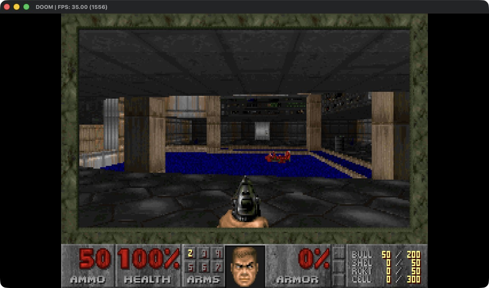

# AnyPS5-ARM native (arm64)

**English** · [Türkçe](docs/native/tr/README.md)

**PS5 games on Apple silicon without Rosetta:** AnyPS5's engine with its own x86-64 to arm64 translator.

This branch holds the native engine alone. The whole project, with the launcher (AnyPS5.app) and the phone app, is on [`main`](https://github.com/utkuhalis/AnyPS5-ARM/tree/main); the engine in its Rosetta mode alone is on [`rosetta`](https://github.com/utkuhalis/AnyPS5-ARM/tree/rosetta).


*DOOM (homebrew) in E1M1, 35 FPS, as an arm64 process: no Rosetta anywhere in it.*

## What "native" means here

PS5 games are x86-64 code; Apple silicon runs arm64. Something has to translate.

| | Rosetta mode (`main`, `rosetta`) | Native mode (`native-arm64`) |
|---|---|---|
| Game code | stays x86-64; macOS translates it through Rosetta on every launch | translated to arm64 **once**, when the app is built, by AnyPS5's own translator |
| System libraries (graphics, audio, pad...) | x86-64, also under Rosetta | built for arm64 |
| The app's binary | `Mach-O 64-bit executable x86_64` | `Mach-O 64-bit executable arm64` |
| Activity Monitor, "Kind" column | Intel | Apple |
| Needs Rosetta installed | yes | no |

Graphics go through MoltenVK to Metal in both modes. Rosetta only appears in the native mode's test suite, as a reference to compare the translator's results against; it is never used to play.

The point is to drop Rosetta's cost and limits. On a light game like DOOM there is nothing to measure yet (it holds its 35 FPS target either way); the gain should show on heavy titles such as Stray.

## Status

| Game | Native status |
|---|---|
| **DOOM (homebrew)** `PPSA99666` | 🟢 Launcher (60 FPS), attract demo and E1M1 at 35 FPS |
| Everything else | 🔴 Not tried yet. Commercial titles need the open items below first. |

The Rosetta mode's status per game is in the [game notebook](docs/games/README.md).

## Requirements

- An Apple silicon Mac (M1 or later), macOS 13 or newer
- Xcode command line tools, CMake, Ninja
- Homebrew `llvm` and `capstone` (the translator links them): `brew install llvm capstone cmake ninja`
- The [Vulkan SDK](https://vulkan.lunarg.com/sdk/home#mac) for macOS (for `libvulkan` and MoltenVK in the bundle)
- The game: a decrypted dump (fake-signed SELFs are fine)

## Build

From the repository root, on the `native-arm64` branch with submodules checked out:

```sh
# 1. The system libraries, for arm64
cmake -S . -B build-arm64 -G Ninja -DCMAKE_BUILD_TYPE=Release -DCMAKE_OSX_ARCHITECTURES=arm64
ninja -C build-arm64 all libs

# 2. The translator (needs Homebrew LLVM and Capstone)
cmake -S tools/translator -B build-translator -G Ninja -DCMAKE_BUILD_TYPE=Release -DLLVM_DIR=$(brew --prefix llvm)/lib/cmake/llvm
ninja -C build-translator
```

## Make an app for a game

```sh
python3 tools/translator/package_native_app.py \
    --eboot <game>/eboot.bin --game <game> \
    --libs build-arm64/core/libs/libs \
    --vulkan ~/VulkanSDK/<version>/macOS \
    --translator build-translator \
    "DOOM (native).app"
```

`--game` is the game folder (the one with `sce_sys`), `--eboot` its executable. A decrypted SELF is unwrapped on the way; a plain ELF works too. The tool translates the eboot, links it with the arm64 libraries and writes a normal `.app`.

Imports that no arm64 library provides are listed at the end; each one is linked to a stub that names it and stops the game if it is ever called.

## Run

Double-click the app, or start it from a terminal:

```sh
open "DOOM (native).app"
```

The output goes to `~/Library/Logs/AnyPS5/<title id>.log`, the shader cache to `~/Library/Caches/org.anyps5.<title id>`.

To confirm there is no Rosetta: `file "DOOM (native).app/Contents/MacOS/eboot"` prints `arm64`, and Activity Monitor shows the process as Apple.

### Useful switches

| Variable | Effect |
|---|---|
| `APS5_NATIVE_TRACE=1` | logs every host call into game code (thread entries, callbacks) |
| `APS5_PAD_SCRIPT=6:cross,9:cross,...` | presses pad buttons at given seconds, for scripted runs |
| `APS5_PRESENT_OCCLUDED=1` | keeps presenting when the window is covered |

The Rosetta mode's variables mostly apply here too ([ENVIRONMENT.md](docs/dev/ENVIRONMENT.md)).

## Tests

```sh
python3 tools/translator/tests/run_native_fixtures.py build-translator build-arm64/core/libs/libs
```

- `import`: a hand-made PS5 ELF that calls `puts` and `exit` through its GOT.
- `lifter-smoke`: integer arithmetic, flags, shifts, division, recursion, indirect calls.
- `vector-smoke`: SSE/AVX2, FMA and BMI over random inputs, NaNs and out-of-range values, compared with the same C file run as x86-64 under Rosetta. The reference is built without optimization, because Rosetta itself gets some optimized AVX sequences wrong.

## How it works, briefly

1. **Translation:** `aps5-translator` decodes the eboot's x86-64 code with Capstone, lifts each function to LLVM IR over the x86 register state, and LLVM optimizes it and emits arm64. Functions are found from the entry point, symbols, relocations, call targets, code addresses taken with `lea`, and switch jump tables.
2. **Memory:** guest memory is the host's, so loads and stores stay plain loads and stores at the same addresses.
3. **Calls into the libraries:** a game call to a system function goes straight to the arm64 library, with the arguments moved from x86 registers to arm64 ones. Variadic functions (`printf`, `sscanf`...) read the game's arguments the x86 way.
4. **Calls back into the game:** thread entries and callbacks are game addresses that the host calls directly. The game's image is not executable, so the call faults; the runtime catches the fault and runs the translated function instead.
5. **Per thread:** each thread gets its own x86 register state, stack and TLS block, laid out the way the PS5 expects.

Design details, the hard parts and the plan: [NATIVE_ARM64.md](docs/dev/NATIVE_ARM64.md).

## Known limits

- Game-bundled prx modules (`sce_module`) are not translated yet. DOOM's bundled `libc.prx` is only stubs, so it does not matter there; most commercial titles need it.
- Not ported yet: `setjmp`/`longjmp`, fibers, guest C++ exception unwinding through translated code, `getcontext`/`setcontext`, 80-bit `long double`. They stop the game with a clear message when reached.
- x86 memory ordering is stronger than arm64's. The translator does not add barriers yet, so multithreaded code that relies on x86 ordering can misbehave.
- New NaNs are positive on arm64 and negative on x86; code that looks at a NaN's sign can differ.
- Audio has not been checked yet.
