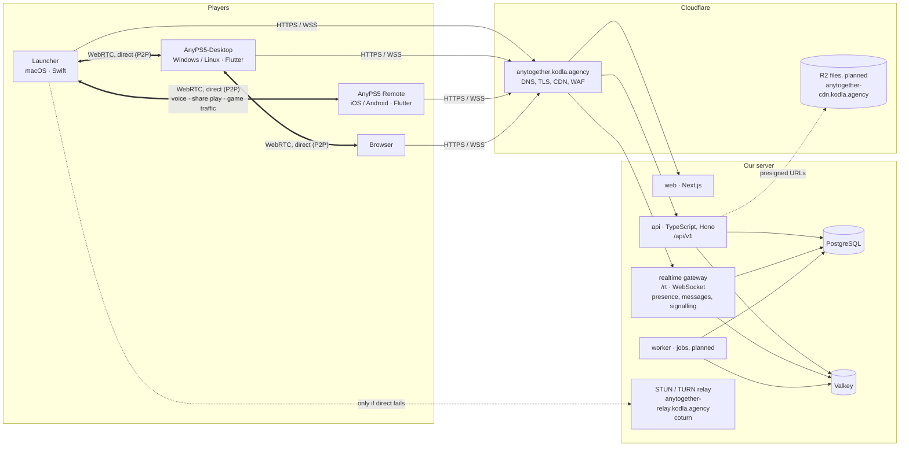
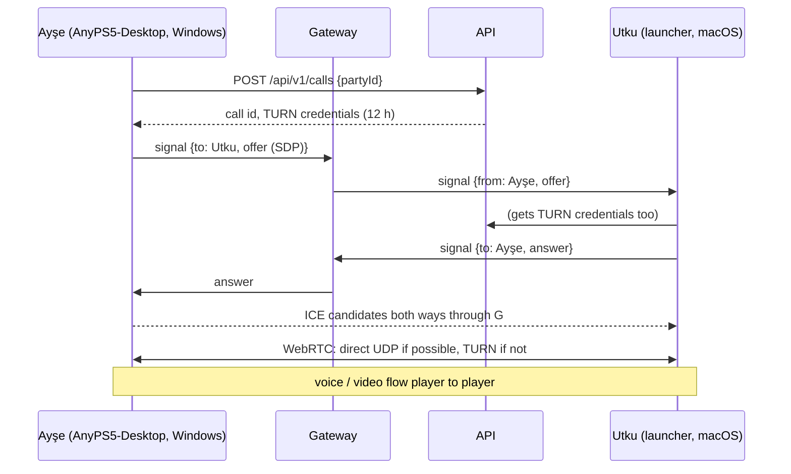

# 2. Architecture

## The idea in two lines

**Players talk to each other directly.** Voice, share play video and online game traffic go
peer-to-peer between the players' own machines, encrypted, without passing through our server.
**The server only introduces them and keeps what must be kept:** accounts, profiles, trophies,
friends, messages for people who are offline, and a relay for the few connections that cannot go
direct.

## The picture



Everything that needs a server goes to **one hostname**, `anytogether.kodla.agency`, behind
Cloudflare: the website at `/`, the API at `/api/v1`, the realtime gateway at `/rt`. Media goes
**player to player** with WebRTC. Only when two players' networks cannot reach each other (strict
NATs, some mobile and office networks, typically 10-20 % of pairs) does it go through our TURN
relay, still encrypted end to end.

## Hostnames (one level under kodla.agency only)

Cloudflare's free certificate covers `kodla.agency` and `*.kodla.agency`, one level deep; a name
like `api.anytogether.kodla.agency` would need a paid certificate and is harder to remember. So
everything lives on one hostname, split by path, plus two siblings that cannot share it:

| Hostname | Through Cloudflare's proxy | What answers |
|---|---|---|
| `anytogether.kodla.agency` | yes | `/` website, `/api/v1/...` API, `/rt` realtime gateway (WebSocket), `/.well-known/...` |
| `anytogether-cdn.kodla.agency` | yes | Cloudflare R2: avatars, theme files and previews, download mirrors |
| `anytogether-relay.kodla.agency` | **no** (DNS only; UDP can't be proxied) | STUN and TURN: UDP/TCP 3478, TLS 5349 |

On the server, the reverse proxy routes by path: `/api` to the API, `/rt` to the gateway, the rest
to the website (each its own application in its own container).

## What goes where

| Traffic | Path | Why |
|---|---|---|
| Sign-in, profiles, trophies, library, friends, themes | client → server (HTTPS) | must be stored and shared |
| Presence (who is online, what they play) | client ↔ gateway (WSS) | friends must learn it even when you are not connected to them |
| Messages | client ↔ gateway, stored in PostgreSQL | must reach people who are offline and every device of theirs |
| WebRTC signalling (offers, answers, ICE candidates) | client ↔ gateway ↔ client | the introduction; a few kilobytes per call |
| **Voice** | **player ↔ player** (WebRTC, Opus) | lowest delay, no server bandwidth |
| **Share play video and game sound** | **host → viewer** (WebRTC, H.264 + Opus) | lowest delay; a 720p60 stream is ~8 Mbit/s that our server never carries |
| **Online play** (each player runs the game) | **player ↔ player** (WebRTC data channels or QUIC; in design) | the games' own packets; every millisecond counts |
| Relay when direct is impossible | player ↔ TURN ↔ player | so it always works; the relay sees only encrypted packets |

## The services on our server

The code is public and MIT licensed at
[github.com/utkuhalis/AnyTogether](https://github.com/utkuhalis/AnyTogether). Built so far
(2026-10-24): the API, the gateway, the website, PostgreSQL and Valkey, and the STUN/TURN relay as
an option. The worker and R2 are not built yet.

### api (TypeScript, Hono on Node 22) · built

The one place that changes stored data; stateless. TypeScript because the website is TypeScript
too, so schemas (Zod, in `packages/shared`) are written once. Today those schemas are the
contract; an OpenAPI document generated from them, for typed clients in **Swift** (macOS
launcher) and **Dart** (phone, AnyPS5-Desktop), is planned. Hono because it is small,
web-standard and portable (Node today, Bun or Cloudflare Workers later). Drizzle with reviewed SQL
migrations, applied when the API starts. Errors as RFC 9457 problem details with stable codes
every client translates. Until the worker exists, the API does the little background work there
is itself: trophy rarity is counted when trophies arrive, and accounts past their 14 days are
purged every hour.

### realtime gateway (same codebase, own process) · built

One WebSocket per signed-in client. Carries presence heartbeats and changes, message delivery,
notifications, and **WebRTC signalling**: when Ayşe calls Utku, her offer goes to the gateway,
which forwards it to Utku's devices; answers and ICE candidates come back the same way. Holds no
state of its own: presence in Valkey, events between gateway processes over Valkey pub/sub.
Launchers and the phone say hello with their access token; the website's browser, which never
holds one, with a one-time ticket its server asks the API for.

### worker (same codebase, own process) · planned

pg-boss jobs inside PostgreSQL: trophy rarity, leaderboards, mail (sign-in codes), push
notifications (APNs, FCM), image resizing and checks, account deletion after the grace period.

### web (Next.js) · built in part

Public profiles and game pages server-rendered (fast, shareable, link previews); the signed-in
app (friends, messages, parties with voice in the browser, share play viewer, Theme Hub,
downloads, leaderboards, settings) in the browser. It uses the same API as everyone. Built:
sign-in (email code or link, passkeys), approving a launcher's device code, profiles with games,
play time and trophies, friends, messages, parties with voice, and settings (profile, avatar,
privacy, passkeys, signed-in devices, data download, account deletion). English by default,
Turkish with a switcher.

### PostgreSQL 17, Valkey 8 · built

PostgreSQL holds everything that must last (avatars too, for now, until R2 is used). Valkey holds
what may vanish: presence (60 s expiry), pub/sub, rate limits, passkey challenges, who is in which
call, the last minutes of events for reconnects.

### coturn (STUN and TURN) · built, optional

STUN tells each player its public address so two players can punch through their routers to each
other (ICE). TURN relays the media when that fails. Credentials are short-lived (issued per call
by the API, HMAC-based, valid 12 hours). TURN only ever sees DTLS-SRTP encrypted media: it cannot
hear or see anything.

### Optional later: an SFU

For a party of 8 people all talking, peer-to-peer means each sends 7 audio streams (7 × 32
kbit/s ≈ 0.2 Mbit/s, fine). For share play to many viewers, peer-to-peer means the host uploads
one video per viewer (3 viewers ≈ 24 Mbit/s up, too much for many homes). Only then is a
forwarding server (an SFU such as LiveKit) worth running. It is a later, optional add-on: the
default is direct.

## Technology choices

| Need | Choice | Why |
|---|---|---|
| API and gateway | TypeScript, Node 22, Hono | one language with the web, shared schemas |
| Database | PostgreSQL 17 + Drizzle | all we need in one engine; SQL migrations |
| Jobs (planned) | pg-boss | queue inside PostgreSQL |
| Temporary state | Valkey 8 | Redis-compatible, open licence |
| Peer-to-peer media | **WebRTC** | built for exactly this: NAT traversal (ICE/STUN/TURN), encryption (DTLS-SRTP), Opus voice, low-latency video, data channels, in every browser and with libraries for every platform |
| WebRTC per platform | macOS: Google's WebRTC framework (prebuilt Swift package); phone and AnyPS5-Desktop (Windows/Linux): `flutter_webrtc`; web: the browser | each client in its own language |
| Relay | coturn | the standard TURN server |
| Website | Next.js | SSR for public pages |
| Files (planned) | Cloudflare R2 | S3 API, no egress fees |
| Sign-in | email codes and links, passkeys (WebAuthn), OpenID Connect (Apple, Google, Discord), the phone hand-off | one tap, nothing to remember (see [API](04-api.md)) |
| Push (planned) | APNs, FCM HTTP v1 | direct, no middleman |
| Errors / metrics (planned) | Sentry, Prometheus + Grafana | standard |
| Deploy | our own server's container platform (git push → build → deploy); Docker Compose with Caddy for anyone running their own | what the server already uses; one file for self-hosters |

## How a call is set up (voice or share play)



## Repository layout

[`utkuhalis/AnyTogether`](https://github.com/utkuhalis/AnyTogether) (public, MIT; monorepo, pnpm
workspaces):

```
apps/
  api/          Hono API (/api/v1), and the moderators' command-line tool
  realtime/     WebSocket gateway: presence, events, signalling
  worker/       pg-boss jobs (planned, empty)
  web/          Next.js website
packages/
  shared/       Zod schemas, event and signalling types, error codes
  db/           Drizzle schema and SQL migrations
infra/          local development services, the Dockerfiles
deploy/         Docker Compose and Caddy for running your own
docs/           self-hosting.md
```

The plan stays on this branch. The macOS launcher's integration lives in AnyPS5-ARM
(`AnyPS5Core/Together/`), the phone app's in `mobile/lib/together/`, the Windows/Linux launcher's
in [AnyPS5-Desktop](https://github.com/utkuhalis/AnyPS5-Desktop), which connects to AnyTogether
itself. See [Clients](07-clients.md) and [Platforms](12-platforms.md).

## Scale

| Stage | Accounts / online | Server |
|---|---|---|
| Launch | 5,000 / 500 | our existing server, shared: AnyTogether within ~3 GB with memory limits; media is peer-to-peer |
| Growing | 50,000 / 5,000 | the same, plus more TURN bandwidth |
| Large | more | more gateway/API processes (stateless), TURN on a second machine, a read replica |

Because media is direct, the server's load is small: requests, sockets and the relay for the
pairs that need it. The relay is the only part whose bandwidth grows with use.
