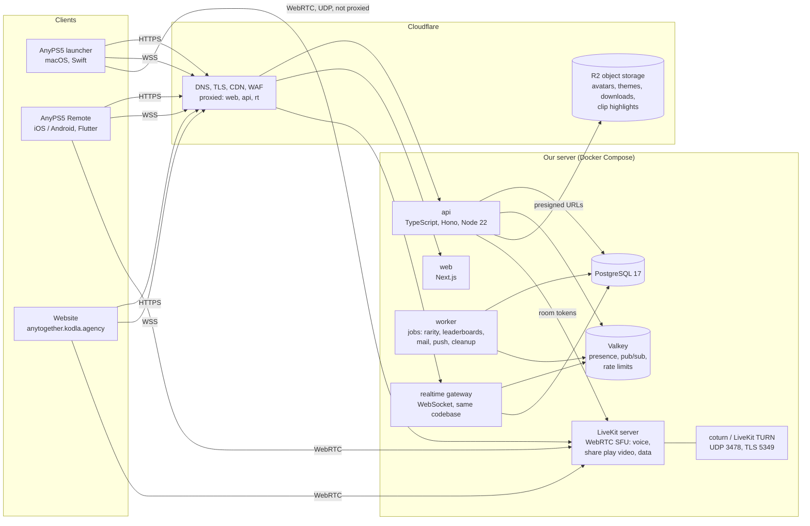
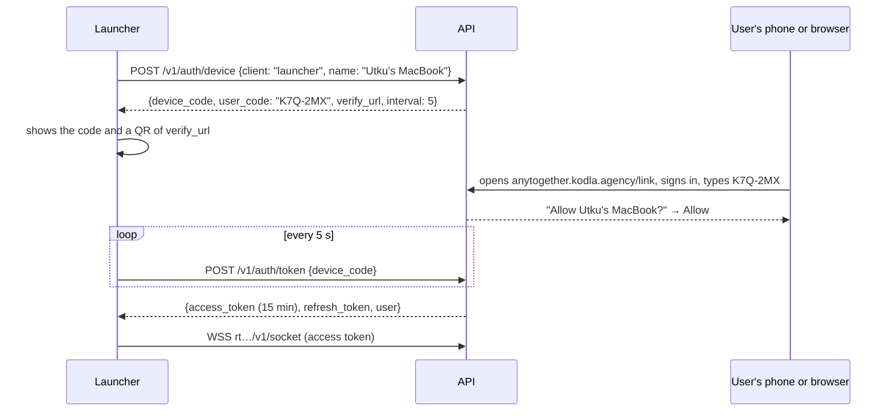

# 2. Architecture

## The picture



Three doors (launcher, phone, web) talk to one API over HTTPS and to one realtime gateway over a
WebSocket. Voice and share play video go peer-to-SFU over WebRTC to a LiveKit server, which
Cloudflare cannot proxy (UDP), so its hostname is DNS-only. Files go straight to and from
Cloudflare R2 with short-lived presigned URLs, so large uploads never pass through our server.

## Hostnames

| Hostname | Proxied by Cloudflare | What answers |
|---|---|---|
| `anytogether.kodla.agency` | yes | The website (today: the coming-soon page) |
| `api.anytogether.kodla.agency` | yes | REST API (`/v1/...`) |
| `rt.anytogether.kodla.agency` | yes (WebSockets) | Realtime gateway (`/v1/socket`) |
| `live.anytogether.kodla.agency` | **no** (DNS only) | LiveKit: signalling over WSS, media over UDP 50000-60000 and TCP 7881 |
| `turn.anytogether.kodla.agency` | **no** | TURN over UDP 3478 and TLS 5349 (for networks that block UDP) |
| `cdn.anytogether.kodla.agency` | yes | R2 public bucket: avatars, theme previews, downloads |

## The services

### api (TypeScript, Hono on Node 22)

The one place that changes data. Stateless; any number can run behind Cloudflare.

- **Why TypeScript:** the website is TypeScript too, so request and response shapes are written
  once (`packages/shared`, with Zod schemas) and used by the API, the gateway and the web. The
  launcher (Swift) and the phone app (Dart) get generated types from the OpenAPI document the API
  publishes.
- **Why Hono:** small, fast, standard Web APIs (`Request`/`Response`), runs on Node today and on
  Cloudflare Workers or Bun later without a rewrite.
- **Database access:** Drizzle ORM with SQL migrations in the repository; every migration is
  reviewed SQL, not generated at deploy time.
- **Validation:** Zod on every input; the same schemas produce the OpenAPI document.
- **Errors:** RFC 9457 problem details (`application/problem+json`) with a stable `code` the
  clients translate into their own language.

### realtime gateway (same codebase, its own process)

Keeps a WebSocket open to every signed-in client and pushes events: a friend came online, a
message arrived, a party invite, a trophy in the feed. It holds no state of its own: who is
online lives in Valkey, and events between gateway processes travel over Valkey pub/sub, so a
user connected to gateway A gets a message sent through gateway B.

### worker (same codebase, its own process)

Jobs that must not slow a request down, queued in PostgreSQL with pg-boss (no extra broker):

- recount trophy rarity for games that changed;
- rebuild leaderboards (every 10 minutes, and at once for a user who asks);
- send mail (verification, password reset) and push notifications (APNs, FCM);
- resize avatars and theme previews uploaded to R2;
- delete accounts asked to be deleted after the 14-day grace period; expire old sessions.

### web (Next.js, App Router)

The website: public profiles (`/u/<name>`), sign-in, settings, friends, messages, parties with
voice in the browser, the Theme Hub, downloads, leaderboards. Server-rendered for public pages
(fast, shareable, good link previews), client-side for the signed-in app. It calls the same API
as everyone else; it has no database access of its own.

### PostgreSQL 17

The source of truth: accounts, profiles, games, trophies, friendships, messages, parties, themes,
reports. Chosen because it does everything here well (relational data, JSONB for flexible
metadata, full-text and trigram search for finding users and games, row-level locks for
counters) and because one well-backed-up database is easier to run than several.

### Valkey (the open-source Redis)

Fast, temporary state: presence (who is online and what they play, with a 60 s expiry renewed by
heartbeats), pub/sub between gateway processes, rate-limit counters, short-lived device-link
codes. Nothing in Valkey must survive a restart; the database can rebuild what matters.

### LiveKit (open source WebRTC SFU, self-hosted)

Carries voice and share play.

- **Why an SFU:** each participant sends their audio (and the host their game video) once; the
  server forwards it to the others. Mesh WebRTC breaks down past three or four people; an MCU
  costs CPU to mix. An SFU is the standard for party voice and one-to-few streaming.
- **Why LiveKit:** open source (Apache 2.0), written in Go, one binary, and it has client SDKs for
  exactly our three doors: **Swift** (launcher), **Flutter** (phone app) and **JavaScript**
  (web). It handles Opus audio with echo cancellation and noise suppression on the clients,
  simulcast, data channels (which share play uses for the friend's pad), and room tokens signed
  by our API.
- **TURN:** LiveKit's embedded TURN, or coturn beside it, for players behind networks that block
  UDP. TURN over TLS on 5349 gets through almost any firewall, at some cost in delay.

### Cloudflare (already in front of the domain)

DNS, TLS certificates, caching of public pages and files, the web application firewall and rate
limiting at the edge, and **R2** for files: avatars, theme packages and previews, clip
highlights, and the download mirrors of AnyPS5's releases. R2 has no egress fees, which matters
for downloads.

## Technology choices, in one table

| Need | Choice | Why | Considered |
|---|---|---|---|
| API language | TypeScript (Node 22 LTS) | One language with the web, shared schemas, large ecosystem | Go (faster, but two languages), Swift on server (shared with launcher, small ecosystem) |
| HTTP framework | Hono | Web-standard, tiny, portable to Workers/Bun | Fastify, Express, NestJS |
| Database | PostgreSQL 17 | Everything we need in one engine | MySQL, SQLite (single writer), Mongo |
| ORM / migrations | Drizzle + SQL migrations | Typed queries, migrations as plain SQL | Prisma (heavier client), Kysely |
| Jobs | pg-boss | Queue inside PostgreSQL, no extra service | BullMQ (needs Redis persistence) |
| Cache / presence | Valkey 8 | Redis-compatible, open license | Redis, KeyDB |
| Realtime | WebSocket gateway of our own | Full control of events and auth, small | Socket.IO, Centrifugo, Ably |
| Voice / video | LiveKit (self-hosted) | SFU with Swift, Flutter and JS SDKs | Janus, mediasoup (no ready mobile SDKs), Agora (paid, closed) |
| TURN | LiveKit TURN or coturn | Standard, proven | Twilio NTS (paid) |
| Files | Cloudflare R2 | S3 API, no egress fees, already on Cloudflare | Backblaze B2, S3 |
| Website | Next.js (App Router) | SSR for public pages, React | Astro, SvelteKit, Remix |
| Mail | Resend (or SMTP from kodla.agency) | Simple API, good delivery | SES, Postmark |
| Push | APNs (token auth) and FCM HTTP v1 directly | No middleman | OneSignal |
| Errors | Sentry (self-hosted or SaaS) | Swift, Dart, JS and Node SDKs | GlitchTip |
| Metrics | Prometheus + Grafana, LiveKit's own metrics | Standard | Datadog (paid) |
| Deploy | Docker Compose on our server, GitHub Actions to build images | Simple, one machine to start | Kubernetes (too much for now) |

## How a request flows

**Signing in from the launcher** (device link, no password typed on the Mac):



This is OAuth 2.0 Device Authorization (RFC 8628). The phone app, when it is already paired with
the launcher, can confirm the code itself in one tap.

**A trophy earned while playing:**

1. The launcher notices the trophy (as it does today for the banner) and appends it to its local
   outbox (a small SQLite file in Application Support).
2. The outbox sends `POST /v1/me/trophies` with the title ID, trophy ID, grade and the time it was
   earned. Sent again later if offline; the server ignores a trophy it already has.
3. The API stores it, bumps the game's progress for this user and queues a rarity recount.
4. The API publishes `trophy.earned` to Valkey; every gateway holding a friend's socket pushes it,
   and the friends' launchers, phones and web feeds show it.

## Repository layout (the code, when it starts)

A new repository, `utkuhalis/AnyTogether` (monorepo, pnpm workspaces):

```
apps/
  api/          Hono API (REST /v1)
  realtime/     WebSocket gateway
  worker/       pg-boss jobs
  web/          Next.js website
packages/
  shared/       Zod schemas, event types, error codes, OpenAPI generation
  db/           Drizzle schema and SQL migrations
infra/
  compose.yaml  PostgreSQL, Valkey, LiveKit, coturn, api, realtime, worker, web, Caddy
  livekit.yaml
  backups/      pg_dump to R2 scripts
docs/           this plan, kept up to date
```

The client side lives where the clients live, in AnyPS5-ARM: `tools/macos/launcher/Sources/AnyPS5Core/Together/`
(Swift) and `mobile/lib/together/` (Dart). See [Clients](07-clients.md).

## Scale we design for

| Stage | Users | One server is enough? |
|---|---|---|
| Launch | up to 5,000 accounts, 500 online | Yes: 4 vCPU, 8 GB RAM, everything on one machine |
| Growing | 50,000 accounts, 5,000 online, 200 voice users | Move LiveKit to its own machine (bandwidth), PostgreSQL stays |
| Large | more | Several API/gateway processes (already stateless), LiveKit cluster, read replica |

Voice is light (Opus at ~32 kbit/s per speaker). Share play is heavy: one 720p60 stream is
~10 Mbit/s up from the host and the same down to each viewer; the server forwards it, so its
bandwidth, not its CPU, sets the limit. Most share play sessions are one friend, and many will
connect peer-to-peer later (see [Realtime](06-realtime-voice-shareplay.md)).
