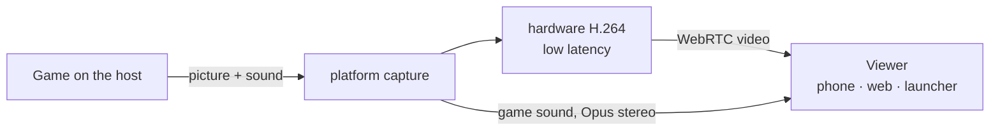

# 6. Realtime, voice and share play

## 6.1 Who carries what

| | Presence, messages, notifications | Voice | Share play (watch only) | Online play game traffic |
|---|---|---|---|---|
| Status | built | built (parties) | planned | in design |
| Path | client ↔ our gateway (WSS) | **player ↔ player** (WebRTC) | **host → viewers** (WebRTC) | **player ↔ player** (WebRTC data channels or QUIC) |
| Server's part | carries and stores | introduces (signalling), relays only if direct fails | the same | the same, plus the game session |
| Delay that matters | ~1 s | < 200 ms mouth to ear | < 120 ms glass to glass | as low as the network allows |
| Lost data | never lost (resume, then REST) | concealed (Opus FEC) | skip to the next key frame | as the game expects: datagrams may drop, streams are resent |
| Encryption | TLS to the server | DTLS-SRTP, end to end between players | DTLS-SRTP | DTLS (SCTP) or QUIC |

## 6.2 Getting two players connected (ICE)

WebRTC's ICE does the "tunnel between them" part:

1. Each side gathers **candidates**: its local addresses, its public address as seen by our STUN
   server (`anytogether-relay.kodla.agency:3478`), and a relayed address on our TURN server.
2. The candidates are exchanged through the gateway as signalling messages.
3. ICE tries the pairs, best first: same network (local addresses), then direct across the
   internet (both routers opened by the outgoing packets: "hole punching"), and only if nothing
   else works, the TURN relay.
4. The chosen path is encrypted (DTLS); even through the relay only encrypted packets pass.

Expected: same network and most home connections go direct; symmetric NATs (some mobile carriers,
office networks) and networks that block UDP use the relay, over UDP or, as a last resort, over
TLS on 5349. The client reports which path was used, so we know how much relay capacity we need.

**Privacy option**: a direct connection shows each player's IP address to the other. Friends-only
calls make this acceptable for most; a setting "Always use the relay" hides it at the cost of a
little delay (see [Security](08-security-privacy.md)).

## 6.3 Signalling over the gateway

Built. Messages between two clients, relayed by the gateway and never stored:

```json
{ "op": "signal", "to": "<user id>", "device": "<device id or *>", "call": "<call id>",
  "kind": "offer | answer | candidate | bye | renegotiate", "data": { … } }
```

- The API creates the call (`POST /api/v1/calls`), checks that the callee may be called (a friend,
  or a member of the party), and returns TURN credentials.
- The gateway forwards `signal` only between members of that call; the peer receives
  `{call, from, device, kind, data}`, `device` being the sender's session, so a reply reaches the
  one device in the call. A call's setup may send up to 300 signals in 10 seconds.
- A call ringing on several devices of the callee stops ringing on the others when one answers.

## 6.4 Voice in parties

Built on the web, in the macOS launcher (Google's WebRTC) and in the phone app (`flutter_webrtc`);
the launcher and the phone in the next AnyPS5-ARM release. Whoever joins later makes the offers;
if two offer at once, the "polite" side gives way. The phone fetches relay credentials again
before they run out.

- **Peer-to-peer mesh**: every member connects to every other member (a party of up to 8: each
  sends its voice to 7 others ≈ 0.2 Mbit/s up, trivial for any connection).
- **Opus**, mono, 48 kHz, 24-32 kbit/s, in-band FEC (survives ~10 % loss), DTX (silence costs
  almost nothing).
- **Processing**: echo cancellation, noise suppression, automatic gain, by the platform: Apple's
  voice processing on macOS/iOS, WebRTC's own on Windows, Linux, Android and the web.
- **The game's sound is never sent**: only the microphone. Headphones are recommended the first
  time.
- **Push-to-talk**: a global key in the launcher (`⌥V` on macOS, built; `Ctrl+Alt+V` on
  Windows/Linux, planned), a button on the phone (planned). Without push-to-talk, `⌥V` turns the
  microphone on and off.
- **The phone as headset** (planned): the launcher tells the paired phone (over the local link
  that exists today) to carry the voice; the phone joins the call itself and keeps being the pad.
  Today the phone can already join a party's voice on its own.
- **Speaking ring**: from the audio level of each incoming track.
- If a party ever needs more than 8 talking members, an optional SFU takes over the call (later).

## 6.5 Share play

Planned. Share play is **watch only**: viewers see and hear the host's game, and nothing they do
reaches it. Control is never handed over; playing together is what online play (6.7) is for.

It reuses what Remote Play built for the local network:

| Remote Play today (macOS launcher, local network) | Share play (any launcher, over the internet) |
|---|---|
| ScreenCaptureKit: the game window and its sound | the platform's capture: ScreenCaptureKit (macOS), Windows.Graphics.Capture + WASAPI loopback (Windows), PipeWire through xdg-desktop-portal (Linux) |
| `StreamEncoder`: H.264, low-latency rate control, no reordering | the same settings in the platform's hardware encoder: VideoToolbox (macOS), Media Foundation / NVENC / AMF / Quick Sync (Windows), VA-API / NVENC (Linux), fed to WebRTC as H.264 |
| Pieces of ≤1200 bytes by UDP to the phone | RTP over SRTP, direct between host and viewer |
| `keyFrame` request when a frame is lost | WebRTC's picture loss indication (PLI) |



**Picture**: 1280x720 at 60 fps, 5-10 Mbit/s, following WebRTC's bandwidth estimate by changing
bit rate at once, then resolution or frame rate if the estimate stays low. Key frames on PLI and
every 4 s. **Sound**: Opus stereo 128 kbit/s, no voice processing.

**Viewers**: one viewer is the common case. Two or three viewers mean the host uploads one stream
per viewer (≈ 8 Mbit/s each): the launcher shows the host's upload estimate and offers 540p/30 fps
for several viewers. Many viewers is where the optional SFU would come in, later.

**Targets**

| Measure | Target |
|---|---|
| Glass to glass | < 120 ms within ~1000 km direct; < 160 ms relayed |
| First picture | < 2 s after pressing Share play |
| Recovery after a loss burst | < 500 ms |

## 6.6 The gateway

Built.

- One WebSocket per signed-in client.
- Auth in the first frame: an access token, or for the website's browser a one-time ticket (it
  never holds a token); then the connection listens on the user's Valkey channel. A session signed
  out elsewhere is closed at once.
- **Presence**: heartbeats every 25 s; devices merged (`in_game` > `online` > `away`); written to
  Valkey with a 60 s expiry; changes published to friends who may see them.
- **Resume**: the last 5 minutes of events per user are kept in a Valkey stream; a reconnecting
  client gets what it missed; older gaps are filled by REST.
- Stateless; Cloudflare and the reverse proxy pass WebSockets; several processes can run side by side.

## 6.7 Online play for games themselves

Voice and share play do not need the game's own online mode. Real online multiplayer, where two
players each run the game on their own machine and the game talks to the other copy as it would
over PlayStation Network, needs the engine to hand the game's network calls to the launcher,
which carries them to the other player. This is our own engine bridge, designed on AnyPS5-ARM's
`online-play` branch
([ONLINE_PLAY.md](https://github.com/utkuhalis/AnyPS5-ARM/blob/online-play/docs/dev/ONLINE_PLAY.md)):

- **The engine** talks to the launcher over an authenticated loopback connection (a fresh secret
  per game start, proven with HMAC both ways, never sent). The game sees a signed-in user (the
  AnyTogether handle), its web API requests are passed to the launcher untouched, and its
  peer-to-peer datagrams go to other players at virtual addresses (198.18.0.0/15, given per game
  session in join order).
- **The launcher** answers the requests it can map onto AnyTogether's game sessions and
  invitations and says "not offered" for the rest, so the game sees exactly what it sees offline.
  It carries the game traffic to the other launchers: first plain UDP with an HMAC tag per packet,
  then WebRTC data channels or QUIC with the AnyTogether relay as fallback, like voice.
- **AnyTogether** keeps the game sessions (built: title, game version, engine build, invites,
  joinable in presence) and refuses a join whose game version or engine build differs. Still to
  add: telling each launcher the others' endpoints and the session key, and session signalling.
- **Plus checks**: while the launcher reports a user signed in to AnyTogether, the game's
  PlayStation Plus and premium checks answer "allowed"; signed out, they answer as before.
- **The clean line**: nothing goes to Sony, nothing stands in for a publisher's own servers, no
  keys, certificates or anti-cheat bypass. Games whose online play is built only on platform
  services can work; games that need their publisher's servers are out of scope.

Status (2026-10-24): built and tested in the engine against a fake launcher: the bridge and its
protocol, an observation log of what games call, sign-in state and Plus checks, web API
pass-through, datagram game traffic; the launcher's side of the bridge, off by default. Not built
yet: push events, session signalling, stream traffic, join intents, NAT traversal and the relay
for game traffic.

## 6.8 Failure behaviour

| What fails | What the user sees |
|---|---|
| Gateway | messages and presence pause ("Reconnecting" in the friends panel); calls already connected **keep going** (they are direct); on return, resume fills the gap |
| Direct path breaks (network change) | ICE restarts, through the relay if needed; voice gaps under a second |
| Relay unreachable and no direct path | "Couldn't connect to <friend>" with the reason; nothing else is affected |
| Share play network too weak | the picture steps down; under 1.5 Mbit/s for 10 s the viewer gets sound only |
| The host's game ends | share play stops, the party continues |
