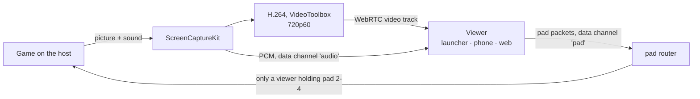

# 6. Realtime, voice and share play

## 6.1 Who carries what

| | Presence, messages, notifications | Voice | Share play | Online play game traffic |
|---|---|---|---|---|
| Status | built | built (parties, 1:1 calls) | built (the macOS launcher hosts) | in design |
| Path | client ↔ our gateway (WSS) | **player ↔ player** (WebRTC) | **host → viewers** (WebRTC), and a viewer's pad back to the host | **player ↔ player** (WebRTC data channels or QUIC) |
| Server's part | carries and stores | introduces (signalling), relays only if direct fails | the same, plus who watches and who holds which pad | the same, plus the game session |
| Delay that matters | ~1 s | < 200 ms mouth to ear | < 120 ms glass to glass; the pad's round trip | as low as the network allows |
| Lost data | never lost (resume, then REST) | concealed (Opus FEC) | picture: recover at the next key frame; sound and pad: dropped, never resent | as the game expects: datagrams may drop, streams are resent |
| Encryption | TLS to the server | DTLS-SRTP, end to end between players | DTLS-SRTP (video), DTLS (data channels) | DTLS (SCTP) or QUIC |

## 6.2 Getting two players connected (ICE)

WebRTC's ICE does the "tunnel between them" part:

1. Each side gathers **candidates**: its local addresses, its public address as seen by our STUN
   server (`anytogether-relay.kodla.agency:3478`), and a relayed address on our TURN server.
2. The candidates are exchanged through the gateway as signalling messages.
3. ICE tries the pairs, best first: same network (local addresses), then direct across the
   internet (both routers opened by the outgoing packets: "hole punching"), and only if nothing
   else works, the TURN relay.
4. The chosen path is encrypted (DTLS); even through the relay only encrypted packets pass.

Expected: same network and most home connections go direct; symmetric NATs (some mobile carriers,
office networks) and networks that block UDP use the relay, over UDP or, as a last resort, over
TLS on 5349. The client reports which path was used, so we know how much relay capacity we need.

**Privacy option**: a direct connection shows each player's IP address to the other. Calls are
only between friends or party members, which makes this acceptable for most; a share play listed
in public, or a party or share play joined from the looking-for-group board, can connect people
who do not know each other. A setting "Always use the relay" (planned) hides the address at the
cost of a little delay (see [Security](08-security-privacy.md)).

## 6.3 Signalling over the gateway

Built. Messages between two clients, relayed by the gateway and never stored:

```json
{ "op": "signal", "to": "<user id>", "device": "<device id or *>", "call": "<call id>",
  "kind": "offer | answer | candidate | bye | renegotiate", "data": { … } }
```

The same frame with `"session": "<game session id>"` signals between two players of a game session
(online play), and with `"share": "<share play id>"` between a share play's host and one of its
viewers; the peer receives `game_session.signal` or `share_play.signal`. In a share play one end is
always the host: viewers never reach each other.

- The API creates the call (`POST /api/v1/calls`), checks that the callee may be called (a friend,
  or a member of the party), and returns TURN credentials.
- The gateway forwards `signal` only between members of that call; the peer receives
  `{call, from, device, kind, data}`, `device` being the sender's session, so a reply reaches the
  one device in the call. A call's setup may send up to 300 signals in 10 seconds.
- A call ringing on several devices of the callee stops ringing on the others when one answers.

## 6.4 Voice in parties

Built on the web, in the macOS launcher (Google's WebRTC), in the phone app and in AnyPS5 Desktop
(`flutter_webrtc`), all released. Whoever joins later makes the offers; if two offer at once, the
"polite" side gives way. Clients fetch relay credentials again before they run out. Muting is
told to everyone in the call (`call.updated`), and a device whose gateway socket goes away leaves
its calls.

- **Peer-to-peer mesh**: every member connects to every other member (a party of up to 8: each
  sends its voice to 7 others ≈ 0.2 Mbit/s up, trivial for any connection).
- **Opus**, mono, 48 kHz, 24-32 kbit/s, in-band FEC (survives ~10 % loss), DTX (silence costs
  almost nothing).
- **Processing**: echo cancellation, noise suppression, automatic gain, by the platform: Apple's
  voice processing on macOS/iOS, WebRTC's own on Windows, Linux, Android and the web.
- **The game's sound is never sent**: only the microphone. Headphones are recommended the first
  time.
- **Push-to-talk**: a global key in the launcher (`⌥V` on macOS; in AnyPS5 Desktop a key chosen
  in the party panel, V by default, read with `GetAsyncKeyState` on Windows and `XQueryKeymap` on
  X11), a button on the phone (planned). Without push-to-talk, the key turns the microphone on and
  off.
- **The phone as headset** (planned): the launcher tells the paired phone (over the local link
  that exists today) to carry the voice; the phone joins the call itself and keeps being the pad.
  Today the phone can already join a party's voice on its own.
- **Speaking ring**: from the audio level of each incoming track.
- If a party ever needs more than 8 talking members, an optional SFU takes over the call (later).

## 6.5 Share play

Built, released in AnyPS5-ARM 0.2.15 and phone 1.11.0. The host's game is streamed to friends,
and the host can hand up to three of them a pad: **player 2, 3 or 4**. The host's own controller
is **player 1** and stays so: no endpoint hands player 1 to anyone, and the engine never seats a
viewer's pad as player 1. Local co-op games become playable together from anywhere; the game runs
only on the host's computer.

| Who | Hosts | Watches | Plays along with a pad |
|---|---|---|---|
| macOS launcher | built | built (full screen, its sound) | built: the controller |
| Phone app | - | built | built: the on-screen pad, with rumble and light bar |
| Website | - | built (`/watch/<id>`) | built: a controller (Gamepad API) or the keyboard |
| AnyPS5 Desktop | planned | planned | planned |

It reuses what Remote Play built for the local network:

| Remote Play (macOS launcher, local network) | Share play (over the internet) |
|---|---|
| ScreenCaptureKit: the game window and its sound | the same capture, without the window's title bar (a windowed game would otherwise be cropped) |
| `StreamEncoder`: H.264, low latency | WebRTC's VideoToolbox H.264 encoder, one video track per viewer |
| Pieces of ≤1200 bytes by UDP to the phone | RTP over SRTP, direct between host and viewer |
| Sound: 16-bit stereo PCM at 48 kHz in 5 ms packets ("APRA") | the same packets, on a data channel |
| The phone's pad: 80-byte packets by UDP | the same packets, on a data channel |
| `keyFrame` request when a frame is lost | WebRTC's picture loss indication (PLI) |



**Picture**: 1280x720 at 60 fps, following WebRTC's bandwidth estimate; from the third viewer on,
each viewer gets 540p at 30 fps, since the host uploads one stream per viewer. The host always
makes the offers; a viewer that waits too long asks for one.

**Sound**: the game's sound goes as Remote Play's packets (16-bit stereo PCM, 48 kHz, 5 ms each,
about 1.5 Mbit/s) on a lossy, unordered data channel ("audio"); the viewer plays it with a small
jitter buffer (starting at about 50 ms, dropping what goes beyond about 150 ms so it never drifts
behind the picture). This keeps the host's path the same as Remote Play's and adds no encoding
delay. Opus is used for voice only; sending the game's sound as an Opus track (about a tenth of
the bandwidth) is a possible later step.

**Pads**: a viewer the host lets play sends the same 80-byte pad packets as the phone ([Platforms](12-platforms.md)
12.4) on a lossy, unordered data channel ("pad"), 120 times a second and at once on every change.
On the host, a router lets a viewer's packets reach the game only while that viewer holds a pad,
through a remote pad bridge held for them, and writes the granted player number into byte 13 of
each packet; the engine seats that pad as that player, or the lowest free one after the first,
never the first. Taking a pad back lets go of every button first. The game's answers (rumble,
light bar, the echo of the last input for the round trip) go back to that viewer on the same
channel.

**Who may come in**: invited friends; the host's friends while it is open to them; and, only if
the host lists it in public, others who ask (the host answers) or, for an open listing, anyone,
which can also show it under Live now. At most 4 viewers (2 by default). The host can take a
viewer out; they come back only if invited again. Blocks keep people apart either way.

**State**: the API keeps the share play, its viewers (device and pad), invites and requests in
Valkey only, renewed by everything the host and viewers do; a share play lasts as long as the
game. When a device's gateway socket closes and does not come back within a short grace, a
viewer's seat goes and a host's share play ends.

**Targets**

| Measure | Target |
|---|---|
| Glass to glass | < 120 ms within ~1000 km direct; < 160 ms relayed |
| First picture | < 2 s after joining |
| Recovery after a loss burst | < 500 ms |

Measured so far: a test runs host and viewer in one process with a synthetic 60 fps picture; the
viewer is shown 720p H.264 at 59 fps, the sound packets arrive whole, and a pad reaches the game's
bridge only once the host hands it over. Glass-to-glass over real networks is still to be
measured.

**Windows and Linux** (planned, in AnyPS5 Desktop): the same protocol, with Windows.Graphics.Capture
and WASAPI process loopback, or PipeWire through xdg-desktop-portal, and the platform's hardware
H.264 encoder.

## 6.6 The gateway

Built.

- One WebSocket per signed-in client.
- Auth in the first frame: an access token, or for the website's browser a one-time ticket (it
  never holds a token); then the connection listens on the user's Valkey channel. A session signed
  out elsewhere is closed at once.
- **Presence**: heartbeats every 25 s; devices merged (`in_game` > `online` > `away`); written to
  Valkey with a 60 s expiry; changes published to friends who may see them.
- **Resume**: the last 5 minutes of events per user are kept in a Valkey stream; a reconnecting
  client gets what it missed; older gaps are filled by REST.
- **Typing**: "I am typing" from a conversation's member to the others, at most every two seconds,
  never kept.
- **Topics**: a socket may watch up to 8 public topics (the looking-for-group board and the public
  parties and share plays, all or one game's); they carry only "changed", so blocks are applied
  when the client reads the list again.
- **Who plays what**: each heartbeat that says "in game" renews the player in that game's set, for
  game hubs; only people whose presence is public are shown.
- **Limits**: 20 sockets per user, 30 frames per 10 seconds per socket, 300 signals per 10 seconds.
- Stateless; Cloudflare and the reverse proxy pass WebSockets; several processes can run side by side.

## 6.7 Online play for games themselves

Voice and share play do not need the game's own online mode. Real online multiplayer, where two
players each run the game on their own machine and the game talks to the other copy as it would
over PlayStation Network, needs the engine to hand the game's network calls to the launcher,
which carries them to the other player. This is our own engine bridge, designed on AnyPS5-ARM's
`online-play` branch
([ONLINE_PLAY.md](https://github.com/utkuhalis/AnyPS5-ARM/blob/online-play/docs/dev/ONLINE_PLAY.md)):

- **The engine** talks to the launcher over an authenticated loopback connection (a fresh secret
  per game start, proven with HMAC both ways, never sent). The game sees a signed-in user (the
  AnyTogether handle), its web API requests are passed to the launcher untouched, and its
  peer-to-peer datagrams go to other players at virtual addresses (198.18.0.0/15, given per game
  session in join order).
- **The launcher** answers the requests it can map onto AnyTogether's game sessions and
  invitations and says "not offered" for the rest, so the game sees exactly what it sees offline.
  It carries the game traffic to the other launchers: first plain UDP with an HMAC tag per packet,
  then WebRTC data channels or QUIC with the AnyTogether relay as fallback, like voice.
- **AnyTogether** keeps the game sessions (built: title, game version, engine build, invites,
  joinable in presence, each player's own properties, signalling between the players
  (`game_session.signal`) and relay credentials for them) and refuses a join whose game version or
  engine build differs. The cross-client run checks it: the macOS launcher hosts, AnyPS5 Desktop
  sees the session as joinable, a different version is refused and the same one joins, and each
  player's properties and a signal reach the other.
- **Plus checks**: while the launcher reports a user signed in to AnyTogether, the game's
  PlayStation Plus and premium checks answer "allowed"; signed out, they answer as before.
- **The clean line**: nothing goes to Sony, nothing stands in for a publisher's own servers, no
  keys, certificates or anti-cheat bypass. Games whose online play is built only on platform
  services can work; games that need their publisher's servers are out of scope.

Status (2026-10-25): built and tested in the engine against a fake launcher: the bridge and its
protocol, an observation log of what games call, sign-in state and Plus checks, web API
pass-through, datagram game traffic; the launcher's side of the bridge, off by default. Not built
yet: push events, session signalling, stream traffic, join intents, NAT traversal and the relay
for game traffic.

## 6.8 Failure behaviour

| What fails | What the user sees |
|---|---|
| Gateway | messages and presence pause ("Reconnecting" in the friends panel); calls already connected **keep going** (they are direct); on return, resume fills the gap |
| Direct path breaks (network change) | ICE restarts, through the relay if needed; voice gaps under a second |
| Relay unreachable and no direct path | "Couldn't connect to <friend>" with the reason; nothing else is affected |
| Share play network too weak | the picture steps down with WebRTC's estimate; late sound is dropped rather than delayed |
| A viewer's device goes away | after a short grace their seat (and pad) is freed |
| The host's game ends, or the host's device goes away | share play stops for everyone, the party continues |
