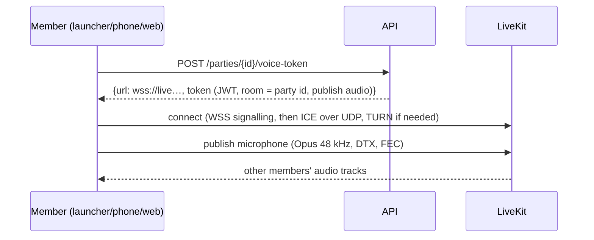
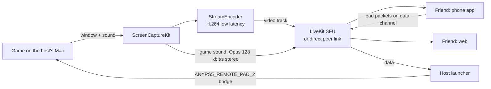

# 6. Realtime, voice and share play

Three kinds of "live" with different needs:

| | Presence, chat, notifications | Voice | Share play |
|---|---|---|---|
| Carried by | Our WebSocket gateway | LiveKit (WebRTC, Opus) | LiveKit or direct WebRTC (H.264 video, Opus audio, data channel) |
| Delay that matters | ~1 s is fine | < 200 ms mouth to ear | < 120 ms glass to glass, < 80 ms input round trip |
| Lost data | must not be lost (resume, then REST) | conceal and go on | skip to the next key frame; pad packets are sent 120 times a second, a lost one does not matter |
| Through Cloudflare | yes | no (UDP) | no (UDP) |

## 6.1 The gateway

- One WebSocket per signed-in client (the launcher, each phone, each browser tab shares one
  through a `SharedWorker`).
- **Auth** in the first frame; the gateway checks the JWT, then subscribes the connection to the
  user's Valkey channel `user:<id>`.
- **Fan-out**: the API publishes an event to `user:<recipient>` for each recipient. Every gateway
  process listens to the channels of the users connected to it. A Valkey stream per user keeps
  the last 5 minutes for `resume`.
- **Presence**: heartbeats every 25 s carry the client's state. The gateway merges the user's
  devices (`in_game` > `online` > `away`), writes `presence:<user>` with a 60 s expiry, and when
  the merged state changes, publishes `presence.updated` to each friend who may see it.
- **Backpressure**: a client that does not read its socket for 30 s is dropped; it reconnects and
  resumes.
- **Scaling**: gateways are stateless; Cloudflare spreads connections; each process holds tens of
  thousands of idle sockets.

## 6.2 Voice in parties

- **Codec**: Opus, mono, 48 kHz, 24-32 kbit/s with in-band FEC (survives ~10 % loss) and DTX
  (silence costs almost nothing).
- **Processing on the client**: echo cancellation, noise suppression, automatic gain. On macOS
  and iOS, Apple's voice processing I/O unit (the same one FaceTime uses); on Android and the web,
  WebRTC's. Optional: RNNoise-style stronger suppression later.
- **The game's own sound** is never in the voice: the launcher captures only the microphone. A
  user listening on speakers relies on echo cancellation; headphones are better and the launcher
  says so the first time.
- **Speaking indicator**: LiveKit's active speaker events drive the ring on avatars.
- **Push-to-talk**: the launcher registers a global key (like the clip key ⌥F12 today, Carbon hot
  key), default `⌥V`; on the phone a button on the party card.
- **The phone as headset**: the launcher tells the paired phone (over the local link that already
  exists) "carry the voice"; the phone joins the LiveKit room itself and the launcher leaves it.
  The phone keeps sending the pad as now.
- **Quality numbers** shown in the party card: round trip to LiveKit, packet loss, jitter.

## 6.3 Share play

This reuses what Remote Play built for the local network (0.2.12):

| Already there (local) | Share play (internet) |
|---|---|
| `RemotePlay.swift`: ScreenCaptureKit gives the game window and its sound | the same capture |
| `StreamEncoder`: H.264, low-latency rate control, no frame reordering, key frames on demand | the same encoder, its frames handed to WebRTC as pre-encoded H.264 (LiveKit's Swift SDK accepts custom encoded frames; otherwise a VideoToolbox H.264 encoder configured identically inside WebRTC) |
| `StreamPacket`: pieces of ≤1200 bytes by UDP | RTP over SRTP, by WebRTC |
| The phone's `FrameAssembler`, MediaCodec / VideoToolbox decoders | the WebRTC decoders on the viewer (phone app via LiveKit Flutter, web via the browser, launcher via LiveKit Swift) |
| Pad: 80-byte input packets to the launcher by UDP, to a remote pad bridge | the same 80-byte packets on a LiveKit data channel (lossy mode), into a free bridge |
| `keyFrame` request when a frame is lost | WebRTC's PLI/FIR (picture loss indication), handled by the encoder |

**Starting**: the host presses Share play; the API issues the host a token that may publish
video, and viewers tokens that may subscribe. The launcher starts capturing (the screen recording
permission is the same one Remote Play and Clips use) and publishes two tracks: `game-video`
(H.264) and `game-audio` (Opus stereo 128 kbit/s, music-grade, no voice processing).

**Picture**: 1280x720 at 60 fps by default, 6-10 Mbit/s; the encoder follows WebRTC's bandwidth
estimate (GCC/TWCC) by changing its bit rate at once, then resolution (960x540) or frame rate
(30) if the estimate stays low. Key frames only on request (PLI) plus every 4 s.

**Direct first**: for one viewer, the clients first try a direct WebRTC connection (ICE with
STUN; most home networks allow it). If ICE fails within 3 s, they use the SFU, and TURN behind
it. Direct saves one hop (often 10-30 ms) and our bandwidth.

**Playing together**: the host gives a viewer a pad slot (`POST /share-play/controller`). The
viewer's client sends pad state as the same 80-byte packet the phone sends today, on the data
channel `pad` in lossy mode (unordered, no retransmit), 120 per second and at once on every
change. The host's launcher accepts packets only from the participant holding the slot (the
participant identity is set by the room token, so it cannot be faked), and writes them to the
remote pad bridge for that slot. The game sees another DualSense; the latency badge shows the
round trip measured with the packet's timestamp, as today.

**Taking over player 1**: the same, with slot 1; the host's own pad is ignored until the host
presses PS on it, which takes player 1 back at once.

**Measured targets**

| Measure | Target | How measured |
|---|---|---|
| Glass to glass | < 120 ms (≤ 1000 km), < 180 ms (same continent) | a timestamp burned into a test frame, read by the viewer |
| Input round trip | < 80 ms (≤ 1000 km) | the pad packet's `sentMicros` echoed back in the game's output packet (exists today) |
| Startup | first frame < 2 s after Share play | logs |
| Recovery | picture back < 500 ms after a loss burst | PLI to next key frame |

## 6.4 NAT, TURN and ports

- STUN on LiveKit and `turn.` for discovering public addresses.
- TURN over UDP 3478 first, TLS over 5349 for networks that block UDP (corporate, some mobile).
- LiveKit media ports UDP 50000-60000 open on the server firewall; TCP 7881 as a fallback.
- TURN credentials are short-lived (issued with the room token), never static.

## 6.5 Failure behaviour

| What fails | What the user sees |
|---|---|
| Gateway | Messages and presence pause; the launcher shows "Reconnecting" in the friends panel; playing is unaffected; on return, resume fills the gap |
| LiveKit | Voice drops with a card "Voice lost, reconnecting"; LiveKit SDKs reconnect by themselves |
| Share play network too weak | Picture steps down; under 1.5 Mbit/s for 10 s the viewer gets "Connection too weak" and audio only |
| The host's game ends | Share play stops for everyone, the party continues |
