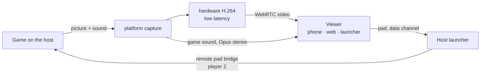

# 6. Realtime, voice and share play

## 6.1 Who carries what

| | Presence, messages, notifications | Voice | Share play | The friend's pad |
|---|---|---|---|---|
| Path | client ↔ our gateway (WSS) | **player ↔ player** (WebRTC) | **host → viewers** (WebRTC) | **viewer → host** (WebRTC data channel) |
| Server's part | carries and stores | introduces (signalling), relays only if direct fails | the same | the same |
| Delay that matters | ~1 s | < 200 ms mouth to ear | < 120 ms glass to glass | < 80 ms round trip |
| Lost data | never lost (resume, then REST) | concealed (Opus FEC) | skip to the next key frame | ignored: sent 120 times a second |
| Encryption | TLS to the server | DTLS-SRTP, end to end between players | DTLS-SRTP | DTLS (SCTP) |

## 6.2 Getting two players connected (ICE)

WebRTC's ICE does the "tunnel between them" part:

1. Each side gathers **candidates**: its local addresses, its public address as seen by our STUN
   server (`anytogether-relay.kodla.agency:3478`), and a relayed address on our TURN server.
2. The candidates are exchanged through the gateway as signalling messages.
3. ICE tries the pairs, best first: same network (local addresses), then direct across the
   internet (both routers opened by the outgoing packets: "hole punching"), and only if nothing
   else works, the TURN relay.
4. The chosen path is encrypted (DTLS); even through the relay only encrypted packets pass.

Expected: same network and most home connections go direct; symmetric NATs (some mobile carriers,
office networks) and networks that block UDP use the relay, over UDP or, as a last resort, over
TLS on 5349. The client reports which path was used, so we know how much relay capacity we need.

**Privacy option**: a direct connection shows each player's IP address to the other. Friends-only
calls make this acceptable for most; a setting "Always use the relay" hides it at the cost of a
little delay (see [Security](08-security-privacy.md)).

## 6.3 Signalling over the gateway

Messages between two clients, relayed by the gateway and never stored:

```json
{ "op": "signal", "to": "<user id>", "device": "<device id or *>", "call": "<call id>",
  "kind": "offer | answer | candidate | bye | renegotiate", "data": { … } }
```

- The API creates the call (`POST /api/v1/calls`), checks that the callee may be called (friends,
  party member, not blocked), and returns TURN credentials.
- The gateway forwards `signal` only between members of that call.
- A call ringing on several devices of the callee stops ringing on the others when one answers.

## 6.4 Voice in parties

- **Peer-to-peer mesh**: every member connects to every other member (a party of up to 8: each
  sends its voice to 7 others ≈ 0.2 Mbit/s up, trivial for any connection).
- **Opus**, mono, 48 kHz, 24-32 kbit/s, in-band FEC (survives ~10 % loss), DTX (silence costs
  almost nothing).
- **Processing**: echo cancellation, noise suppression, automatic gain, by the platform: Apple's
  voice processing on macOS/iOS, WebRTC's own on Windows, Linux, Android and the web.
- **The game's sound is never sent**: only the microphone. Headphones are recommended the first
  time.
- **Push-to-talk**: a global key in the launcher (default `⌥V` on macOS, `Ctrl+Alt+V` on
  Windows/Linux), a button on the phone.
- **The phone as headset**: the launcher tells the paired phone (over the local link that exists
  today) to carry the voice; the phone joins the call itself and keeps being the pad.
- **Speaking ring**: from the audio level of each incoming track.
- If a party ever needs more than 8 talking members, an optional SFU takes over the call (later).

## 6.5 Share play

It reuses what Remote Play built for the local network:

| Remote Play today (macOS launcher, local network) | Share play (any launcher, over the internet) |
|---|---|
| ScreenCaptureKit: the game window and its sound | the platform's capture: ScreenCaptureKit (macOS), Windows.Graphics.Capture + WASAPI loopback (Windows), PipeWire through xdg-desktop-portal (Linux) |
| `StreamEncoder`: H.264, low-latency rate control, no reordering | the same settings in the platform's hardware encoder: VideoToolbox (macOS), Media Foundation / NVENC / AMF / Quick Sync (Windows), VA-API / NVENC (Linux), fed to WebRTC as H.264 |
| Pieces of ≤1200 bytes by UDP to the phone | RTP over SRTP, direct between host and viewer |
| `keyFrame` request when a frame is lost | WebRTC's picture loss indication (PLI) |
| Pad: 80-byte packets to a remote pad bridge | the same 80-byte packets on a data channel, into the same bridge |



**Picture**: 1280x720 at 60 fps, 5-10 Mbit/s, following WebRTC's bandwidth estimate by changing
bit rate at once, then resolution or frame rate if the estimate stays low. Key frames on PLI and
every 4 s. **Sound**: Opus stereo 128 kbit/s, no voice processing.

**Viewers**: one viewer is the common case. Two or three viewers mean the host uploads one stream
per viewer (≈ 8 Mbit/s each): the launcher shows the host's upload estimate and offers 540p/30 fps
for several viewers. Many viewers is where the optional SFU would come in, later.

**Playing together**: the host gives a viewer a pad slot. The viewer's client sends the same
80-byte pad packet the phone sends today on a data channel named `pad` (unordered, no
retransmits), 120 per second and at once on change. The host's launcher takes packets only from
the peer holding the slot (the peer is authenticated by the call, so it cannot be faked) and
writes them into the remote pad bridge of that slot; the game sees another DualSense. Taking over
player 1 is the same with slot 1; the host's PS button takes it back at once. The round trip is
measured with the packet's timestamp echoed in the game's output packet, as the phone does today.

**Targets**

| Measure | Target |
|---|---|
| Glass to glass | < 120 ms within ~1000 km direct; < 160 ms relayed |
| Pad round trip | < 80 ms within ~1000 km |
| First picture | < 2 s after pressing Share play |
| Recovery after a loss burst | < 500 ms |

## 6.6 The gateway

- One WebSocket per signed-in client (browser tabs share one through a `SharedWorker`).
- Auth in the first frame; then the connection listens on the user's Valkey channel.
- **Presence**: heartbeats every 25 s; devices merged (`in_game` > `online` > `away`); written to
  Valkey with a 60 s expiry; changes published to friends who may see them.
- **Resume**: the last 5 minutes of events per user are kept in a Valkey stream; a reconnecting
  client gets what it missed; older gaps are filled by REST.
- Stateless; Cloudflare and Traefik pass WebSockets; several processes can run side by side.

## 6.7 Later: online play for games themselves

Voice, share play and a friend's pad over share play do not need the game's own online mode.
Real online multiplayer, where two players each run the game on their own machine and the game
talks to the other copy as it would over PlayStation Network, needs the engine to hand the game's
network calls to the launcher, which carries them to the other player through the same kind of
direct connection (WebRTC data channels or QUIC) with the same relay as fallback. That is engine
work on top of this plan, and AnyPlay is designing exactly such a bridge for its fork; see
[Open questions](11-open-questions.md).

## 6.8 Failure behaviour

| What fails | What the user sees |
|---|---|
| Gateway | messages and presence pause ("Reconnecting" in the friends panel); calls already connected **keep going** (they are direct); on return, resume fills the gap |
| Direct path breaks (network change) | ICE restarts, through the relay if needed; voice gaps under a second |
| Relay unreachable and no direct path | "Couldn't connect to <friend>" with the reason; nothing else is affected |
| Share play network too weak | the picture steps down; under 1.5 Mbit/s for 10 s the viewer gets sound only |
| The host's game ends | share play stops, the party continues |
