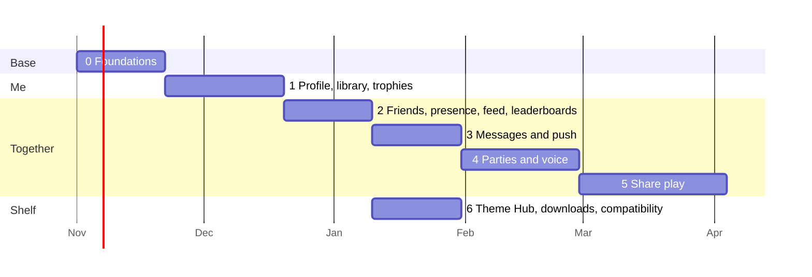

# 10. Roadmap

Each phase ships something people can use, behind a switch in the launcher until it is solid.
"Done" means every check in its list passes, not "the code is written".

Dates are a guide for one developer working with Claude on the server, the macOS launcher and
the phone app; the Windows/Linux launcher integrates the Rust crate in step, phase by phase.
Phase 6 can run beside 3-5.

## Phase 0: Foundations (≈3 weeks)

**Ships**: the repository, the server, one-tap sign-in, and every launcher signed in.

- AnyTogether monorepo (apps/api, realtime, worker, web; packages/shared, db), CI, staging.
- On our server: the Coolify apps (web, api, realtime, worker), PostgreSQL and Valkey resources,
  memory limits, backups to R2, the `/api` and `/rt` routes on `anytogether.kodla.agency`.
- Sign-in: Apple, Google, Discord (OpenID Connect + PKCE), email codes, phone hand-off, device
  code fallback; the first sign-in creates the account; sessions; refresh rotation.
- Realtime gateway with hello, heartbeats, resume (no features on it yet).
- macOS launcher: `TogetherClient`, `TogetherAuth`, `TogetherSocket`, Settings → AnyTogether →
  Continue with Apple / Google / Discord / phone / email, signed-in chip in the top bar.
- The `anytogether` Rust crate (api, auth, socket) for the Windows/Linux launcher, tested in the
  same CI; offered to that launcher's maintainer with an integration guide.
- macOS launcher release builds signed with Developer ID and notarized.
- Website: landing page replacing "Coming soon", one-tap sign-in, `/link`, settings, privacy pages.

**Done when**
- [ ] A new user taps "Continue with Google" in the launcher and is signed in, with an account
      created, in one tap (already signed in to Google in the browser); signing out on the web
      signs the launcher out within 5 s.
- [ ] The phone, signed in, signs the launcher in with one tap.
- [ ] The Rust crate signs in and opens the gateway on Windows and Linux (CI on both).
- [ ] A launcher with the server unreachable behaves exactly as before AnyTogether (automated test).
- [ ] Backups restore on staging; the restore test is green.
- [ ] Refresh-token reuse revokes the session (test).

## Phase 1: Profile, game library, trophies (≈4 weeks)

**Ships**: your gamer card, your games and trophies online.

- Profiles, handles, avatars (R2 + worker resizing + nudity check), showcase, privacy settings.
- Game catalogue, sessions (launcher `SessionRecorder` + outbox), library with play time.
- Trophy sets and earned trophies (launcher `TrophySync`), rarity job, points.
- Launcher: profile overlay, dates and rarity on the trophy screen and banner, play time from all
  computers. Phone: profile card. Web: `/u/<handle>`, games, trophies pages with Open Graph images.

**Done when**
- [ ] Playing Silksong for 10 minutes and earning a trophy shows both on the web profile within
      30 s; offline, they appear after the launcher reconnects, once.
- [ ] Two computers on one account (a Mac and a Windows PC) add up play time correctly.
- [ ] Rarity of a trophy matches a hand count on staging data.
- [ ] Hidden trophies stay hidden to users who have not earned them.

## Phase 2: Friends, presence, activity feed, leaderboards (≈3 weeks)

- Friend requests (handle, QR), blocks, presence with games, feed with folding, likes and
  comments, leaderboards (friends and global, per game).
- Launcher: Friends panel, online count, feed panel, "friends playing" on the game page.
  Phone: Friends and Feed tabs. Web: friends, feed, leaderboards.

**Done when**
- [ ] Starting a game shows "playing X" on a friend's launcher within 3 s; closing it within 60 s
      at most (expiry) and usually at once.
- [ ] "Appear offline" and blocks hide presence completely (test).
- [ ] Feed shows one folded item for five trophies in an hour.

## Phase 3: Messages and push (≈3 weeks)

- Direct and group conversations, attachments, read state, typing, reports.
- Push for the phone (APNs, FCM); toasts in the launcher that do not take focus from a game.

**Done when**
- [ ] A message sent from the web arrives in the launcher under 1 s and on a locked phone as a
      push under 5 s.
- [ ] Killing the network mid-send and resending never duplicates a message (test).
- [ ] Unread counts agree on all three doors.

## Phase 4: Parties and voice (≈4 weeks)

- coturn on the server (`anytogether-relay.kodla.agency`, ports 3478, 5349, relay range opened
  with Utku's approval); calls and signalling over the gateway; peer-to-peer voice in every
  launcher (macOS WebRTC framework, Rust crate on Windows/Linux), the phone (`flutter_webrtc`) and
  the web; push-to-talk; the phone as headset; party chat; "Play the same game".

**Done when**
- [ ] Five people (Mac, Windows PC, Linux, iPhone, browser) talk for 30 minutes with no drop,
      mouth-to-ear under 200 ms within Türkiye/Europe (measured).
- [ ] Most calls connect directly; the quality reports show the share that needed the relay.
- [ ] A game in front keeps voice going; the party overlay shows who speaks.
- [ ] A user behind a UDP-blocking network joins through TURN/TLS.

## Phase 5: Share play (≈5 weeks)

- Every launcher hosts: macOS from `RemotePlay`'s capture and low-latency H.264, Windows and
  Linux from their own capture and hardware encoders; direct to each viewer, relay if needed;
  viewers on phone, web, any launcher; pad over data channel into a remote pad
  bridge; take over player 1; quality steps; latency badge.

**Done when**
- [ ] A friend 500 km away watches 720p60 with glass-to-glass under 120 ms (median) and plays as
      player 2 with input round trip under 80 ms, with a Mac as host and with a Windows PC as host.
- [ ] The host takes player 1 back with PS at once.
- [ ] A weak network steps down without freezing for more than 500 ms.

## Phase 6: Theme Hub, downloads, compatibility (≈3 weeks, beside 3-5)

- Theme upload from the Studio, moderation queue, likes, versions; launcher's Themes screen reads
  the API (GitHub folder kept as fallback); profile themes.
- Downloads page with mirrored releases and checksums; `GET /releases/latest`.
- Compatibility reports (opt-in) and verdicts on game pages and in the launcher's library.
- Later on the same shelf: phone pad layouts, per-game presets, shared shader caches.

**Done when**
- [ ] A theme made in the Studio is installable by another user 1 minute after it is approved.
- [ ] Downloads match GitHub releases byte for byte (checksum test in CI).
- [ ] Turning compatibility reports off sends nothing (test).

## After

- Passkeys; end-to-end encrypted direct messages and voice; App Store / Play Store releases of
  the phone app; tournaments and challenges on leaderboards; spectating public share play for
  friends of friends; a public API for community tools.
