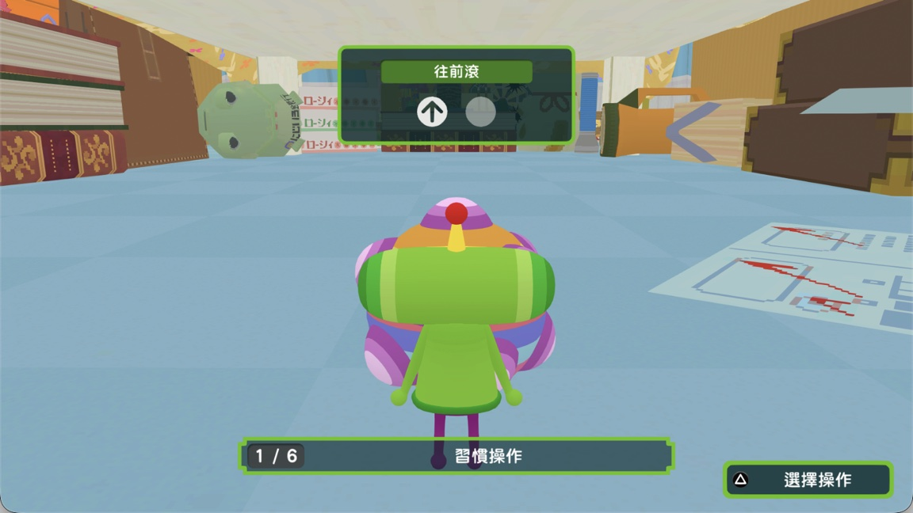

[← All games](README.md) · **English** · [Türkçe](tr/katamari.md)

# Once Upon a KATAMARI

`PPSA21904` · Unity (IL2CPP)

**Status:** 🟡 Work in progress · title screen and tutorial render; hold Esc to skip the black opening cutscene · **FPS:** title screen 30.45; tutorial 1.19 (snapshots, not warm-cache measurements)

Tested on an Apple M1 Mac with a 7-core GPU, macOS 27.0.1, at a 1920×1080 Vulkan render extent. The user reports that the black screen at startup and when beginning a new game is a cutscene that does not render; holding Esc skips it and continues into the game.

The user also reports that relaunching starts the game from the beginning. Save-data files exist in the app's `_sd` directory, but their presence does not confirm that game progress was committed or successfully loaded. The in-game save flow and resume behavior still need verification; don't treat this as a confirmed save-data implementation bug yet.

The test used a fresh macOS relink of the decrypted game and its Unity modules, packaged with the `main` build at `0deeb2a99` and MoltenVK. The upstream rect-list culling fix (`140bdd3d4`) removed the invalid rect-list errors from the tested run.

## Screenshots

*Title screen: 30.45 FPS at capture (19,433 presented frames).*

*First tutorial scene: 1.19 FPS at capture (164,403 presented frames).*

These are point-in-time readings. The number in parentheses in the window title is the total presented-frame count, not a shader count. The user reports shader compilation was still ongoing and stopped the session because the Mac was on battery; no warm-cache FPS was measured.

## Step by step

| | Stage | Details |
|---|---|---|
| ✅ | **Startup executable and modules** | Relinked the game executable, its two Unity modules and five Unity plugins from decrypted files. The packaged title starts and loads Unity content. |
| ✅ | **Degenerate rect-list draws** | The log no longer reports the invalid nondegenerate-rectangle validation failure after using the upstream culling fix. |
| ✅ | **Opening cutscene and first scene** | The opening cutscene is black; holding Esc skips it. The title screen and first tutorial scene render. |
| 🔧 | **Shader warm-up and performance** | Shader compilation was still ongoing when the user stopped on battery. The screenshots show 30.45 FPS on the title screen and 1.19 FPS in the tutorial; repeat after warm-up to measure steady-state performance. |
| 🔧 | **Save and resume** | The user reports the next launch starts from the beginning despite save files being present. Verify the in-game save action and whether a saved run resumes. |

✅ done · 🔧 in progress · ⏭️ next

## Technical details

| | |
|---|---|
| Game ID | `PPSA21904` |
| Engine | `Unity (IL2CPP)` |
| Graphics path | `libSceAgc → Vulkan → MoltenVK → Metal` |
| CPU path | `x86-64 → Rosetta 2` |
| Test hardware | `Apple M1, 7-core GPU; macOS 27.0.1` |
| Tested source | `main at 0deeb2a99` |
| Output | `Title and tutorial render after skipping black cutscene; screenshot FPS 30.45 and 1.19; warm-cache FPS and save/resume unverified` |

First reported by Eyad Al-Daoud in [PR #8](https://github.com/AnyTogether/AnyPS5-ARM/pull/8).
