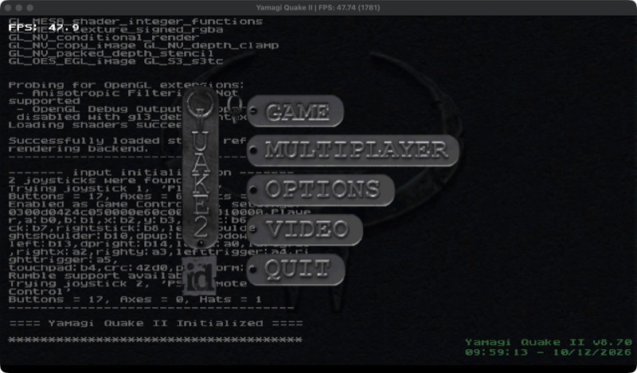

[← All games](README.md) · **English** · [Türkçe](tr/quake.md)

# Quake II and Quake III

`PPSA99007 · PPSA99303` · PS5_Mesa (OpenGL / RADV) · `sceAgcDriverSubmitDcb`

**Status:** 🟡 Quake II in game · Quake III needs data files · **FPS:** Quake II menu ~48, in game ~13

| Menu | In game (base1) |
|---|---|
|  |  |

Both homebrew ports drive the GPU through Mesa, but they submit their command buffers with Sony's `sceAgcDriverSubmitDcb`. That puts them within AnyPS5's scope, and upstream takes PRs for these ports. (An earlier version of this page said "out of scope"; that was wrong.)

## Step by step

| | Stage | Details |
|---|---|---|
| ✅ | **Startup** | With upstream #3840 (`fcntl`/`ioctl`) and #3886 (120 Hz output) the game reaches its first frame. |
| ✅ | **Last provoking vertex** | MoltenVK has no `provokingVertexLast`. Draws that read flat inputs use a private index copy in which every triangle starts with its last vertex; the winding is kept. |
| ✅ | **GL depth range** | Mesa's blitter uses a `[-1, 1]` depth range, and MoltenVK has no `depth_range_unrestricted`. The range is turned into equivalent zero-to-one clipping. |
| ✅ | **Menu and in game** | Menu at ~48 FPS; base1 loads. |
| 🔧 | **In-game speed** | ~13 FPS. Mesa rewrites the same streaming memory every frame, and every such store is a ~20 µs page fault under Rosetta. A change that removes those faults reaches ~40 FPS, but it breaks a test, so it is not on main yet. |
| ⏭️ | **Quake III** | Runs but opens no window: `baseq3/` holds only `zz-ps5-ui.pk3`. It needs `pak0.pk3` from your own copy plus `pak1–8.pk3` from the 1.32 point release. |

✅ done · 🔧 in progress · ⏭️ next

## Technical details

| | |
|---|---|
| Quake II | `Yamagi Quake II v8.70 + PS5_Mesa OpenGL 3.3` |
| Quake III | `Quake3e + PS5_Mesa RADV (Vulkan)` |
| Framebuffer | `3840x2160, the game's own choice` |
| Related commit | `8ebc654e6 fix(agc): draw Yamagi Quake II's GL pipeline on MoltenVK` |

## Links

- [PS5_Quake3e](https://github.com/griches/PS5_Quake3e)
- [Yamagi Quake II](https://github.com/yquake2/yquake2)
