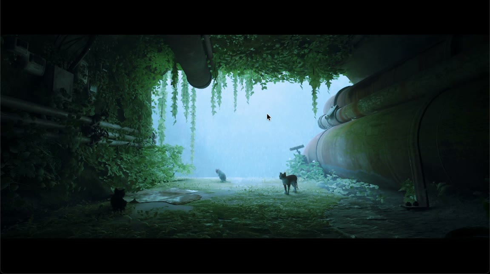
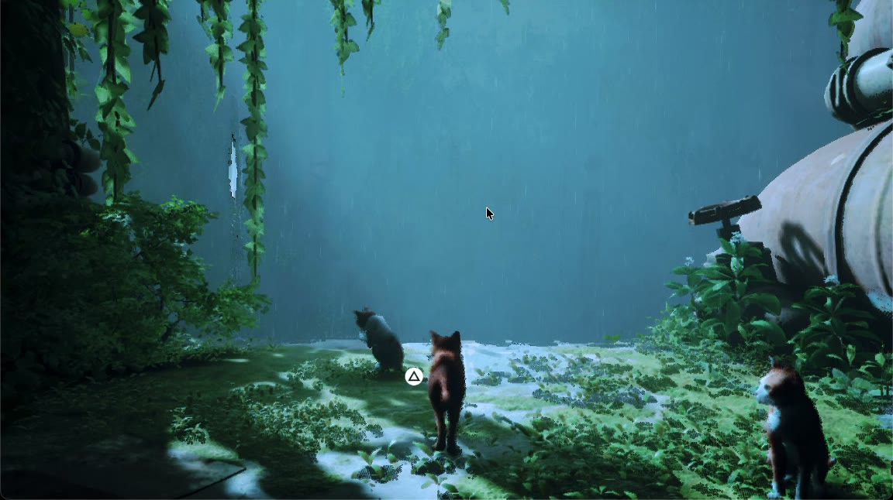
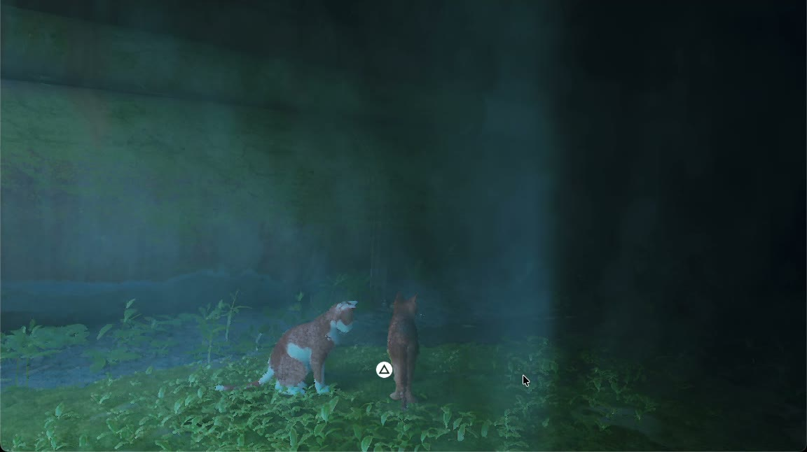
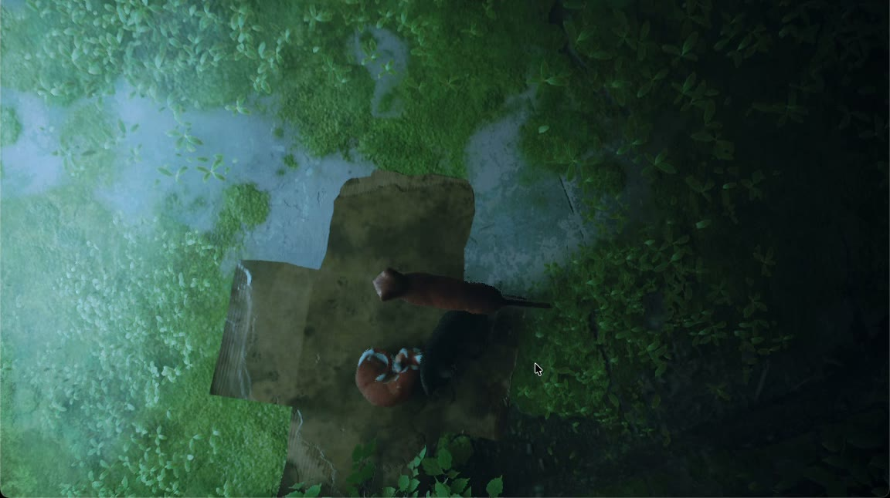
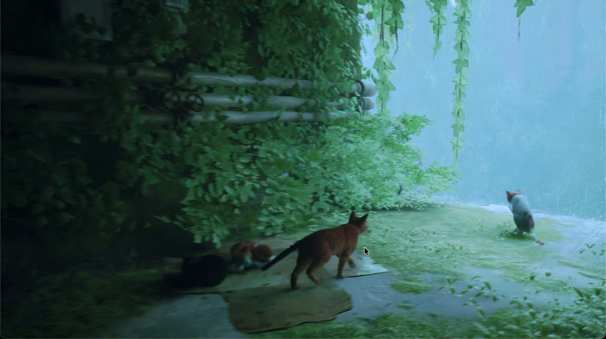

[← All games](README.md) · **English** · [Türkçe](tr/stray.md)

# Stray

`PPSA02100` · Unreal Engine 4

**Status:** 🟢 Playable, first chapter without problems · **FPS:** ~1-11 in game, mostly 4-8 (M3 Pro, 1080p)

The first chapter plays from start to end: the opening in the overgrown pipes, the cat family, the climbs and the cardboard nap. The picture is right, with no missing or broken graphics. The frame rate is the only problem and it is very low. That is the next step.

*The opening in the overgrown pipes*

*The cat family*

| | |
|---|---|
|  |  |
| *Light under the wall* | *The cardboard nap* |

*Under the vines*

Captured on 15 October 2026 from main after the third upstream merge (`cc213ee99`), at 1920x1080.

## Step by step

| | Stage | Details |
|---|---|---|
| ✅ | **160 GiB buffer crash** | Indices past every vertex record count are redirected to a single zero vertex (upstream PR #4292). |
| ✅ | **Root cause: late write-back** | GPU results were written to memory late and overwrote memory the game had already reused. With immediate write-backs, menus and text drew completely. |
| ✅ | **Write watch bug** | Memory mapped over a reservation was not watched (fixed upstream). |
| ✅ | **Startup regression** | Fixed: a quadratic shader pass and a blocked signal mask around thread creation. |
| ✅ | **Shader arithmetic** | Pixel and compute shaders no longer turn every f32 add and mul into an unoptimized helper call under MoltenVK (the hottest shader: 17 → 5 ms). |
| ✅ | **Output resolution** | The PS5 build hardcodes 3840x2160 output. With [tools/macos/patches/PPSA02100.json](../../tools/macos/patches/PPSA02100.json), applied by `tools/package_macos_app.py` (`--no-game-patches` skips it), the bundle asks for 720p, 900p, 1080p (default), 1440p or 4K when it starts; `APS5_RESOLUTION=1280x720` answers in advance. |
| ✅ | **PlayGo without metadata** | The dump has no `playgo-*` file. Upstream now refuses every chunk id but 0 for such a dump, and Stray asks for chunk 1 at startup; the port takes it as fully installed. |
| ✅ | **First chapter** | Plays through with correct graphics. |
| 🔧 | **FPS** | ~1-11 FPS in game at 1080p. Earlier measurements at 1080p put the limit on the driver thread (~52 ms per frame against ~31 ms on the GPU): GPU syncs, write-backs and queue submits. |

✅ done · 🔧 in progress · ⏭️ next

## Technical details

| | |
|---|---|
| Engine | `Unreal Engine 4` |
| Split 256-bit stores | `211,077` |
| Output | `1920x1080 with the patch, 3840x2160 without` |
| Now | `First chapter playable, ~1-11 FPS` |

## Links

- [Upstream PR #4292](https://github.com/boykopovar/AnyPS5/pull/4292)
