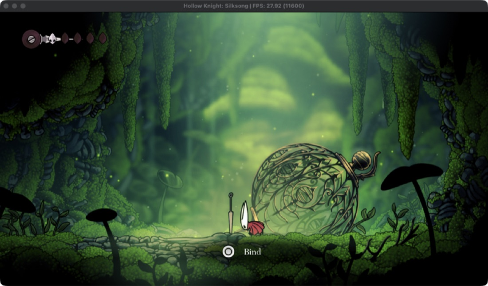
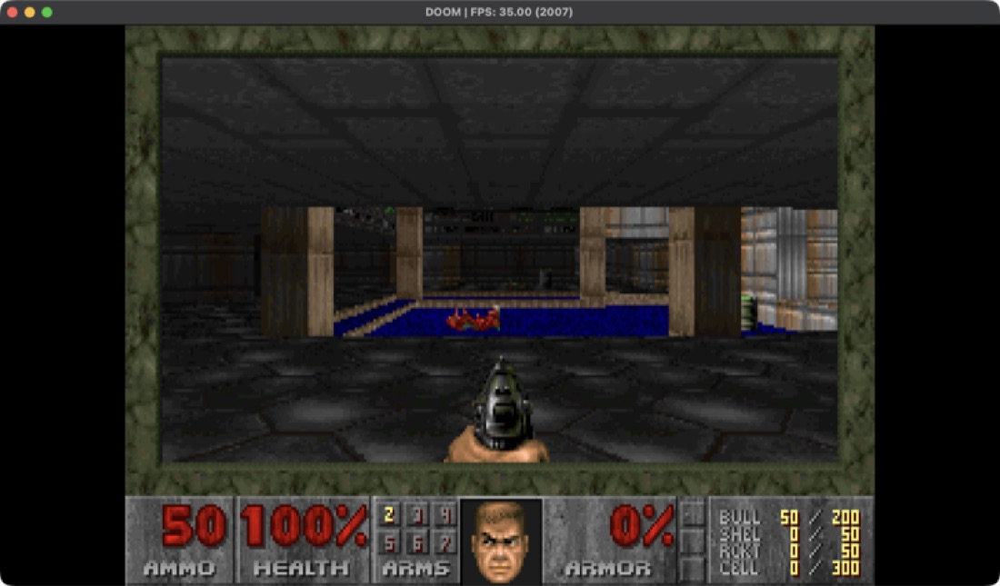
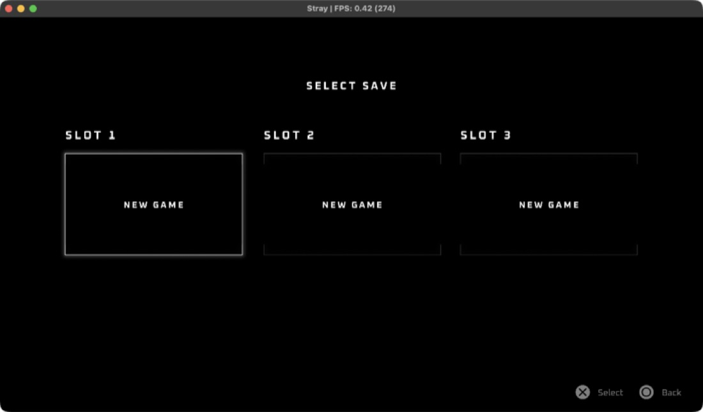
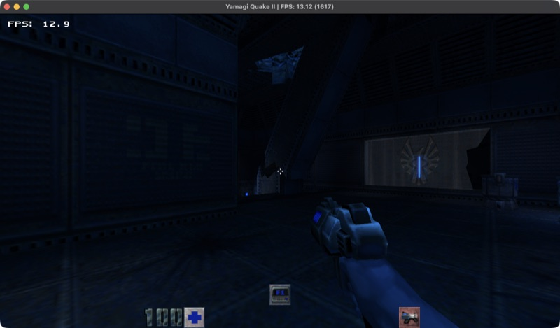

[English](../README.md) · **Türkçe**

# Oyun Durum Defteri

PS5 oyunlarını Apple Silicon Mac'te, Rosetta 2 ve MoltenVK üzerinden çalıştırma denemelerimiz. Her oyunun sayfasında ekran görüntüleri, adım adım geldiğimiz yer ve teknik ayrıntılar var.

Test donanımı: MacBook Pro M3 Pro, macOS 26.6.2, Vulkan SDK 1.4.363.0. Son güncelleme: 12 Ekim 2026.

🟢 Oynanabilir · 🟡 Üzerinde çalışılıyor · 🔴 Açılmıyor · ⚪ Kapsam dışı

| | Oyun | Kimlik | Motor | Durum | FPS |
|---|---|---|---|---|---|
|  | [**Hollow Knight: Silksong**](silksong.md) | `PPSA12544` | Unity (IL2CPP) | 🟡 Oyun içi, ilk bölge | Menü 60 · oyun içi ~28–48 |
|  | [**Plants vs. Zombies: Replanted**](pvz.md) | `PPSA29802` | Unity (IL2CPP) | 🟡 Kullanıcı sözleşmesi ekranı | 60 |
|  | [**DOOM (homebrew)**](doom.md) | `PPSA99666` | lowbit/ps5-doom | 🟢 Oynanabilir, E1M1 ve sonrası | 35 (oyunun kendi hedefi) |
|  | [**Dreaming Sarah**](dreaming-sarah.md) | `PPSA02929` | Construct 2 | 🟢 Oynanabilir | 60 |
|  | [**AnyPS5 Breakout**](breakout.md) | `APS5TEST1` | Projenin test oyunu | 🟢 Oynanabilir | 60 |
|  | [**Stray**](stray.md) | `PPSA02100` | Unreal Engine 4 | 🔴 Başlangıçta kapanıyor (gerileme) | — |
|  | [**Quake II ve Quake III**](quake.md) | `PPSA99007 · PPSA99303` | PS5_Mesa (OpenGL / RADV) | 🟡 Quake II oyun içi · Quake III veri bekliyor | Menü ~48 · oyun içi ~13 |
|  | **GTA III – Definitive Edition** | `PPSA03527` | Unreal Engine 4 | 🔴 Henüz yeniden denenmedi | — |
