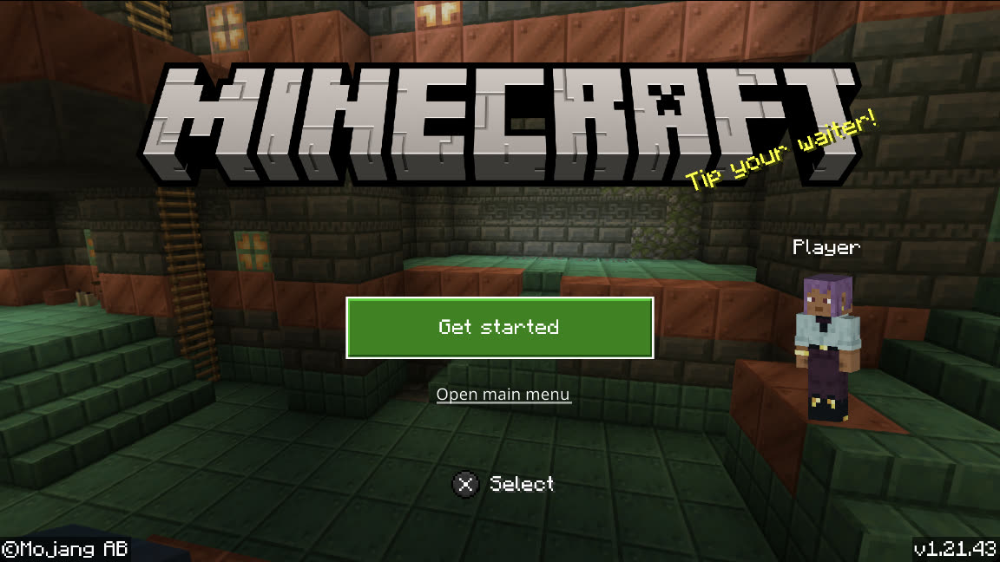
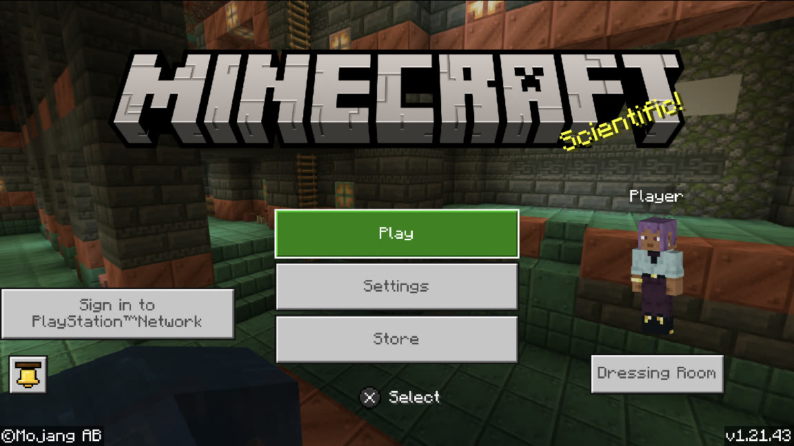
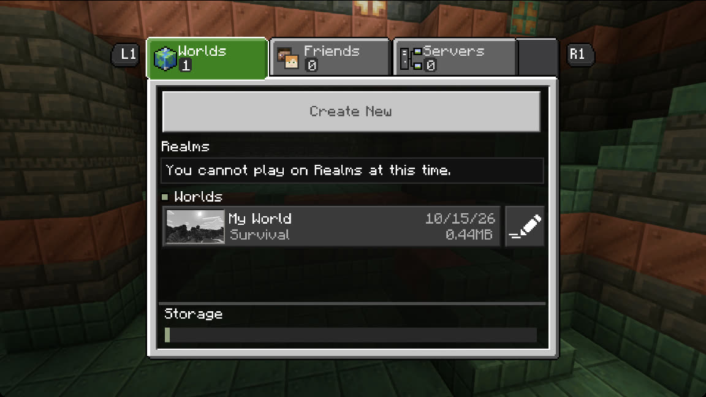
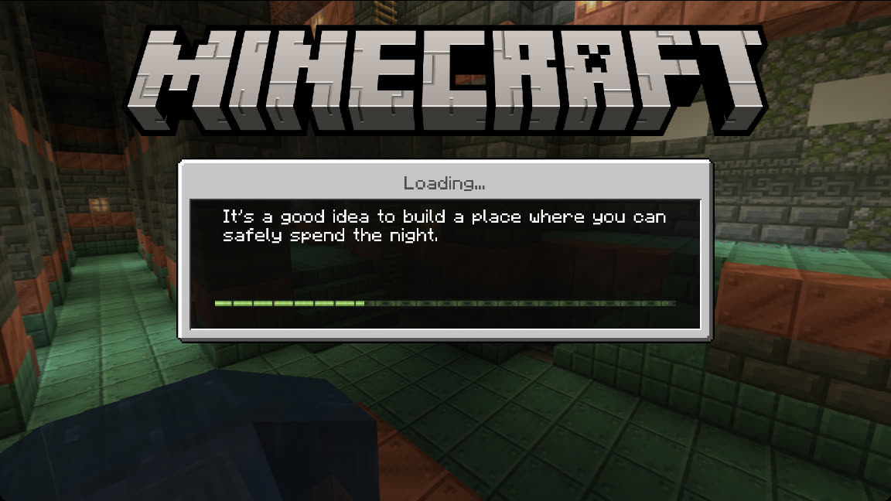
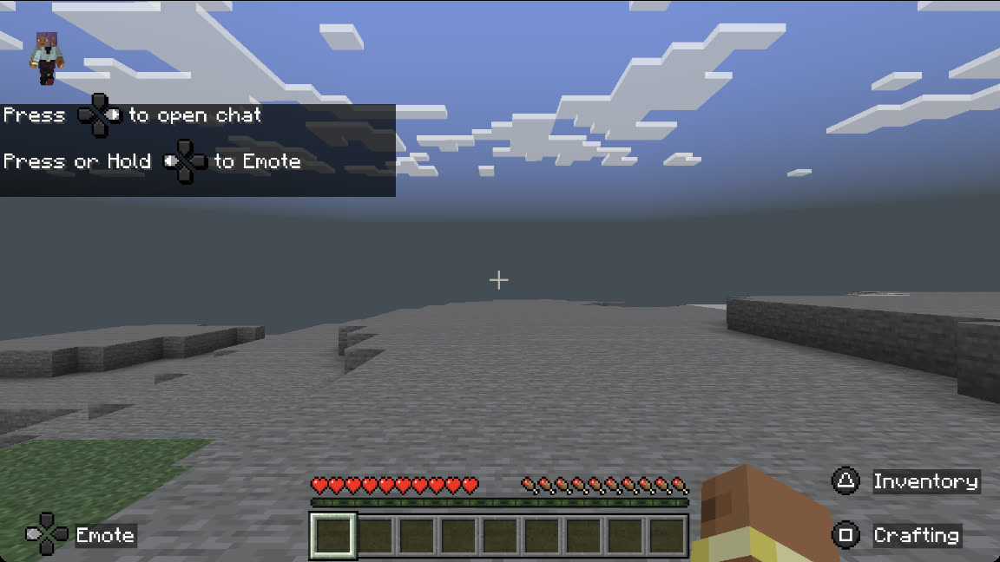
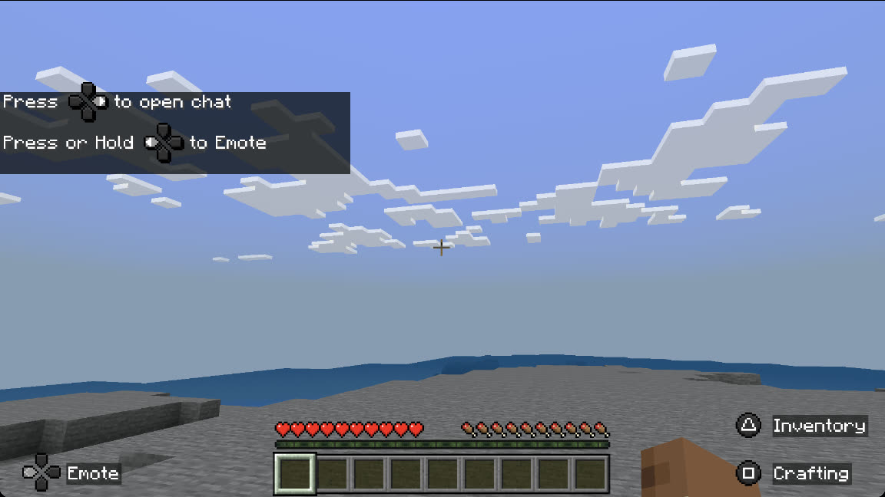

[← Tüm oyunlar](README.md) · [English](../minecraft.md) · **Türkçe**

# Minecraft

`PPSA17221` · Bedrock Edition (v1.21.43) · Render Dragon, Coherent Gameface arayüzü

**Durum:** 🟡 Dünyaya giriyor, ~20 saniye sonra çöküyor · **FPS:** menüler 60 · oyun içinde ~7-8 (M3 Pro, 1080p çıkış)

İlk deneme baya ileri gitti: açılış ekranı, ana menü, dünya oluşturma ve yükleme sabit 60 FPS'te çalışıyor; yeni bir hayatta kalma dünyası HUD, kalpler, açlık ve eşya çubuğuyla açılıyor. Dünya göründükten ~20 saniye sonra oyun `create direct memory backing: Too many open files` hatasıyla duruyor: macOS'ta her direct memory bloğu kendi dosya tanımlayıcısını tutuyor ve dünyanın ayırdığı bellek bunları tüketiyor. Dünyada FPS ~7-8'e düşüyor; Stray'deki gibi GPU her karenin çoğunda boşta bekliyor.

*Açılış ekranı, 60 FPS*

| | |
|---|---|
|  |  |
| *Ana menü* | *Dünya listesi* |
|  |  |
| *Dünya yükleniyor* | *Dünyaya doğuş* |

*Yeni bir hayatta kalma dünyasında*

15 Ekim 2026'da main'den (`7759cfca6`) alındı. Oyun klasöründeki dört modül de (`libcohtml`, `libRenoirCore`, `libfmod`, `MediaDecoders`) dönüştürülsün diye `--module-dir .` ile relink edildi.

## Adım adım

| | Aşama | Ayrıntı |
|---|---|---|
| ✅ | **Açılıyor** | Eboot ve tüm `.prx`'ler sahte imzalı SELF; relink'ten önce `tools/unwrap_self.py` her birini ELF'e çeviriyor. |
| ✅ | **Menüler** | Açılış ekranı, ana menü, Play, dünya oluşturma ve yükleme 60 FPS. |
| ✅ | **Dünyaya giriş** | Yeni bir hayatta kalma dünyası HUD ile açılıyor. |
| 🟡 | **"Get started" panelleri** | İlk kurulum ekranlarındaki panellerin başlığı ve çerçevesi çiziliyor, içi çizilmiyor. |
| ⏭️ | **Açık dosya sınırı** | Dünyada ~20 saniye sonra direct memory oluştururken `Too many open files`. macOS'ta her direct memory bloğu ayrı bir POSIX paylaşımlı bellek nesnesi ve bir tanımlayıcı tutuyor; çözüm daha az nesneyle karşılamak ya da sınırı yükseltmek. |
| ⏭️ | **Dünyada FPS** | ~7-8 FPS: GPU kare başına ~10 ms çalışıyor, 110-130 ms boşta; Stray'deki gibi sınır sürücü iş parçacığı. |

✅ tamamlandı · 🟡 kısmen · 🔧 şu an · ⏭️ sırada

## Teknik bilgi

| | |
|---|---|
| Motor | `Bedrock Edition, Render Dragon` |
| Ek modüller | `libcohtml.Prospero, libRenoirCore.PS5, libfmod, MediaDecoders.Prospero` |
| Relink | `relinker --macos --to-rosetta --module-dir . eboot.bin out/eboot` |
| Menüler | `10 saniyede 600 kare` |
| Dünyada | `10 saniyede 69-84 kare, GPU kare başına ~10 ms meşgul` |
| Şu an | `Dünyaya giriyor, açık dosya sınırında çöküyor` |
