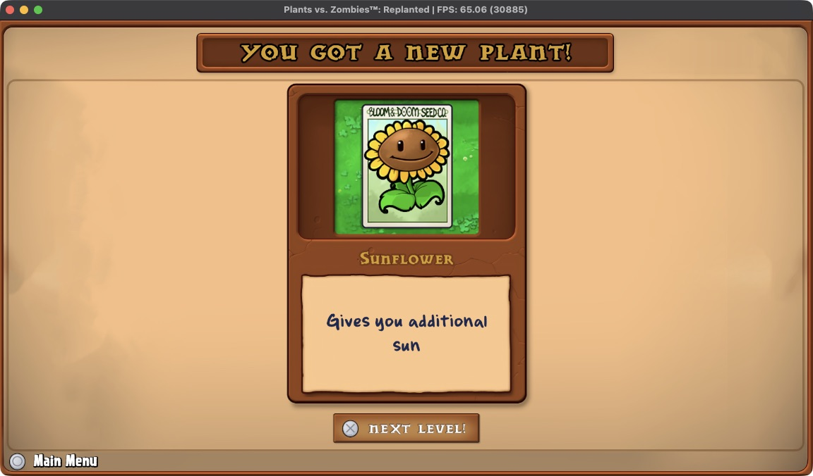
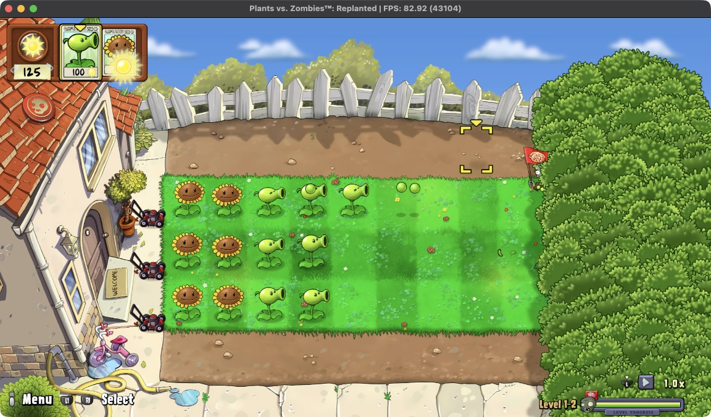
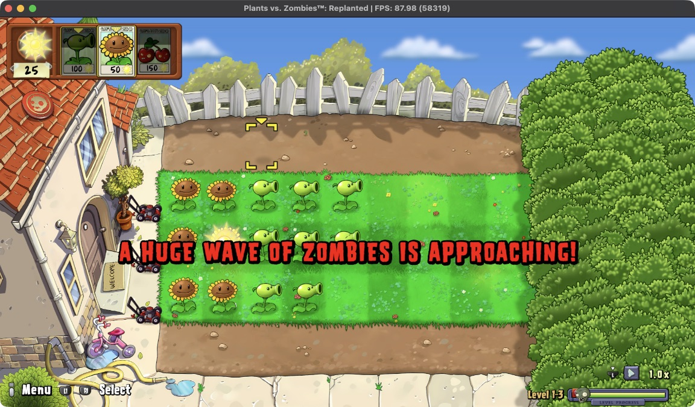
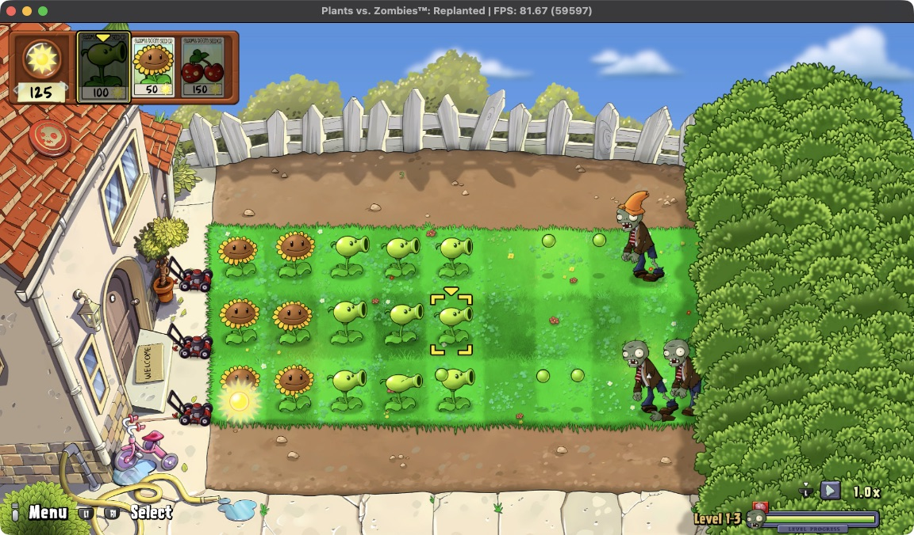
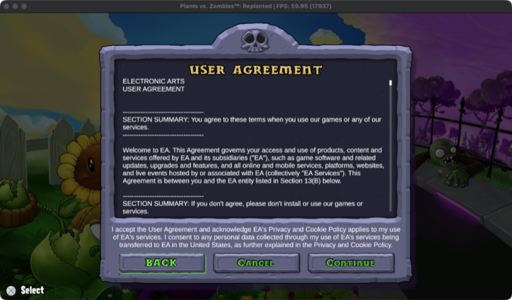

[← Tüm oyunlar](README.md) · [English](../pvz.md) · **Türkçe**

# Plants vs. Zombies: Replanted

`PPSA29802` · Unity (IL2CPP)

**Durum:** 🟢 Oynanabilir · 1-1, 1-2 ve 1-3 oynandı · **FPS:** menü ~120 · oyun içi 60–120 (120 Hz ekran)

Ana menüden ilk bölümlere kadar, yeni bitkiler ve dev zombi dalgaları dahil oynanıyor; görüntü kusursuz. Altı dakikalık kesintisiz oyunda hiç bozulma ya da kapanma olmadı.

*Oyun içi: ilk bölüm, ilk tohumu ekme, 117 FPS*

| | |
|---|---|
|  *1-1 bitti: Ayçiçeği açıldı* |  *1-2: ayçiçekleri ve bezelye atıcılar* |
|  *1-3: "A huge wave of zombies is approaching!", 88 FPS* |  *1-3: dalga bahçeye ulaşıyor* |

*EA kullanıcı sözleşmesi ekranı*

## Adım adım

| | Aşama | Ayrıntı |
|---|---|---|
| ✅ | **Silksong ile aynı Unity hazırlığı** | SELF → ELF, modüller exe ile, eklentiler ayrı. |
| ✅ | **C# exception'ları yakalanıyor** | Tarih/saat hesabındaki bir ArgumentOutOfRangeException oyunun kendi kodunda yakalanamıyordu. macOS'ta unwind tablolarını raporlayan düzeltme (PR #4, kabonKoda) ile çözüldü. |
| ✅ | **MSAA sample locations** | Oyun 4x MSAA'da standart dışı örnek noktaları kullanıyor; VK_EXT_sample_locations ile uygulanıyor. Main artık upstream'in uygulamasını kullanıyor. |
| ✅ | **MSAA bellek boyutu** | 4x MSAA hedefinin boyutu 2 MB fazla hesaplanıyordu ve küçük bir görüntüyle çakışıyordu; AddrLib'in GFX10 kuralıyla düzeltildi. |
| ✅ | **Rosetta + AVX çökmesi** | Upstream #4194 ile çözüldü; exe'de 53.718 yazma bölündü. |
| ✅ | **Ana menü ve oyun** | 1-1, 1-2 ve 1-3 elle oynandı: ana menü ~120 FPS, oyun içi 120 Hz ekranda 60–120 FPS. |
| ✅ | **Açılış çökmesi düzeltildi** | İki açılıştan biri, maskeli bir `vmaskmovps` yazması izlenen bir sayfanın sınırını aştığı için Rosetta `EmulateForward` hatasıyla kapanıyordu. Relinker artık maskeli yazmaları eleman eleman yapıyor (b8dce7fb9; bu oyunda 63 site). O günden beri art arda beş açılışta hiç çökme olmadı. |

✅ tamamlandı · 🔧 şu an · ⏭️ sırada

## Teknik bilgi

| | |
|---|---|
| Kimlik | `PPSA29802 · içerik 01.001.001` |
| Motor | `Unity, IL2CPP` |
| MSAA | `4x, özel örnek noktaları` |
| Bölünen 256-bit yazma | `53.718 (exe)` |
| 5 dk test | `17.933 kare, kapanma yok` |

## Bugün nasıl dönüştürülür (Unity, elle)

AnyPS5.app bu adımları henüz yapmıyor; şimdilik elle:

1. `eboot.bin`, `sce_module/*.prx`, `Media/Modules/*.prx` ve `Media/Plugins/*.prx` dosyalarını SELF'ten ELF'e çevir.
2. `Media/Modules` içindekileri (`Il2cppUserAssemblies.prx`, `PS5Util.prx`) `sce_module` ile birlikte koyup exe'yi `relinker --macos --to-rosetta` ile relink et.
3. `Media/Plugins` eklentilerini exe'ye bağlamadan ayrı bir relink ile `.guest.prx` olarak üret ve orijinallerinin yanına koy; Unity onları çalışma anında başlangıç argümanlarıyla yükler.
4. Paketledikten sonra `Media/Modules/*.guest.prx` dosyalarını `sce_module` kopyalarına symlink yap (oyun aynı modülü `Il2CppUserAssemblies` adıyla da açar), eklentilerin `libc`/`libSceNpCppWebApi` bağımlılıkları için `Media/Plugins` altına symlink ekle, `app0/libs` → `../../../MacOS/libs` bağla.

## Bağlantılar

- [PR #4: macOS unwind tabloları](https://github.com/AnyTogether/AnyPS5-ARM/pull/4)
- [Upstream #4194](https://github.com/boykopovar/AnyPS5/pull/4194)
