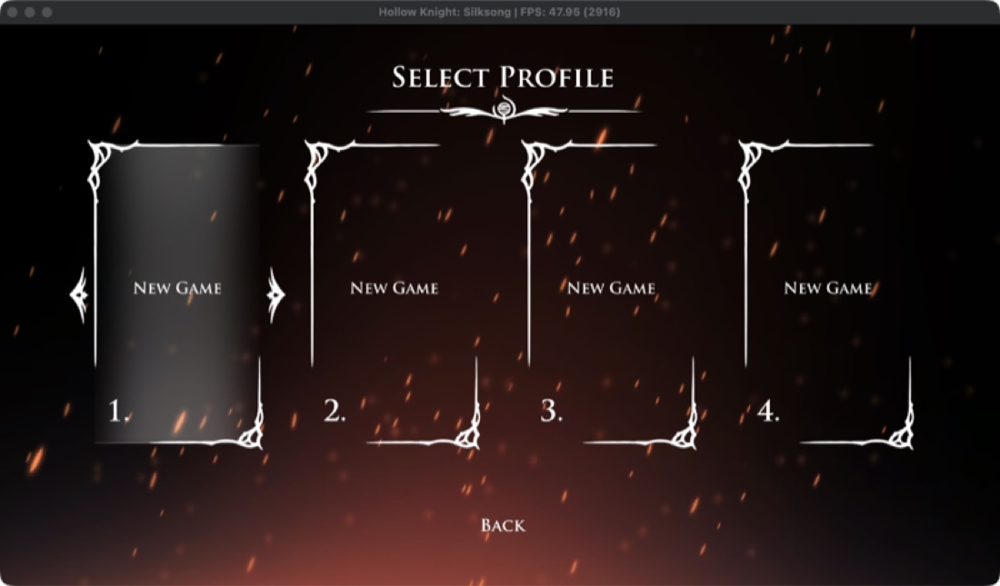

[← Tüm oyunlar](README.md) · [English](../silksong.md) · **Türkçe**

# Hollow Knight: Silksong

`PPSA12544` · Unity (IL2CPP)

**Durum:** 🟡 Üzerinde çalışılıyor · Oyun içi, ilk bölge · **FPS:** Menü 60 · oyun içi ~28–48

Oyun açılıyor, menülerden geçip ilk bölgede oynanıyor. Tek pürüz, uzun oturumlarda ara sıra görülen bir kapanma.

*Oyun içi: Hornet ilk bölgede, HUD ve "Bind" ipucu görünüyor*

*Profil seçme ekranı (Select Profile)*

## Adım adım

| | Aşama | Ayrıntı |
|---|---|---|
| ✅ | **Exe ve modüller dönüştürüldü** | Dump'taki SELF dosyaları (eboot ve sce_module) ELF'e çevrildi; Unity'nin Media/Modules ve Media/Plugins modülleri de dahil. |
| ✅ | **Unity modülleri bağlandı** | Il2cppUserAssemblies ve PS5Util exe ile birlikte bağlanıyor. Eklentiler (PSN, SaveData, Share...) ayrı hazırlanıp çalışma anında yükleniyor. |
| ✅ | **"PSN eski sürüm" hatası çözüldü** | Eklentilere başlangıç argümanları artık iletiliyor: fablevoid'in macOS relinker düzeltmesi (1b865fc3e), upstream üzerinden geldi. |
| ✅ | **Eklenti bağımlılıkları** | Media/Plugins altındaki eklentilerin libc ve libSceNpCppWebApi bağımlılıkları bulunur hâle getirildi. |
| ✅ | **Rosetta + AVX çökmesi giderildi** | Sayfa sınırını aşan hizasız 256-bit yazmalar ikiye bölünüyor (upstream #4194). Exe'de 55.017 yazma bölündü. |
| 🔧 | **Ara sıra kapanma** | Beş dakikalık iki denemeden birinde 293. saniyede segfault; çökme raporu yok. İnceleniyor. |
| ⏭️ | **Performans** | Oyun içinde FPS düşüyor; Rosetta ve MoltenVK katmanları ile GPU senkronizasyonu incelenecek. |

✅ tamamlandı · 🔧 şu an · ⏭️ sırada

## Teknik bilgi

| | |
|---|---|
| Kimlik | `PPSA12544 · sürüm 01.000.010` |
| Motor | `Unity 2021+, IL2CPP` |
| Grafik yolu | `libSceAgc → Vulkan → MoltenVK → Metal` |
| CPU yolu | `x86-64 → Rosetta 2` |
| Bölünen 256-bit yazma | `55.017 (exe)` |
| Test donanımı | `MacBook Pro M3 Pro, macOS 26.6.2` |

## Bugün nasıl dönüştürülür (Unity, elle)

AnyPS5.app bu adımları henüz yapmıyor; şimdilik elle:

1. `eboot.bin`, `sce_module/*.prx`, `Media/Modules/*.prx` ve `Media/Plugins/*.prx` dosyalarını SELF'ten ELF'e çevir.
2. `Media/Modules` içindekileri (`Il2cppUserAssemblies.prx`, `PS5Util.prx`) `sce_module` ile birlikte koyup exe'yi `relinker --macos --to-rosetta` ile relink et.
3. `Media/Plugins` eklentilerini exe'ye bağlamadan ayrı bir relink ile `.guest.prx` olarak üret ve orijinallerinin yanına koy; Unity onları çalışma anında başlangıç argümanlarıyla yükler.
4. Paketledikten sonra `Media/Modules/*.guest.prx` dosyalarını `sce_module` kopyalarına symlink yap (oyun aynı modülü `Il2CppUserAssemblies` adıyla da açar), eklentilerin `libc`/`libSceNpCppWebApi` bağımlılıkları için `Media/Plugins` altına symlink ekle, `app0/libs` → `../../../MacOS/libs` bağla.

## Bağlantılar

- [Upstream #4194 (256-bit yazma bölme)](https://github.com/boykopovar/AnyPS5/pull/4194)
- [Upstream #3731 (Linux'ta 60 FPS raporu)](https://github.com/boykopovar/AnyPS5/issues/3731)
