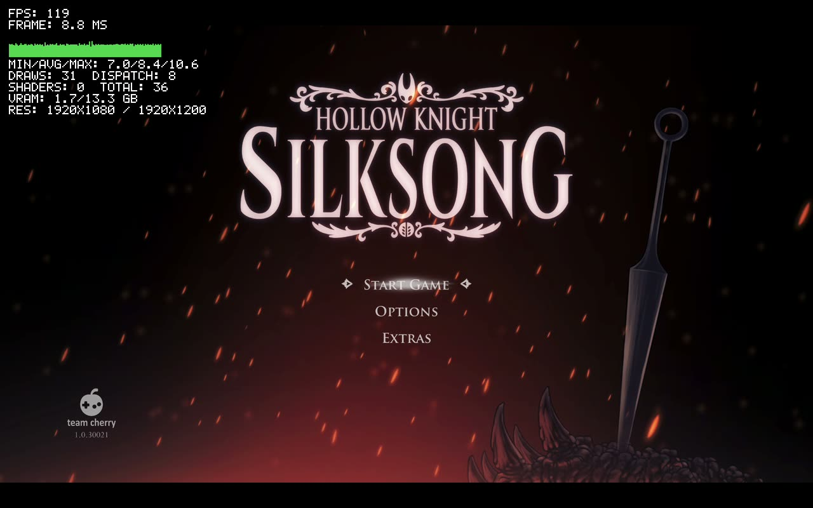
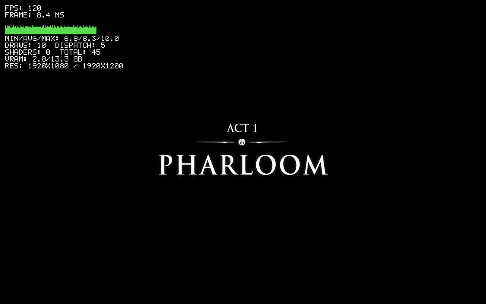
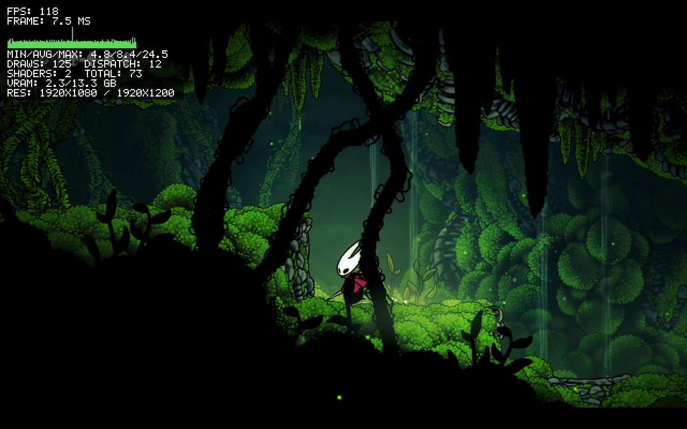
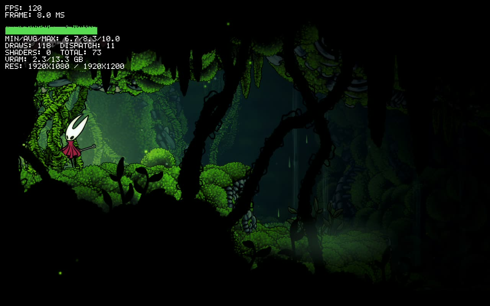
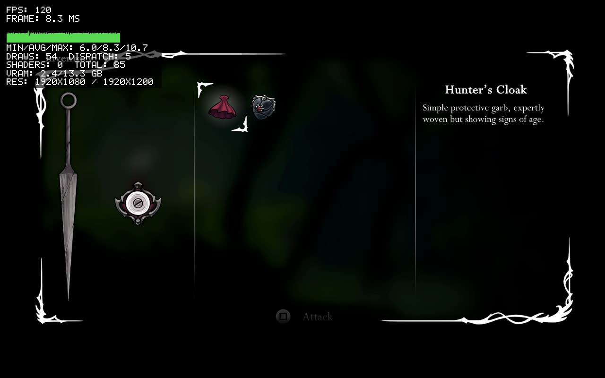

[← Tüm oyunlar](README.md) · [English](../silksong.md) · **Türkçe**

# Hollow Knight: Silksong

`PPSA12544` · Unity (IL2CPP)

**Durum:** 🟢 Oynanabilir · Yeni oyun, Moss Grotto'ya kadar · **FPS:** 120, menüler ve oyun içi

AnyPS5.app'te tek tıkla kilidi açıldı ve oradan başlatıldı. Yeni oyun başlık ekranından açılışa ve Moss Grotto'ya kadar, envanter dahil, 1920×1080'de sabit 120 FPS ile oynanıyor (kare başına ortalama 8,3–8,4 ms). 12 Ekim'de oyun içi ~25–50 FPS'ti; o günden beri alınan upstream güncellemeleri bunu yükseltti.

*Oyun içi: Hornet Moss Grotto'da, 119 FPS, kare başına ortalama 8,4 ms*

| | |
|---|---|
|  *Başlık ekranı, 119 FPS* |  *1. Perde: Pharloom* |
|  *Moss Grotto'nun derinleri, 118 FPS* |  *Tırmanış, 120 FPS* |
|  *Envanter (Hunter's Cloak), 120 FPS* | |

## Adım adım

| | Aşama | Ayrıntı |
|---|---|---|
| ✅ | **Exe ve modüller dönüştürüldü** | Dump'taki SELF dosyaları (eboot ve sce_module) ELF'e çevrildi; Unity'nin Media/Modules ve Media/Plugins modülleri de dahil. |
| ✅ | **Unity modülleri bağlandı** | Il2cppUserAssemblies ve PS5Util exe ile birlikte bağlanıyor. Eklentiler (PSN, SaveData, Share...) ayrı hazırlanıp çalışma anında yükleniyor. |
| ✅ | **"PSN eski sürüm" hatası çözüldü** | Eklentilere başlangıç argümanları artık iletiliyor: fablevoid'in macOS relinker düzeltmesi (1b865fc3e), upstream üzerinden geldi. |
| ✅ | **Eklenti bağımlılıkları** | Media/Plugins altındaki eklentilerin libc ve libSceNpCppWebApi bağımlılıkları bulunur hâle getirildi. |
| ✅ | **Rosetta + AVX çökmesi giderildi** | Sayfa sınırını aşan hizasız 256-bit yazmalar ikiye bölünüyor (upstream #4194). Exe'de 55.017 yazma bölündü. |
| ✅ | **Performans** | 21 Ekim'de menülerde ve oyun içinde 120 FPS (kare başına ortalama 8,3–8,4 ms); 12 Ekim'de oyun içi ~25–50'ydi. |
| ✅ | **Tek tıkla kilit açma** | AnyPS5.app, Unity'nin Media/Modules ve Media/Plugins modüllerini kendisi relink ediyor (15c0b29e0); aşağıdaki elle adımlara artık gerek yok. |
| 🔧 | **Ara sıra kapanma** | Daha önce beş dakikalık iki denemeden biri 293. saniyede segfault verdi; çökme raporu yok. 12 ve 21 Ekim'deki oturumlarda çökme olmadı. İnceleniyor. |

✅ tamamlandı · 🔧 şu an · ⏭️ sırada

## Teknik bilgi

| | |
|---|---|
| Kimlik | `PPSA12544 · sürüm 01.000.010` |
| Motor | `Unity 2021+, IL2CPP` |
| Grafik yolu | `libSceAgc → Vulkan → MoltenVK → Metal` |
| CPU yolu | `x86-64 → Rosetta 2` |
| Bölünen 256-bit yazma | `55.017 (exe)` |
| Test donanımı | `MacBook Pro M3 Pro, macOS 26.6.2` |

## Nasıl dönüştürülür

Dump klasörünü AnyPS5.app'te aç ve **Kilidi Aç**'a bas: `eboot.bin`'i ve `Media/Modules` ile `Media/Plugins` dahil bütün modülleri dönüştürüp macOS için relink ediyor ve uygulamayı hazırlıyor (M3 Pro'da yaklaşık 30 saniye). Elle yaparken relinker'a `sce_module`'ün yanında `--module-dir Media/Modules --module-dir Media/Plugins` gerekiyor.

## Bağlantılar

- [Upstream #4194 (256-bit yazma bölme)](https://github.com/boykopovar/AnyPS5/pull/4194)
- [Upstream #3731 (Linux'ta 60 FPS raporu)](https://github.com/boykopovar/AnyPS5/issues/3731)
