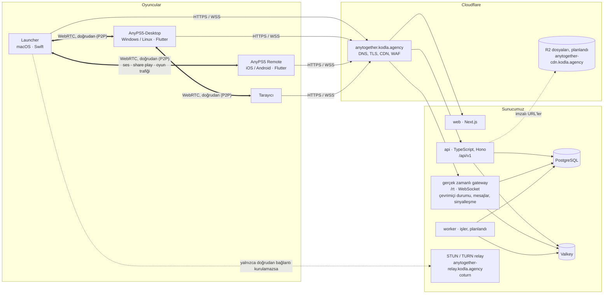
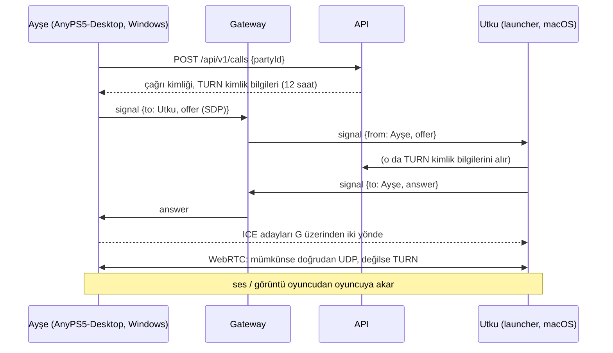

# 2. Mimari

## İki satırda fikir

**Oyuncular birbirleriyle doğrudan konuşur.** Ses, share play (birlikte oynama) görüntüsü ve çevrimiçi oyun trafiği,
oyuncuların kendi makineleri arasında eşten eşe (P2P), şifreli olarak ve sunucumuzdan geçmeden akar.
**Sunucu yalnızca onları tanıştırır ve saklanması gerekeni saklar:** hesaplar, profiller, kupalar,
arkadaşlar, çevrimdışı olanlar için mesajlar ve doğrudan kurulamayan az sayıdaki bağlantı için bir
relay (aktarma sunucusu).

## Genel resim



Sunucu gerektiren her şey Cloudflare arkasındaki **tek bir hostname'e**, `anytogether.kodla.agency`'ye
gider: web sitesi `/`'da, API `/api/v1`'de, gerçek zamanlı gateway `/rt`'de. Medya WebRTC ile
**oyuncudan oyuncuya** gider. Yalnızca iki oyuncunun ağları birbirine ulaşamadığında (katı
NAT'lar, bazı mobil ve ofis ağları; genellikle çiftlerin %10-20'si) TURN relay'imizden geçer ve
yine de uçtan uca şifreli kalır.

## Hostname'ler (yalnızca kodla.agency'nin bir seviye altında)

Cloudflare'in ücretsiz sertifikası `kodla.agency`'yi ve tek seviye derinlikte `*.kodla.agency`'yi kapsar;
`api.anytogether.kodla.agency` gibi bir ad ücretli sertifika gerektirir ve akılda tutması da zordur. Bu yüzden
her şey yola göre ayrılmış tek bir hostname'de durur; buna onunla paylaşılamayan iki kardeş hostname eklenir:

| Hostname | Cloudflare proxy'sinden geçiyor mu | Kim yanıt veriyor |
|---|---|---|
| `anytogether.kodla.agency` | evet | `/` web sitesi, `/api/v1/...` API, `/rt` gerçek zamanlı gateway (WebSocket), `/.well-known/...` |
| `anytogether-cdn.kodla.agency` | evet | Cloudflare R2: avatarlar, tema dosyaları ve önizlemeleri, indirme aynaları |
| `anytogether-relay.kodla.agency` | **hayır** (yalnızca DNS; UDP proxy'lenemez) | STUN ve TURN: UDP/TCP 3478, TLS 5349 |

Sunucuda reverse proxy yola göre yönlendirir: `/api` API'ye, `/rt` gateway'e, geri kalanı web
sitesine (her biri kendi container'ında ayrı bir uygulama).

## Ne nereye gider

| Trafik | Yol | Neden |
|---|---|---|
| Giriş, profiller, kupalar, kütüphane, arkadaşlar, temalar | istemci → sunucu (HTTPS) | saklanmalı ve paylaşılmalı |
| Çevrimiçi durumu (kim çevrimiçi, ne oynuyor) | istemci ↔ gateway (WSS) | sen onlara bağlı olmasan bile arkadaşların bunu öğrenmeli |
| Mesajlar | istemci ↔ gateway, PostgreSQL'de saklanır | çevrimdışı olanlara ve onların tüm cihazlarına ulaşmalı |
| WebRTC sinyalleşmesi (offer'lar, answer'lar, ICE adayları) | istemci ↔ gateway ↔ istemci | tanıştırma; çağrı başına birkaç kilobayt |
| **Ses** | **oyuncu ↔ oyuncu** (WebRTC, Opus) | en düşük gecikme, sunucu bant genişliği yok |
| **Share play görüntüsü ve oyun sesi** | **yayıncı → izleyici** (WebRTC: bir H.264 görüntü track'i, oyunun sesi bir veri kanalında) | en düşük gecikme; 720p60 bir yayın ~8 Mbit/s eder ve sunucumuz bunu hiç taşımaz |
| **Share play kumandası** | **izleyici → yayıncı** (bir WebRTC veri kanalı) | yalnızca yayıncının 2., 3. ya da 4. kumandayı verdiği izleyici için; saniyede 120 küçük paket |
| **Çevrimiçi oyun** (her oyuncu oyunu kendisi çalıştırır) | **oyuncu ↔ oyuncu** (WebRTC veri kanalları ya da QUIC; tasarım aşamasında) | oyunların kendi paketleri; her milisaniye önemli |
| Doğrudan bağlantı mümkün değilse relay | oyuncu ↔ TURN ↔ oyuncu | her zaman çalışsın diye; relay yalnızca şifreli paketleri görür |

## Sunucumuzdaki servisler

Kod herkese açık ve MIT lisanslı:
[github.com/utkuhalis/AnyTogether](https://github.com/utkuhalis/AnyTogether). Şimdiye kadar
yapılanlar (2026-10-25): API, gateway, web sitesi, PostgreSQL ve Valkey, isteğe bağlı olarak da
STUN/TURN relay. Worker ve R2 henüz yok: az sayıdaki arka plan işini API kendisi çalıştırır,
dosyalar (avatarlar, tema dosyaları ve görselleri) PostgreSQL'de tutulur.

### api (TypeScript, Node 22 üzerinde Hono) · yapıldı

Saklanan veriyi değiştiren tek yer; durumsuz. TypeScript, çünkü web sitesi de TypeScript;
böylece şemalar (Zod, `packages/shared` içinde) bir kez yazılır. Bugün sözleşme bu şemalardır;
onlardan üretilecek bir OpenAPI belgesi, **Swift** (macOS launcher'ı) ve **Dart** (telefon,
AnyPS5-Desktop) için tipli istemcilerle birlikte planlandı. Hono, çünkü küçük, web standartlarına
uygun ve taşınabilir (bugün Node, ileride Bun ya da Cloudflare Workers). İncelenmiş SQL
migration'larıyla Drizzle; migration'lar API açılırken uygulanır. Hatalar, her istemcinin kendi
diline çevirdiği sabit kodlarla RFC 9457 problem details biçiminde. Worker yapılana kadar az
sayıdaki arka plan işini API kendisi yapar: kupa nadirliği, akış öğeleri ve uyumluluk
değerlendirmeleri verileri geldiğinde hesaplanır; 14 günü dolan hesaplar silinir ve kullanılmayan
tema dosyaları saatte bir temizlenir; e-posta özetine 10 dakikada bir bakılır; süresi dolan grup
arama ilanları kapatılır; gateway soketi kopan cihazlar kısa bir bekleme süresinden sonra share
play'lerden çıkarılır. Liderlik tabloları bir iş gerektirmez: istek anında hesaplanır ve bir dakika
Valkey'de tutulur. İndirmeler her projenin en son GitHub sürümünden gelir; on dakika Valkey'de
tutulur (GitHub çökerse diye son geçerli yanıt da bir hafta).

### gerçek zamanlı gateway (aynı kod tabanı, ayrı süreç) · yapıldı

Giriş yapmış her istemci için bir WebSocket. Çevrimiçi durumu heartbeat'lerini ve değişikliklerini, mesaj teslimini,
yazıyor bilgisini, bildirimleri, akış öğelerini ve çağrılar, oyun oturumları ve share play için
**WebRTC sinyalleşmesini** taşır: Ayşe Utku'yu aradığında offer'ı gateway'e gider,
gateway onu Utku'nun cihazlarına iletir; answer'lar ve ICE adayları da aynı yoldan geri döner. Bir soket
herkese açık konuları da izleyebilir (oyuncu arama panosu, herkese açık partiler ve share play'ler;
tümü ya da tek bir oyununkiler); bunlar yalnızca "bir şey değişti" bilgisini taşır, istemci de listeyi
yeniden okur. Gateway, oyun sayfaları için şu anda kimin ne oynadığını tutar. Kendine ait
hiçbir durum tutmaz: çevrimiçi durumu Valkey'de, gateway süreçleri arasındaki olaylar Valkey pub/sub üzerinden.
Launcher'lar ve telefon erişim token'larıyla merhaba der; hiç token tutmayan web sitesinin tarayıcısı
ise sitenin sunucusunun API'den aldığı tek kullanımlık bir biletle.

### worker (aynı kod tabanı, ayrı süreç) · planlandı

PostgreSQL içinde pg-boss işleri: bugün API'nin kendisinin yaptıklarını devralır, buna kuyruk
gerektirenler eklenir: telefona anlık bildirimler (APNs, FCM), görsel denetimi, Open Graph görselleri.

### web (Next.js) · yapıldı

Herkese açık profiller, oyun sayfaları ve uyumluluk listesi sunucu tarafında render edilir (hızlı,
paylaşılabilir); giriş yapılmış uygulama tarayıcıda çalışır. Herkesle aynı API'yi kullanır. Yapılanlar:
giriş (e-posta kodu ya da bağlantısı, passkey'ler), bir launcher'ın cihaz kodunu onaylama, ana sayfa
akışı, oyunlar, oynama süresi, kupalar ve son etkinliklerle profiller, arkadaşlar, mesajlar ve gruplar,
sesli partiler, her sayfadan bir arkadaşı arama, bir arkadaşın share play'ini izleme ve bir
kumandayla ya da klavyeyle birlikte oynama, oyuncu bulma (oyuncu arama panosu, Şu an canlı,
kişiler), oyun sayfaları, liderlik tabloları, Tema Hub, uyumluluk listesi, indirmeler, tarayıcı
bildirimleriyle bildirimler, ayarlar (profil, avatar, gizlilik, keşif, bildirimler, passkey'ler, giriş
yapılmış cihazlar, verileri indirme, hesap silme) ve moderatörlerin `/admin` sayfası. Varsayılan dil
İngilizce, Türkçe bir seçiciyle.

### PostgreSQL 17, Valkey 8 · yapıldı

PostgreSQL kalıcı olması gereken her şeyi tutar; R2 kullanılana kadar dosyaları da: avatarları ve
tema dosyalarını görselleriyle birlikte, en fazla 1 MiB'lik parçalar halinde bir blob tablosunda.
Valkey kaybolabilecek olanları tutar: çevrimiçi durumu (60 sn ömür), pub/sub, istek sınırları,
passkey challenge'ları, kimin hangi çağrıda olduğu, share play'ler (oyun sürdüğü kadar yaşarlar, bu
yüzden yalnızca Valkey'de dururlar), şu anda kimin ne oynadığı, bir dakikalığına liderlik tabloları,
on dakikalığına indirmeler, yeniden bağlanmalar için olayların son birkaç dakikası.

### coturn (STUN ve TURN) · yapıldı, isteğe bağlı

STUN her oyuncuya kendi genel adresini söyler; böylece iki oyuncu router'larını delerek birbirine
ulaşabilir (ICE). Bu başarısız olursa TURN medyayı aktarır. Kimlik bilgileri kısa ömürlüdür (API tarafından
çağrı başına verilir, HMAC tabanlı, 12 saat geçerli). TURN yalnızca DTLS-SRTP ile şifrelenmiş medya görür:
hiçbir şey duyamaz, hiçbir şey göremez.

### İleride, isteğe bağlı: bir SFU

Herkesin konuştuğu 8 kişilik bir partide eşten eşe, her birinin 7 ses akışı göndermesi demektir (7 × 32
kbit/s ≈ 0.2 Mbit/s, sorun değil). Share play'de ise eşten eşe, yayıncının her izleyici için
ayrı bir görüntü yüklemesi demektir; bu yüzden bir share play'de en fazla 4 izleyici olur ve üçüncü
izleyiciden itibaren her biri 30 fps'de 540p alır. Çok daha fazla izleyiciye share play, bir
yönlendirme sunucusu (LiveKit gibi bir SFU) çalıştırmaya değeceği yerdir. Bu sonradan eklenecek,
isteğe bağlı bir eklentidir: varsayılan doğrudan bağlantıdır.

## Teknoloji seçimleri

| İhtiyaç | Seçim | Neden |
|---|---|---|
| API ve gateway | TypeScript, Node 22, Hono | web ile tek dil, ortak şemalar |
| Veritabanı | PostgreSQL 17 + Drizzle | ihtiyacımız olan her şey tek motorda; SQL migration'ları |
| İşler (planlandı) | pg-boss | PostgreSQL içinde kuyruk |
| Geçici durum | Valkey 8 | Redis uyumlu, açık lisans |
| Eşten eşe medya | **WebRTC** | tam olarak bunun için yapılmış: NAT geçişi (ICE/STUN/TURN), şifreleme (DTLS-SRTP), Opus ses, düşük gecikmeli görüntü, veri kanalları; her tarayıcıda var ve her platform için kütüphanesi mevcut |
| Platform başına WebRTC | macOS: Google'ın WebRTC framework'ü (hazır derlenmiş Swift paketi); telefon ve AnyPS5-Desktop (Windows/Linux): `flutter_webrtc`; web: tarayıcının kendisi | her istemci kendi dilinde |
| Relay | coturn | standart TURN sunucusu |
| Web sitesi | Next.js | herkese açık sayfalar için SSR |
| Dosyalar | bugün PostgreSQL (bir blob tablosu); Cloudflare R2 planlandı | şimdilik yedeklenecek tek yer; ileride S3 API ve çıkış trafiği ücreti yok |
| Giriş | e-posta kodları ve bağlantıları, passkey'ler (WebAuthn), OpenID Connect (Apple, Google, Discord), telefondan devir | tek dokunuş, akılda tutulacak bir şey yok (bkz. [API](04-api.md)) |
| Anlık bildirim | sunucunun kendi VAPID anahtarlarıyla Web Push (yapıldı, web sitesi); telefon için APNs, FCM HTTP v1 (planlandı) | doğrudan, aracısız |
| Hatalar / metrikler (planlandı) | Sentry, Prometheus + Grafana | standart |
| Dağıtım | kendi sunucumuzun container platformu (git push → build → deploy); kendi sunucusunu kuranlar için Caddy ile Docker Compose | sunucunun zaten kullandığı şey; kendi kuranlar için tek dosya |

## Bir çağrı nasıl kurulur (ses ya da share play)



## Depo düzeni

[`utkuhalis/AnyTogether`](https://github.com/utkuhalis/AnyTogether) (herkese açık, MIT; monorepo,
pnpm workspaces):

```
apps/
  api/          Hono API (/api/v1) ve moderatörlerin komut satırı aracı
  realtime/     WebSocket gateway: çevrimiçi durumu, olaylar, sinyalleşme
  worker/       pg-boss işleri (planlandı, boş)
  web/          Next.js web sitesi
packages/
  shared/       Zod şemaları, olay ve sinyalleşme tipleri, hata kodları
  db/           Drizzle şeması ve SQL migration'ları
infra/          yerel geliştirme servisleri, Dockerfile'lar
deploy/         kendi sunucunu kurmak için Docker Compose ve Caddy
e2e/            tek bir yerel yığına karşı tüm istemciler (istemciler arası test)
docs/           self-hosting.md, web sitesinin ekran görüntüleri
```

Plan bu branch'te kalır. macOS launcher'ının entegrasyonu AnyPS5-ARM'da (`AnyPS5Core/Together/`,
share play'in WebRTC'si de `AnyPS5SharePlay/` içinde), telefon uygulamasınınki `mobile/lib/together/`
altında, Windows/Linux launcher'ınınki ise AnyTogether'a kendisi bağlanan
[AnyPS5-Desktop](https://github.com/utkuhalis/AnyPS5-Desktop) projesinde (`lib/core/together/`) yer alır. Bkz. [İstemciler](07-istemciler.md) ve [Platformlar](12-platformlar.md).

## Ölçek

| Aşama | Hesap / çevrimiçi | Sunucu |
|---|---|---|
| Lansman | 5,000 / 500 | mevcut sunucumuz, paylaşımlı: bellek sınırlarıyla AnyTogether ~3 GB içinde kalır; medya eşten eşe |
| Büyüme | 50,000 / 5,000 | aynısı, artı daha fazla TURN bant genişliği |
| Büyük | daha fazlası | daha fazla gateway/API süreci (durumsuz), ikinci bir makinede TURN, bir okuma replikası |

Medya doğrudan gittiği için sunucunun yükü küçüktür: istekler, soketler ve ihtiyaç duyan çiftler için
relay. Bant genişliği kullanımla birlikte büyüyen tek parça relay'dir.
