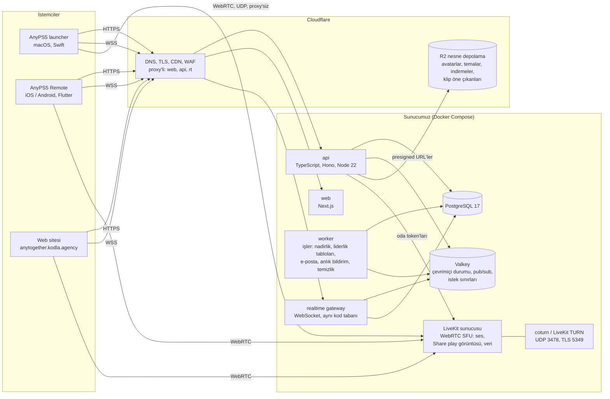
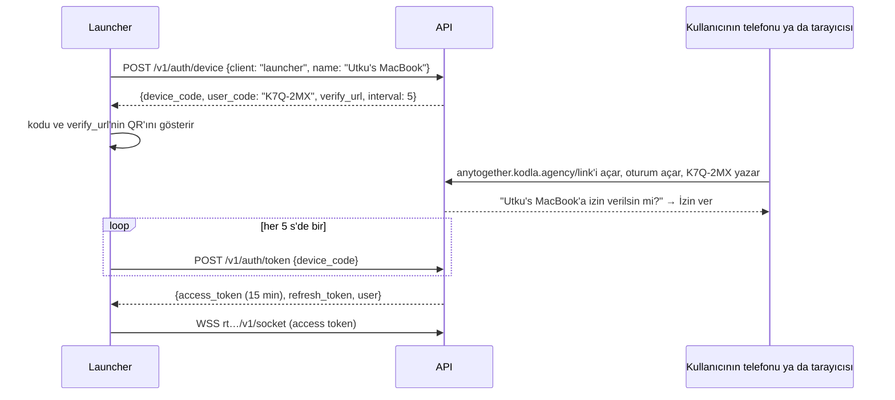

# 2. Mimari

## Genel tablo



Üç kapı (launcher, telefon, web) HTTPS üzerinden tek bir API ile, bir WebSocket üzerinden de tek bir
realtime gateway ile konuşur. Ses ve Share play görüntüsü WebRTC üzerinden istemciden SFU'ya, yani
bir LiveKit sunucusuna gider; Cloudflare bunu proxy'leyemez (UDP), bu yüzden onun hostname'i yalnızca
DNS'tir. Dosyalar kısa ömürlü presigned URL'lerle doğrudan Cloudflare R2'ye gider ve oradan gelir;
böylece büyük yüklemeler hiçbir zaman sunucumuzdan geçmez.

## Hostname'ler

| Hostname | Cloudflare proxy'si | Kim yanıt veriyor |
|---|---|---|
| `anytogether.kodla.agency` | evet | Web sitesi (bugün: "yakında" sayfası) |
| `api.anytogether.kodla.agency` | evet | REST API (`/v1/...`) |
| `rt.anytogether.kodla.agency` | evet (WebSocket'ler) | Realtime gateway (`/v1/socket`) |
| `live.anytogether.kodla.agency` | **hayır** (yalnızca DNS) | LiveKit: sinyalleşme WSS üzerinden, medya UDP 50000-60000 ve TCP 7881 üzerinden |
| `turn.anytogether.kodla.agency` | **hayır** | UDP 3478 ve TLS 5349 üzerinden TURN (UDP'yi engelleyen ağlar için) |
| `cdn.anytogether.kodla.agency` | evet | R2 herkese açık bucket: avatarlar, tema önizlemeleri, indirmeler |

## Servisler

### api (TypeScript, Node 22 üzerinde Hono)

Veriyi değiştiren tek yer. Durumsuzdur; Cloudflare arkasında istenen sayıda kopya çalışabilir.

- **Neden TypeScript:** web sitesi de TypeScript, dolayısıyla istek ve yanıt şekilleri bir kez
  yazılır (`packages/shared`, Zod şemalarıyla) ve API, gateway ve web tarafından kullanılır.
  Launcher (Swift) ve telefon uygulaması (Dart), API'nin yayınladığı OpenAPI belgesinden üretilen
  tipleri alır.
- **Neden Hono:** küçük, hızlı, standart Web API'leri (`Request`/`Response`); bugün Node üzerinde,
  ileride yeniden yazmaya gerek kalmadan Cloudflare Workers ya da Bun üzerinde çalışır.
- **Veritabanı erişimi:** depoda SQL migration'larıyla Drizzle ORM; her migration deploy anında
  üretilmez, gözden geçirilmiş SQL'dir.
- **Doğrulama:** her girdide Zod; aynı şemalar OpenAPI belgesini de üretir.
- **Hatalar:** istemcilerin kendi dillerine çevirdiği sabit bir `code` içeren RFC 9457 problem
  details (`application/problem+json`).

### realtime gateway (aynı kod tabanı, ayrı süreç)

Oturum açmış her istemciye açık bir WebSocket tutar ve olayları iter: bir arkadaş çevrimiçi oldu,
bir mesaj geldi, bir parti daveti, akışta bir kupa. Kendine ait hiçbir durum tutmaz: kimin
çevrimiçi olduğu Valkey'de durur, gateway süreçleri arasındaki olaylar Valkey pub/sub üzerinden
taşınır; böylece A gateway'ine bağlı bir kullanıcı, B gateway'i üzerinden gönderilen bir mesajı alır.

### worker (aynı kod tabanı, ayrı süreç)

Bir isteği yavaşlatmaması gereken işler; pg-boss ile PostgreSQL içinde kuyruğa alınır (ek bir
broker yok):

- değişen oyunlar için kupa nadirliğini yeniden hesaplamak;
- liderlik tablolarını yeniden oluşturmak (her 10 dakikada bir, isteyen kullanıcı için hemen);
- e-posta (doğrulama, parola sıfırlama) ve anlık bildirim (APNs, FCM) göndermek;
- R2'ye yüklenen avatarları ve tema önizlemelerini yeniden boyutlandırmak;
- silinmesi istenen hesapları 14 günlük bekleme süresinden sonra silmek; eski oturumları sona erdirmek.

### web (Next.js, App Router)

Web sitesi: herkese açık profiller (`/u/<name>`), oturum açma, ayarlar, arkadaşlar, mesajlar,
tarayıcıda sesli sohbetli partiler, Tema Hub'ı, indirmeler, liderlik tabloları. Herkese açık
sayfalar sunucu tarafında render edilir (hızlı, paylaşılabilir, iyi bağlantı önizlemeleri),
oturum açılmış uygulama istemci tarafında. Herkesle aynı API'yi çağırır; kendine ait bir
veritabanı erişimi yoktur.

### PostgreSQL 17

Asıl doğruluk kaynağı: hesaplar, profiller, oyunlar, kupalar, arkadaşlıklar, mesajlar, partiler,
temalar, şikâyetler. Seçilme nedeni, buradaki her işi iyi yapması (ilişkisel veri, esnek meta veri
için JSONB, kullanıcı ve oyun bulmak için tam metin ve trigram araması, sayaçlar için satır
düzeyinde kilitler) ve iyi yedeklenen tek bir veritabanını işletmenin birkaç taneyi işletmekten
daha kolay olması.

### Valkey (açık kaynak Redis)

Hızlı, geçici durum: çevrimiçi durumu (kimin çevrimiçi olduğu ve ne oynadığı; heartbeat'lerle
yenilenen 60 s'lik bir sona erme süresiyle), gateway süreçleri arasında pub/sub, istek sınırı
sayaçları, kısa ömürlü cihaz bağlama kodları. Valkey'deki hiçbir şeyin yeniden başlatmadan sağ
çıkması gerekmez; önemli olanı veritabanı yeniden oluşturabilir.

### LiveKit (açık kaynak WebRTC SFU, kendi sunucumuzda)

Sesli sohbeti ve Share play'i taşır.

- **Neden SFU:** her katılımcı sesini (yayıncı da oyun görüntüsünü) bir kez gönderir; sunucu onu
  diğerlerine iletir. Mesh WebRTC üç-dört kişiden sonra dağılır; MCU ise karıştırma için CPU harcar.
  Parti sesli sohbeti ve birden-birkaç kişiye yayın için standart SFU'dur.
- **Neden LiveKit:** açık kaynak (Apache 2.0), Go ile yazılmış, tek binary ve tam da bizim üç
  kapımız için istemci SDK'ları var: **Swift** (launcher), **Flutter** (telefon uygulaması) ve
  **JavaScript** (web). İstemcilerde yankı engelleme ve gürültü bastırmayla Opus sesi, simulcast'i,
  veri kanallarını (Share play'in arkadaşın kolu için kullandığı) ve API'mizin imzaladığı oda
  token'larını halleder.
- **TURN:** UDP'yi engelleyen ağların arkasındaki oyuncular için LiveKit'in gömülü TURN'ü ya da
  yanında coturn. 5349 üzerinden TLS'li TURN, gecikmeden biraz ödün vererek neredeyse her
  güvenlik duvarını aşar.

### Cloudflare (zaten alan adının önünde)

DNS, TLS sertifikaları, herkese açık sayfaların ve dosyaların önbelleğe alınması, uçta web
uygulama güvenlik duvarı ve istek sınırlama, ve dosyalar için **R2**: avatarlar, tema paketleri
ve önizlemeleri, klip öne çıkanları ve AnyPS5 sürümlerinin indirme aynaları. R2'de çıkış
(egress) ücreti yoktur; bu da indirmeler için önemlidir.

## Teknoloji seçimleri, tek tabloda

| İhtiyaç | Seçim | Neden | Değerlendirilenler |
|---|---|---|---|
| API dili | TypeScript (Node 22 LTS) | Web ile tek dil, ortak şemalar, geniş ekosistem | Go (daha hızlı ama iki dil), sunucuda Swift (launcher ile ortak, küçük ekosistem) |
| HTTP framework | Hono | Web standardı, çok küçük, Workers/Bun'a taşınabilir | Fastify, Express, NestJS |
| Veritabanı | PostgreSQL 17 | İhtiyacımız olan her şey tek motorda | MySQL, SQLite (tek yazıcı), Mongo |
| ORM / migration'lar | Drizzle + SQL migration'ları | Tipli sorgular, düz SQL olarak migration'lar | Prisma (daha ağır istemci), Kysely |
| İşler | pg-boss | PostgreSQL içinde kuyruk, ek servis yok | BullMQ (Redis kalıcılığı gerektirir) |
| Önbellek / çevrimiçi durumu | Valkey 8 | Redis uyumlu, açık lisans | Redis, KeyDB |
| Gerçek zamanlı | Kendi WebSocket gateway'imiz | Olaylar ve kimlik doğrulama üzerinde tam kontrol, küçük | Socket.IO, Centrifugo, Ably |
| Ses / görüntü | LiveKit (kendi sunucumuzda) | Swift, Flutter ve JS SDK'ları olan SFU | Janus, mediasoup (hazır mobil SDK yok), Agora (ücretli, kapalı) |
| TURN | LiveKit TURN ya da coturn | Standart, kendini kanıtlamış | Twilio NTS (ücretli) |
| Dosyalar | Cloudflare R2 | S3 API, çıkış ücreti yok, zaten Cloudflare'de | Backblaze B2, S3 |
| Web sitesi | Next.js (App Router) | Herkese açık sayfalar için SSR, React | Astro, SvelteKit, Remix |
| E-posta | Resend (ya da kodla.agency üzerinden SMTP) | Basit API, iyi teslimat | SES, Postmark |
| Anlık bildirim | Doğrudan APNs (token auth) ve FCM HTTP v1 | Aracı yok | OneSignal |
| Hatalar | Sentry (kendi sunucumuzda ya da SaaS) | Swift, Dart, JS ve Node SDK'ları | GlitchTip |
| Metrikler | Prometheus + Grafana, LiveKit'in kendi metrikleri | Standart | Datadog (ücretli) |
| Deploy | Sunucumuzda Docker Compose, imajları derlemek için GitHub Actions | Basit, başlangıç için tek makine | Kubernetes (şimdilik fazla) |

## Bir istek nasıl akar

**Launcher'dan oturum açma** (cihaz bağlama, Mac'te parola yazılmaz):



Bu, OAuth 2.0 Device Authorization'dır (RFC 8628). Telefon uygulaması launcher ile zaten
eşleştirilmişse kodu tek dokunuşla kendisi onaylayabilir.

**Oynarken kazanılan bir kupa:**

1. Launcher kupayı fark eder (bugün bildirim için yaptığı gibi) ve yerel giden kutusuna ekler
   (Application Support'ta küçük bir SQLite dosyası).
2. Giden kutusu; title ID, kupa ID'si, derece ve kazanılma zamanıyla `POST /v1/me/trophies`
   gönderir. Çevrimdışıysa daha sonra yeniden gönderilir; sunucu zaten sahip olduğu bir kupayı yok sayar.
3. API kaydı saklar, bu kullanıcının oyundaki ilerlemesini günceller ve bir nadirlik yeniden
   hesaplamasını kuyruğa alır.
4. API, `trophy.earned` olayını Valkey'e yayınlar; bir arkadaşın soketini tutan her gateway onu
   iter ve arkadaşların launcher'ları, telefonları ve web akışları onu gösterir.

## Depo yapısı (kod yazılmaya başladığında)

Yeni bir depo, `utkuhalis/AnyTogether` (monorepo, pnpm workspaces):

```
apps/
  api/          Hono API'si (REST /v1)
  realtime/     WebSocket gateway'i
  worker/       pg-boss işleri
  web/          Next.js web sitesi
packages/
  shared/       Zod şemaları, olay tipleri, hata kodları, OpenAPI üretimi
  db/           Drizzle şeması ve SQL migration'ları
infra/
  compose.yaml  PostgreSQL, Valkey, LiveKit, coturn, api, realtime, worker, web, Caddy
  livekit.yaml
  backups/      pg_dump'ı R2'ye yükleyen script'ler
docs/           bu plan, güncel tutulur
```

İstemci tarafı, istemcilerin yaşadığı yerde, AnyPS5-ARM içinde durur: `tools/macos/launcher/Sources/AnyPS5Core/Together/`
(Swift) ve `mobile/lib/together/` (Dart). Bkz. [İstemciler](07-istemciler.md).

## Tasarladığımız ölçek

| Aşama | Kullanıcılar | Tek sunucu yeter mi? |
|---|---|---|
| Lansman | en fazla 5,000 hesap, 500 çevrimiçi | Evet: 4 vCPU, 8 GB RAM, her şey tek makinede |
| Büyüme | 50,000 hesap, 5,000 çevrimiçi, 200 sesli sohbet kullanıcısı | LiveKit kendi makinesine taşınır (bant genişliği), PostgreSQL kalır |
| Büyük | daha fazlası | Birden çok API/gateway süreci (zaten durumsuz), LiveKit kümesi, okuma replikası |

Sesli sohbet hafiftir (konuşan başına ~32 kbit/s Opus). Share play ağırdır: tek bir 720p60 yayın,
yayıncıdan ~10 Mbit/s yukarı ve her izleyiciye aynı miktarda aşağı demektir; sunucu onu iletir,
bu yüzden sınırı CPU'su değil bant genişliği belirler. Share play oturumlarının çoğu tek bir
arkadaşladır ve birçoğu ileride eşler arası bağlanacaktır (bkz. [Gerçek zamanlı](06-anlik-ses-birlikte-oynama.md)).
