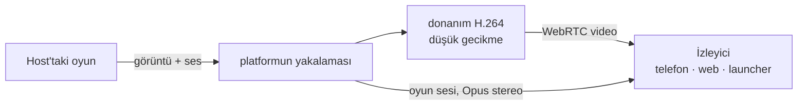

# 6. Anlık iletişim, ses ve birlikte oynama

## 6.1 Neyi kim taşıyor

| | Çevrimiçi durumu, mesajlar, bildirimler | Ses | Share play (birlikte oynama, yalnızca izleme) | Çevrimiçi oyun trafiği |
|---|---|---|---|---|
| Durum | yapıldı | yapıldı (partiler) | planlandı | tasarım aşamasında |
| Yol | istemci ↔ kendi gateway'imiz (WSS) | **oyuncu ↔ oyuncu** (WebRTC) | **host → izleyiciler** (WebRTC) | **oyuncu ↔ oyuncu** (WebRTC veri kanalları ya da QUIC) |
| Sunucunun rolü | taşır ve saklar | tarafları tanıştırır (sinyalleşme), yalnızca doğrudan bağlantı kurulamazsa relay (aktarma sunucusu) üzerinden aktarır | aynı | aynı, artı oyun oturumu |
| Önemli olan gecikme | ~1 sn | < 200 ms ağızdan kulağa gecikme | < 120 ms ekrandan ekrana gecikme | ağın izin verdiği kadar düşük |
| Kaybolan veri | asla kaybolmaz (önce resume, sonra REST) | gizlenir (Opus FEC) | bir sonraki anahtar kareye atlanır | oyunun beklediği gibi: datagramlar düşebilir, akışlar yeniden gönderilir |
| Şifreleme | sunucuya kadar TLS | DTLS-SRTP, oyuncular arasında uçtan uca | DTLS-SRTP | DTLS (SCTP) ya da QUIC |

## 6.2 İki oyuncuyu birbirine bağlamak (ICE)

"Aralarında tünel kurma" işini WebRTC'nin ICE mekanizması üstlenir:

1. Her taraf **adayları** toplar: kendi yerel adresleri, STUN sunucumuzun
   (`anytogether-relay.kodla.agency:3478`) gördüğü genel adresi ve TURN sunucumuzdaki bir relay adresi.
2. Adaylar gateway üzerinden sinyalleşme mesajları olarak karşılıklı iletilir.
3. ICE çiftleri en iyisinden başlayarak dener: aynı ağ (yerel adresler), ardından internet üzerinden
   doğrudan bağlantı (iki yönlendirici de giden paketlerle açılır: NAT delme (hole punching)) ve
   ancak başka hiçbir yol işe yaramazsa TURN relay'i.
4. Seçilen yol şifrelenir (DTLS); relay üzerinden geçse bile yalnızca şifreli paketler aktarılır.

Beklenen tablo: aynı ağdaki bağlantılar ve ev bağlantılarının çoğu doğrudan kurulur; simetrik NAT'lar
(bazı mobil operatörler, ofis ağları) ve UDP'yi engelleyen ağlar relay'i kullanır; UDP üzerinden ya da
son çare olarak 5349 numaralı porttan TLS üzerinden. İstemci hangi yolun kullanıldığını raporlar;
böylece ne kadar relay kapasitesine ihtiyacımız olduğunu biliriz.

**Gizlilik seçeneği**: doğrudan bağlantı, her oyuncunun IP adresini karşı tarafa gösterir. Görüşmelerin
yalnızca arkadaşlar arasında yapılabilmesi bunu çoğu kişi için kabul edilebilir kılar; "Her zaman relay
kullan" ayarı ise biraz gecikme pahasına IP adresini gizler (bkz. [Güvenlik](08-guvenlik-gizlilik.md)).

## 6.3 Gateway üzerinden sinyalleşme

Yapıldı. İki istemci arasındaki, gateway'in aktardığı ve asla saklanmayan mesajlar:

```json
{ "op": "signal", "to": "<user id>", "device": "<device id or *>", "call": "<call id>",
  "kind": "offer | answer | candidate | bye | renegotiate", "data": { … } }
```

- Görüşmeyi API oluşturur (`POST /api/v1/calls`), aranan kişinin aranabilir olduğunu (bir arkadaş
  ya da partinin bir üyesi) kontrol eder ve TURN kimlik bilgilerini döndürür.
- Gateway, `signal` mesajlarını yalnızca o görüşmenin üyeleri arasında iletir; karşı taraf
  `{call, from, device, kind, data}` alır, `device` gönderenin oturumudur; böylece yanıt görüşmedeki
  tek cihaza ulaşır. Bir görüşmenin kurulumu 10 saniyede 300 sinyale kadar gönderebilir.
- Aranan kişinin birden çok cihazında çalan bir görüşme, biri yanıtladığında diğerlerinde çalmayı bırakır.

## 6.4 Partilerde ses

Web'de, macOS launcher'ında (Google'ın WebRTC'si) ve telefon uygulamasında (`flutter_webrtc`)
yapıldı; launcher ve telefon AnyPS5-ARM'ın sonraki sürümünde. Sonradan katılan offer'ları yapar;
ikisi aynı anda offer yaparsa "kibar" taraf geri çekilir. Telefon, relay kimlik bilgilerini süreleri
dolmadan yeniden alır.

- **Eşten eşe (P2P) ağ (mesh)**: her üye diğer her üyeye bağlanır (en fazla 8 kişilik bir partide her
  üye sesini 7 kişiye gönderir ≈ 0.2 Mbit/s yükleme; hangi bağlantı olursa olsun önemsiz bir yük).
- **Opus**, mono, 48 kHz, 24-32 kbit/s, bant içi FEC (~%10 kayba dayanır), DTX (sessizlik neredeyse
  hiç bant genişliği harcamaz).
- **İşleme**: yankı giderme, gürültü bastırma ve otomatik kazanç platform tarafından yapılır: macOS/iOS'ta
  Apple'ın ses işleme altyapısı, Windows, Linux, Android ve web'de WebRTC'nin kendi işlemcisi.
- **Oyunun sesi asla gönderilmez**: yalnızca mikrofon. İlk kullanımda kulaklık önerilir.
- **Bas-konuş**: launcher'da genel bir kısayol tuşu (macOS'ta `⌥V`, yapıldı; Windows/Linux'ta
  `Ctrl+Alt+V`, planlandı), telefonda bir düğme (planlandı). Bas-konuş kapalıyken `⌥V` mikrofonu açıp kapatır.
- **Kulaklık olarak telefon** (planlandı): launcher, eşleştirilmiş telefona (bugün zaten var olan yerel
  bağlantı üzerinden) sesi taşımasını söyler; telefon görüşmeye kendisi katılır ve kumanda olmayı
  sürdürür. Telefon bugün de bir partinin sesine kendi başına katılabiliyor.
- **Konuşma halkası**: gelen her ses kanalının seviyesinden hesaplanır.
- Bir partide bir gün 8'den fazla konuşan üyeye ihtiyaç duyulursa, görüşmeyi isteğe bağlı bir SFU
  devralır (ileride).

## 6.5 Share play

Planlandı. Share play **yalnızca izlemedir**: izleyiciler host'un oyununu görür ve duyar, yaptıkları
hiçbir şey oyuna ulaşmaz. Kontrol asla devredilmez; birlikte oynamak çevrimiçi oyunun (6.7) işidir.

Remote Play'in yerel ağ için kurduğu altyapıyı yeniden kullanır:

| Bugünkü Remote Play (macOS launcher, yerel ağ) | Share play (her launcher, internet üzerinden) |
|---|---|
| ScreenCaptureKit: oyun penceresi ve sesi | platformun yakalama altyapısı: ScreenCaptureKit (macOS), Windows.Graphics.Capture + WASAPI loopback (Windows), xdg-desktop-portal üzerinden PipeWire (Linux) |
| `StreamEncoder`: H.264, düşük gecikmeli bit hızı denetimi, kare yeniden sıralaması yok | aynı ayarlarla platformun donanım kodlayıcısı: VideoToolbox (macOS), Media Foundation / NVENC / AMF / Quick Sync (Windows), VA-API / NVENC (Linux); WebRTC'ye H.264 olarak verilir |
| Telefona UDP ile ≤1200 baytlık parçalar | host ile izleyici arasında doğrudan, SRTP üzerinden RTP |
| Bir kare kaybolduğunda `keyFrame` isteği | WebRTC'nin görüntü kaybı bildirimi (PLI) |



**Görüntü**: 1280x720, 60 fps, 5-10 Mbit/s; WebRTC'nin bant genişliği tahminini izler: önce bit hızını
anında değiştirir, tahmin düşük kalmaya devam ederse çözünürlüğü ya da kare hızını düşürür. Anahtar
kareler PLI geldiğinde ve her 4 sn'de bir. **Ses**: Opus stereo 128 kbit/s, ses işleme yok.

**İzleyiciler**: yaygın durum tek izleyicidir. İki ya da üç izleyici, host'un her izleyici için ayrı bir
akış yüklemesi demektir (her biri ≈ 8 Mbit/s): launcher host'un tahmini yükleme hızını gösterir ve
birden çok izleyici için 540p/30 fps önerir. Çok sayıda izleyici, ileride isteğe bağlı SFU'nun devreye
gireceği noktadır.

**Hedefler**

| Ölçüt | Hedef |
|---|---|
| Ekrandan ekrana gecikme | ~1000 km içinde doğrudan bağlantıda < 120 ms; relay üzerinden < 160 ms |
| İlk görüntü | Share play'e basıldıktan sonra < 2 sn |
| Ani kayıp sonrası toparlanma | < 500 ms |

## 6.6 Gateway

Yapıldı.

- Giriş yapmış her istemci için bir WebSocket.
- Kimlik doğrulama ilk çerçevede yapılır: bir erişim token'ı ya da web sitesinin tarayıcısı için (hiç
  token tutmadığından) tek kullanımlık bir bilet; ardından bağlantı kullanıcının Valkey kanalını dinler.
  Başka bir yerden kapatılan bir oturum anında kapanır.
- **Çevrimiçi durumu**: her 25 sn'de bir heartbeat; cihazlar birleştirilir (`in_game` > `online` > `away`);
  60 sn süreyle Valkey'e yazılır; değişiklikler bunu görmeye yetkili arkadaşlara yayımlanır.
- **Resume**: kullanıcı başına son 5 dakikanın olayları bir Valkey stream'inde tutulur; yeniden bağlanan
  istemci kaçırdıklarını alır; daha eski boşluklar REST ile doldurulur.
- Durumsuzdur; Cloudflare ve reverse proxy WebSocket'leri geçirir; birden çok süreç yan yana çalışabilir.

## 6.7 Oyunların kendisi için çevrimiçi oyun

Ses ve share play, oyunun kendi çevrimiçi moduna ihtiyaç duymaz. Gerçek çevrimiçi çok oyunculu oyun,
yani iki oyuncunun oyunu kendi makinesinde çalıştırdığı ve oyunun diğer kopyayla PlayStation Network
üzerindeymiş gibi konuştuğu senaryo, motorun oyunun ağ çağrılarını launcher'a devretmesini gerektirir;
launcher da bunları diğer oyuncuya taşır. Bu bizim kendi motor köprümüz; AnyPS5-ARM'ın `online-play`
branch'inde tasarlanıyor
([ONLINE_PLAY.md](https://github.com/utkuhalis/AnyPS5-ARM/blob/online-play/docs/dev/ONLINE_PLAY.md)):

- **Motor**, launcher'la kimliği doğrulanmış bir loopback bağlantısı üzerinden konuşur (her oyun
  başlangıcında yeni bir sır; iki yönde HMAC ile kanıtlanır, hiç gönderilmez). Oyun giriş yapmış bir
  kullanıcı görür (AnyTogether kullanıcı adı), web API istekleri dokunulmadan launcher'a iletilir ve
  eşten eşe datagramları sanal adreslerdeki (198.18.0.0/15, oyun oturumu başına katılma sırasına göre
  verilir) diğer oyunculara gider.
- **Launcher**, AnyTogether'ın oyun oturumlarına ve davetlerine eşleyebildiği istekleri yanıtlar,
  gerisine "sunulmuyor" der; böylece oyun tam olarak çevrimdışıyken gördüğünü görür. Oyun trafiğini diğer
  launcher'lara taşır: önce paket başına bir HMAC etiketiyle düz UDP, ardından ses gibi, yedek olarak
  AnyTogether relay'iyle WebRTC veri kanalları ya da QUIC.
- **AnyTogether** oyun oturumlarını tutar (yapıldı: oyun, oyun sürümü, motor derlemesi, davetler,
  çevrimiçi durumunda katılınabilirlik) ve oyun sürümü ya da motor derlemesi farklı bir katılmayı
  reddeder. Eklenecekler: her launcher'a diğerlerinin uç noktalarını ve oturum anahtarını bildirmek,
  oturum sinyalleşmesi.
- **Plus kontrolleri**: launcher AnyTogether'a giriş yapmış bir kullanıcı bildirdiği sürece oyunun
  PlayStation Plus ve premium kontrolleri "izin verildi" yanıtını alır; çıkış yapılmışken eskisi gibi yanıt verir.
- **Temiz çizgi**: Sony'ye hiçbir şey gitmez, hiçbir şey bir yayıncının kendi sunucularının yerine
  geçmez; anahtar, sertifika ya da anti-cheat atlatma yok. Çevrimiçi oyunu yalnızca platform servisleri
  üzerine kurulu oyunlar çalışabilir; yayıncısının sunucularına ihtiyaç duyan oyunlar kapsam dışıdır.

Durum (2026-10-24): motorda sahte bir launcher'a karşı yapıldı ve test edildi: köprü ve protokolü,
oyunların ne çağırdığını kaydeden bir gözlem günlüğü, giriş durumu ve Plus kontrolleri, web API
aktarımı, datagram oyun trafiği; launcher'ın köprü tarafı, varsayılan olarak kapalı. Henüz yapılmayanlar:
push olayları, oturum sinyalleşmesi, akış trafiği, katılma intent'leri, NAT geçişi ve oyun trafiği için relay.

## 6.8 Hata durumunda davranış

| Ne bozulursa | Kullanıcı ne görür |
|---|---|
| Gateway | mesajlar ve çevrimiçi durumu duraklar (arkadaşlar panelinde "Yeniden bağlanılıyor"); zaten bağlı olan görüşmeler **devam eder** (doğrudan oldukları için); gateway geri geldiğinde resume aradaki boşluğu doldurur |
| Doğrudan yol kopar (ağ değişikliği) | ICE yeniden başlar, gerekirse relay üzerinden; sesteki kesintiler bir saniyenin altında kalır |
| Relay'e ulaşılamıyor ve doğrudan yol yok | nedeniyle birlikte "<arkadaş> ile bağlantı kurulamadı"; başka hiçbir şey etkilenmez |
| Share play için ağ çok zayıf | görüntü kalitesi kademeli olarak düşer; 10 sn boyunca 1.5 Mbit/s'nin altında kalırsa izleyici yalnızca sesi alır |
| Host'un oyunu biter | share play durur, parti devam eder |
