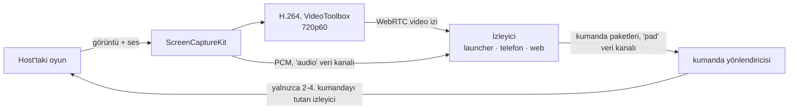

# 6. Anlık iletişim, ses ve birlikte oynama

## 6.1 Neyi kim taşıyor

| | Çevrimiçi durumu, mesajlar, bildirimler | Ses | Share play (birlikte oynama) | Çevrimiçi oyun trafiği |
|---|---|---|---|---|
| Durum | yapıldı | yapıldı (partiler, birebir görüşmeler) | yapıldı (host macOS launcher'ı) | tasarım aşamasında |
| Yol | istemci ↔ kendi gateway'imiz (WSS) | **oyuncu ↔ oyuncu** (WebRTC) | **host → izleyiciler** (WebRTC) ve izleyicinin kumandası geri host'a | **oyuncu ↔ oyuncu** (WebRTC veri kanalları ya da QUIC) |
| Sunucunun rolü | taşır ve saklar | tarafları tanıştırır (sinyalleşme), yalnızca doğrudan bağlantı kurulamazsa relay (aktarma sunucusu) üzerinden aktarır | aynı, artı kimin izlediği ve hangi kumandanın kimde olduğu | aynı, artı oyun oturumu |
| Önemli olan gecikme | ~1 sn | < 200 ms ağızdan kulağa gecikme | < 120 ms ekrandan ekrana gecikme; kumandanın gidiş-dönüş süresi | ağın izin verdiği kadar düşük |
| Kaybolan veri | asla kaybolmaz (önce resume, sonra REST) | gizlenir (Opus FEC) | görüntü: bir sonraki anahtar karede toparlanır; ses ve kumanda: düşer, asla yeniden gönderilmez | oyunun beklediği gibi: datagramlar düşebilir, akışlar yeniden gönderilir |
| Şifreleme | sunucuya kadar TLS | DTLS-SRTP, oyuncular arasında uçtan uca | DTLS-SRTP (görüntü), DTLS (veri kanalları) | DTLS (SCTP) ya da QUIC |

## 6.2 İki oyuncuyu birbirine bağlamak (ICE)

"Aralarında tünel kurma" işini WebRTC'nin ICE mekanizması üstlenir:

1. Her taraf **adayları** toplar: kendi yerel adresleri, STUN sunucumuzun
   (`anytogether-relay.kodla.agency:3478`) gördüğü genel adresi ve TURN sunucumuzdaki bir relay adresi.
2. Adaylar gateway üzerinden sinyalleşme mesajları olarak karşılıklı iletilir.
3. ICE çiftleri en iyisinden başlayarak dener: aynı ağ (yerel adresler), ardından internet üzerinden
   doğrudan bağlantı (iki yönlendirici de giden paketlerle açılır: NAT delme (hole punching)) ve
   ancak başka hiçbir yol işe yaramazsa TURN relay'i.
4. Seçilen yol şifrelenir (DTLS); relay üzerinden geçse bile yalnızca şifreli paketler aktarılır.

Beklenen tablo: aynı ağdaki bağlantılar ve ev bağlantılarının çoğu doğrudan kurulur; simetrik NAT'lar
(bazı mobil operatörler, ofis ağları) ve UDP'yi engelleyen ağlar relay'i kullanır; UDP üzerinden ya da
son çare olarak 5349 numaralı porttan TLS üzerinden. İstemci hangi yolun kullanıldığını raporlar;
böylece ne kadar relay kapasitesine ihtiyacımız olduğunu biliriz.

**Gizlilik seçeneği**: doğrudan bağlantı, her oyuncunun IP adresini karşı tarafa gösterir. Görüşmeler
yalnızca arkadaşlar ya da parti üyeleri arasında yapılır, bu da durumu çoğu kişi için kabul edilebilir
kılar; ancak herkese açık listelenen bir share play ya da oyuncu arama panosundan katılınan bir parti
veya share play, birbirini tanımayan insanları bağlayabilir. "Her zaman relay kullan" ayarı (planlandı)
biraz gecikme pahasına adresi gizler (bkz. [Güvenlik](08-guvenlik-gizlilik.md)).

## 6.3 Gateway üzerinden sinyalleşme

Yapıldı. İki istemci arasındaki, gateway'in aktardığı ve asla saklanmayan mesajlar:

```json
{ "op": "signal", "to": "<user id>", "device": "<device id or *>", "call": "<call id>",
  "kind": "offer | answer | candidate | bye | renegotiate", "data": { … } }
```

Aynı çerçeve `"session": "<game session id>"` ile bir oyun oturumunun iki oyuncusu arasında
(çevrimiçi oyun), `"share": "<share play id>"` ile de bir share play'in host'u ile izleyicilerinden
biri arasında sinyalleşir; karşı taraf `game_session.signal` ya da `share_play.signal` alır. Bir share
play'de uçlardan biri her zaman host'tur: izleyiciler birbirine asla ulaşmaz.

- Görüşmeyi API oluşturur (`POST /api/v1/calls`), aranan kişinin aranabilir olduğunu (bir arkadaş
  ya da partinin bir üyesi) kontrol eder ve TURN kimlik bilgilerini döndürür.
- Gateway, `signal` mesajlarını yalnızca o görüşmenin üyeleri arasında iletir; karşı taraf
  `{call, from, device, kind, data}` alır, `device` gönderenin oturumudur; böylece yanıt görüşmedeki
  tek cihaza ulaşır. Bir görüşmenin kurulumu 10 saniyede 300 sinyale kadar gönderebilir.
- Aranan kişinin birden çok cihazında çalan bir görüşme, biri yanıtladığında diğerlerinde çalmayı bırakır.

## 6.4 Partilerde ses

Web'de, macOS launcher'ında (Google'ın WebRTC'si), telefon uygulamasında ve AnyPS5 Desktop'ta
(`flutter_webrtc`) yapıldı, hepsi sürümde. Sonradan katılan offer'ları yapar; ikisi aynı anda offer
yaparsa "kibar" taraf geri çekilir. İstemciler relay kimlik bilgilerini süreleri dolmadan yeniden
alır. Mikrofonun kapatıldığı görüşmedeki herkese bildirilir (`call.updated`); gateway soketi kopan bir
cihaz görüşmelerinden çıkar.

- **Eşten eşe (P2P) ağ (mesh)**: her üye diğer her üyeye bağlanır (en fazla 8 kişilik bir partide her
  üye sesini 7 kişiye gönderir ≈ 0.2 Mbit/s yükleme; hangi bağlantı olursa olsun önemsiz bir yük).
- **Opus**, mono, 48 kHz, 24-32 kbit/s, bant içi FEC (~%10 kayba dayanır), DTX (sessizlik neredeyse
  hiç bant genişliği harcamaz).
- **İşleme**: yankı giderme, gürültü bastırma ve otomatik kazanç platform tarafından yapılır: macOS/iOS'ta
  Apple'ın ses işleme altyapısı, Windows, Linux, Android ve web'de WebRTC'nin kendi işlemcisi.
- **Oyunun sesi asla gönderilmez**: yalnızca mikrofon. İlk kullanımda kulaklık önerilir.
- **Bas-konuş**: launcher'da genel bir kısayol tuşu (macOS'ta `⌥V`; AnyPS5 Desktop'ta parti panelinde
  seçilen bir tuş, varsayılanı V, Windows'ta `GetAsyncKeyState`, X11'de `XQueryKeymap` ile okunur),
  telefonda bir düğme (planlandı). Bas-konuş kapalıyken bu tuş mikrofonu açıp kapatır.
- **Kulaklık olarak telefon** (planlandı): launcher, eşleştirilmiş telefona (bugün zaten var olan yerel
  bağlantı üzerinden) sesi taşımasını söyler; telefon görüşmeye kendisi katılır ve kumanda olmayı
  sürdürür. Telefon bugün de bir partinin sesine kendi başına katılabiliyor.
- **Konuşma halkası**: gelen her ses kanalının seviyesinden hesaplanır.
- Bir partide bir gün 8'den fazla konuşan üyeye ihtiyaç duyulursa, görüşmeyi isteğe bağlı bir SFU
  devralır (ileride).

## 6.5 Share play

Yapıldı; AnyPS5-ARM 0.2.15 ve telefon 1.11.0 ile yayımlandı. Host'un oyunu arkadaşlara yayınlanır ve
host bunlardan en fazla üçüne bir kumanda verebilir: **2., 3. ya da 4. oyuncu**. Host'un kendi
kumandası **1. oyuncudur** ve öyle kalır: hiçbir endpoint 1. oyuncuyu kimseye vermez, motor da bir
izleyicinin kumandasını asla 1. oyuncu olarak oturtmaz. Yerel co-op oyunlar her yerden birlikte
oynanabilir hale gelir; oyun yalnızca host'un bilgisayarında çalışır.

| Kim | Host olur | İzler | Kumandayla birlikte oynar |
|---|---|---|---|
| macOS launcher | yapıldı | yapıldı (tam ekran, kendi sesiyle) | yapıldı: kumanda |
| Telefon uygulaması | - | yapıldı | yapıldı: ekrandaki kumanda, titreşim ve ışık çubuğuyla |
| Web sitesi | - | yapıldı (`/watch/<id>`) | yapıldı: bir kumanda (Gamepad API) ya da klavye |
| AnyPS5 Desktop | planlandı | planlandı | planlandı |

Remote Play'in yerel ağ için kurduğu altyapıyı yeniden kullanır:

| Remote Play (macOS launcher, yerel ağ) | Share play (internet üzerinden) |
|---|---|
| ScreenCaptureKit: oyun penceresi ve sesi | aynı yakalama, pencerenin başlık çubuğu olmadan (yoksa pencere modundaki bir oyun kırpılırdı) |
| `StreamEncoder`: H.264, düşük gecikme | WebRTC'nin VideoToolbox H.264 kodlayıcısı, izleyici başına bir video izi |
| Telefona UDP ile ≤1200 baytlık parçalar | host ile izleyici arasında doğrudan, SRTP üzerinden RTP |
| Ses: 48 kHz'de 16 bit stereo PCM, 5 ms'lik paketler ("APRA") | aynı paketler, bir veri kanalında |
| Telefonun kumandası: UDP ile 80 baytlık paketler | aynı paketler, bir veri kanalında |
| Bir kare kaybolduğunda `keyFrame` isteği | WebRTC'nin görüntü kaybı bildirimi (PLI) |



**Görüntü**: 1280x720, 60 fps, WebRTC'nin bant genişliği tahminini izler; üçüncü izleyiciden itibaren
host her izleyici için ayrı bir akış yüklediğinden her izleyici 540p, 30 fps alır. Offer'ları her
zaman host yapar; çok bekleyen bir izleyici offer ister.

**Ses**: oyunun sesi Remote Play'in paketleriyle (16 bit stereo PCM, 48 kHz, her biri 5 ms, yaklaşık
1.5 Mbit/s) kayıplı, sırasız bir veri kanalında ("audio") gider; izleyici bunu küçük bir jitter
tamponuyla çalar (yaklaşık 50 ms'den başlar, yaklaşık 150 ms'yi aşanı atar ki görüntünün asla gerisine
kaymasın). Böylece host'un yolu Remote Play'inkiyle aynı kalır ve kodlama gecikmesi eklenmez. Opus
yalnızca konuşma sesi için kullanılır; oyunun sesini bir Opus izi olarak göndermek (bant genişliğinin
yaklaşık onda biri) ileride atılabilecek bir adım.

**Kumandalar**: host'un oynamasına izin verdiği bir izleyici, telefonla aynı 80 baytlık kumanda
paketlerini ([Platformlar](12-platformlar.md) 12.4) kayıplı, sırasız bir veri kanalında ("pad") saniyede
120 kez ve her değişiklikte anında gönderir. Host'ta bir yönlendirici, bir izleyicinin paketlerini
yalnızca o izleyici bir kumanda tuttuğu sürece, onun için ayrılmış bir uzak kumanda köprüsü üzerinden
oyuna ulaştırır ve verilen oyuncu numarasını her paketin 13. baytına yazar; motor o kumandayı o oyuncu
olarak, ya da birinciden sonraki en düşük boş oyuncu olarak oturtur, asla birinci olarak değil.
Kumanda geri alınırken önce bütün tuşlar bırakılır. Oyunun yanıtları (titreşim, ışık çubuğu,
gidiş-dönüş süresi için son girdinin yankısı) aynı kanaldan o izleyiciye geri gider.

**Kim girebilir**: davet edilen arkadaşlar; host arkadaşlarına açık tuttuğu sürece host'un arkadaşları;
ve yalnızca host herkese açık listelerse, isteyen başkaları (host yanıtlar) ya da açık bir listelemede
herkes; bu durumda "Şu an canlı" altında da görünebilir. En fazla 4 izleyici (varsayılan 2). Host bir
izleyiciyi çıkarabilir; o kişi ancak yeniden davet edilirse geri gelir. Engellemeler insanları her iki
yönde de ayrı tutar.

**Durum**: API share play'i, izleyicilerini (cihaz ve kumanda), davetleri ve istekleri yalnızca Valkey'de
tutar; host'un ve izleyicilerin yaptığı her şey bunları yeniler; bir share play oyun sürdüğü sürece
sürer. Bir cihazın gateway soketi kapanır ve kısa bir süre içinde geri gelmezse, izleyicinin yeri
boşalır, host'un share play'i ise biter.

**Hedefler**

| Ölçüt | Hedef |
|---|---|
| Ekrandan ekrana gecikme | ~1000 km içinde doğrudan bağlantıda < 120 ms; relay üzerinden < 160 ms |
| İlk görüntü | katıldıktan sonra < 2 sn |
| Ani kayıp sonrası toparlanma | < 500 ms |

Şimdiye kadar ölçülen: bir test, host'u ve izleyiciyi sentetik 60 fps bir görüntüyle tek bir süreçte
çalıştırır; izleyiciye 59 fps'de 720p H.264 gösterilir, ses paketleri eksiksiz ulaşır ve bir kumanda
oyunun köprüsüne ancak host onu verdikten sonra ulaşır. Gerçek ağlarda ekrandan ekrana gecikme henüz
ölçülmedi.

**Windows ve Linux** (planlandı, AnyPS5 Desktop'ta): aynı protokol; Windows.Graphics.Capture ve WASAPI
süreç loopback'i ya da xdg-desktop-portal üzerinden PipeWire ve platformun donanım H.264 kodlayıcısı.

## 6.6 Gateway

Yapıldı.

- Giriş yapmış her istemci için bir WebSocket.
- Kimlik doğrulama ilk çerçevede yapılır: bir erişim token'ı ya da web sitesinin tarayıcısı için (hiç
  token tutmadığından) tek kullanımlık bir bilet; ardından bağlantı kullanıcının Valkey kanalını dinler.
  Başka bir yerden kapatılan bir oturum anında kapanır.
- **Çevrimiçi durumu**: her 25 sn'de bir heartbeat; cihazlar birleştirilir (`in_game` > `online` > `away`);
  60 sn süreyle Valkey'e yazılır; değişiklikler bunu görmeye yetkili arkadaşlara yayımlanır.
- **Resume**: kullanıcı başına son 5 dakikanın olayları bir Valkey stream'inde tutulur; yeniden bağlanan
  istemci kaçırdıklarını alır; daha eski boşluklar REST ile doldurulur.
- **Yazıyor**: bir sohbetin üyesinden diğerlerine "yazıyorum", en fazla iki saniyede bir, asla saklanmaz.
- **Konular**: bir soket en fazla 8 herkese açık konuyu izleyebilir (oyuncu arama panosu ile herkese
  açık partiler ve share play'ler, tümü ya da tek bir oyununki); bunlar yalnızca "değişti" bilgisini
  taşır, böylece engellemeler istemci listeyi yeniden okuduğunda uygulanır.
- **Kim ne oynuyor**: "oyunda" diyen her heartbeat, oyun sayfaları için oyuncuyu o oyunun kümesinde
  yeniler; yalnızca çevrimiçi durumu herkese açık olanlar gösterilir.
- **Sınırlar**: kullanıcı başına 20 soket, soket başına 10 saniyede 30 çerçeve, 10 saniyede 300 sinyal.
- Durumsuzdur; Cloudflare ve reverse proxy WebSocket'leri geçirir; birden çok süreç yan yana çalışabilir.

## 6.7 Oyunların kendisi için çevrimiçi oyun

Ses ve share play, oyunun kendi çevrimiçi moduna ihtiyaç duymaz. Gerçek çevrimiçi çok oyunculu oyun,
yani iki oyuncunun oyunu kendi makinesinde çalıştırdığı ve oyunun diğer kopyayla PlayStation Network
üzerindeymiş gibi konuştuğu senaryo, motorun oyunun ağ çağrılarını launcher'a devretmesini gerektirir;
launcher da bunları diğer oyuncuya taşır. Bu bizim kendi motor köprümüz; AnyPS5-ARM'ın `online-play`
branch'inde tasarlanıyor
([ONLINE_PLAY.md](https://github.com/utkuhalis/AnyPS5-ARM/blob/online-play/docs/dev/ONLINE_PLAY.md)):

- **Motor**, launcher'la kimliği doğrulanmış bir loopback bağlantısı üzerinden konuşur (her oyun
  başlangıcında yeni bir sır; iki yönde HMAC ile kanıtlanır, hiç gönderilmez). Oyun giriş yapmış bir
  kullanıcı görür (AnyTogether kullanıcı adı), web API istekleri dokunulmadan launcher'a iletilir ve
  eşten eşe datagramları sanal adreslerdeki (198.18.0.0/15, oyun oturumu başına katılma sırasına göre
  verilir) diğer oyunculara gider.
- **Launcher**, AnyTogether'ın oyun oturumlarına ve davetlerine eşleyebildiği istekleri yanıtlar,
  gerisine "sunulmuyor" der; böylece oyun tam olarak çevrimdışıyken gördüğünü görür. Oyun trafiğini diğer
  launcher'lara taşır: önce paket başına bir HMAC etiketiyle düz UDP, ardından ses gibi, yedek olarak
  AnyTogether relay'iyle WebRTC veri kanalları ya da QUIC.
- **AnyTogether** oyun oturumlarını tutar (yapıldı: oyun, oyun sürümü, motor derlemesi, davetler,
  çevrimiçi durumunda katılınabilirlik, her oyuncunun kendi özellikleri, oyuncular arası sinyalleşme
  (`game_session.signal`) ve onlar için relay kimlik bilgileri) ve oyun sürümü ya da motor derlemesi
  farklı bir katılmayı reddeder. İstemciler arası test bunu doğrular: host macOS launcher'ıdır, AnyPS5
  Desktop oturumu katılınabilir olarak görür, farklı bir sürüm reddedilir, aynısı katılır ve her
  oyuncunun özellikleri ile bir sinyal karşı tarafa ulaşır.
- **Plus kontrolleri**: launcher AnyTogether'a giriş yapmış bir kullanıcı bildirdiği sürece oyunun
  PlayStation Plus ve premium kontrolleri "izin verildi" yanıtını alır; çıkış yapılmışken eskisi gibi yanıt verir.
- **Temiz çizgi**: Sony'ye hiçbir şey gitmez, hiçbir şey bir yayıncının kendi sunucularının yerine
  geçmez; anahtar, sertifika ya da anti-cheat atlatma yok. Çevrimiçi oyunu yalnızca platform servisleri
  üzerine kurulu oyunlar çalışabilir; yayıncısının sunucularına ihtiyaç duyan oyunlar kapsam dışıdır.

Durum (2026-10-25): motorda sahte bir launcher'a karşı yapıldı ve test edildi: köprü ve protokolü,
oyunların ne çağırdığını kaydeden bir gözlem günlüğü, giriş durumu ve Plus kontrolleri, web API
aktarımı, datagram oyun trafiği; launcher'ın köprü tarafı, varsayılan olarak kapalı. Henüz yapılmayanlar:
push olayları, oturum sinyalleşmesi, akış trafiği, katılma intent'leri, NAT geçişi ve oyun trafiği için relay.

## 6.8 Hata durumunda davranış

| Ne bozulursa | Kullanıcı ne görür |
|---|---|
| Gateway | mesajlar ve çevrimiçi durumu duraklar (arkadaşlar panelinde "Yeniden bağlanılıyor"); zaten bağlı olan görüşmeler **devam eder** (doğrudan oldukları için); gateway geri geldiğinde resume aradaki boşluğu doldurur |
| Doğrudan yol kopar (ağ değişikliği) | ICE yeniden başlar, gerekirse relay üzerinden; sesteki kesintiler bir saniyenin altında kalır |
| Relay'e ulaşılamıyor ve doğrudan yol yok | nedeniyle birlikte "<arkadaş> ile bağlantı kurulamadı"; başka hiçbir şey etkilenmez |
| Share play için ağ çok zayıf | görüntü WebRTC'nin tahminine göre kademeli olarak düşer; geciken ses geciktirilmek yerine atılır |
| Bir izleyicinin cihazı gider | kısa bir bekleme süresinden sonra yeri (ve kumandası) boşalır |
| Host'un oyunu biter ya da host'un cihazı gider | share play herkes için durur, parti devam eder |
