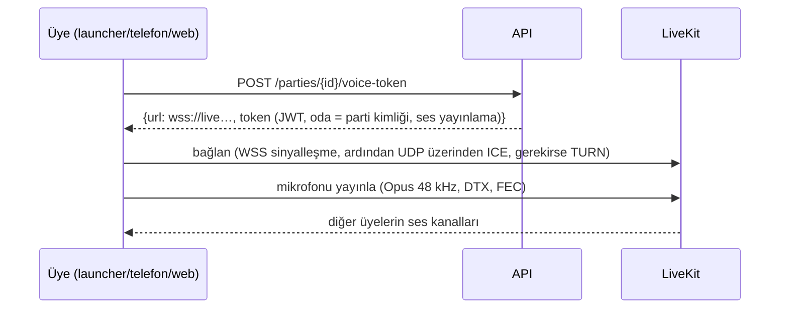
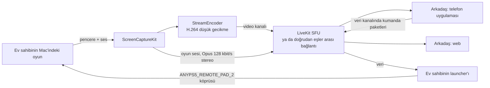

# 6. Anlık iletişim, ses ve birlikte oynama

İhtiyaçları birbirinden farklı üç tür "canlı" iletişim:

| | Çevrimiçi durumu, sohbet, bildirimler | Ses | Share play |
|---|---|---|---|
| Taşıyan | Kendi WebSocket gateway'imiz | LiveKit (WebRTC, Opus) | LiveKit ya da doğrudan WebRTC (H.264 video, Opus ses, veri kanalı) |
| Önemli olan gecikme | ~1 sn yeterli | < 200 ms ağızdan kulağa gecikme | < 120 ms ekrandan ekrana gecikme, < 80 ms girdi gidiş-dönüş süresi |
| Kaybolan veri | kaybolmamalı (önce resume, sonra REST) | gizlenir ve devam edilir | bir sonraki anahtar kareye atlanır; kumanda paketleri saniyede 120 kez gönderilir, birinin kaybolması önemli değildir |
| Cloudflare üzerinden | evet | hayır (UDP) | hayır (UDP) |

## 6.1 Gateway

- Giriş yapmış her istemci için bir WebSocket (launcher, her telefon; her tarayıcı sekmesi ise
  `SharedWorker` üzerinden tek bir soketi paylaşır).
- **Kimlik doğrulama** ilk çerçevede yapılır; gateway JWT'yi doğrular, ardından bağlantıyı
  kullanıcının `user:<id>` Valkey kanalına abone eder.
- **Dağıtım (fan-out)**: API her alıcı için `user:<recipient>` kanalına bir olay yayımlar. Her
  gateway süreci, kendisine bağlı kullanıcıların kanallarını dinler. Kullanıcı başına bir Valkey
  stream'i, `resume` için son 5 dakikayı tutar.
- **Çevrimiçi durumu**: her 25 sn'de bir gelen heartbeat'ler istemcinin durumunu taşır. Gateway
  kullanıcının cihazlarını birleştirir (`in_game` > `online` > `away`), `presence:<user>` anahtarını
  60 sn süreyle yazar ve birleşik durum değiştiğinde bunu görmeye yetkili her arkadaşa
  `presence.updated` yayımlar.
- **Geri basınç (backpressure)**: soketini 30 sn boyunca okumayan istemcinin bağlantısı kesilir;
  istemci yeniden bağlanır ve kaldığı yerden devam eder.
- **Ölçekleme**: gateway'ler durumsuzdur; bağlantıları Cloudflare dağıtır; her süreç on binlerce
  boşta soketi taşıyabilir.

## 6.2 Partilerde ses

- **Codec**: Opus, mono, 48 kHz, 24-32 kbit/s; bant içi FEC (~%10 kayba dayanır) ve DTX (sessizlik
  neredeyse hiç bant genişliği harcamaz) ile.
- **İstemcide işleme**: yankı giderme, gürültü bastırma, otomatik kazanç. macOS ve iOS'ta Apple'ın
  voice processing I/O birimi (FaceTime'ın kullandığının aynısı); Android ve web'de WebRTC'nin kendi
  işlemesi. İsteğe bağlı: ileride RNNoise tarzı daha güçlü gürültü bastırma.
- **Oyunun kendi sesi** hiçbir zaman sesli sohbete karışmaz: launcher yalnızca mikrofonu yakalar.
  Hoparlörden dinleyen kullanıcı yankı gidermeye güvenir; kulaklık daha iyidir ve launcher bunu ilk
  seferde söyler.
- **Konuşma göstergesi**: avatarlardaki halkayı LiveKit'in aktif konuşmacı olayları yönetir.
- **Bas-konuş**: launcher genel bir kısayol kaydeder (bugünkü ⌥F12 klip kısayolu gibi, Carbon hot
  key), varsayılanı `⌥V`; telefonda ise parti kartındaki bir düğme.
- **Kulaklık olarak telefon**: launcher eşleşmiş telefona (zaten var olan yerel bağlantı üzerinden)
  "sesi sen taşı" der; telefon LiveKit odasına kendisi katılır, launcher odadan ayrılır. Telefon
  kumanda verisini şimdiki gibi göndermeye devam eder.
- Parti kartında gösterilen **kalite değerleri**: LiveKit'e gidiş-dönüş süresi, paket kaybı, jitter.

## 6.3 Share play (birlikte oynama)

Bu bölüm, Remote Play'in yerel ağ için kurduğu altyapıyı (0.2.12) yeniden kullanır:

| Zaten var olan (yerel) | Share play (internet) |
|---|---|
| `RemotePlay.swift`: ScreenCaptureKit oyun penceresini ve sesini verir | aynı yakalama |
| `StreamEncoder`: H.264, düşük gecikmeli bit hızı kontrolü, kare yeniden sıralama yok, istek üzerine anahtar kare | aynı encoder; kareleri önceden kodlanmış H.264 olarak WebRTC'ye verilir (LiveKit'in Swift SDK'sı özel kodlanmış kareleri kabul eder; olmazsa WebRTC içinde birebir aynı ayarlanmış bir VideoToolbox H.264 encoder'ı) |
| `StreamPacket`: UDP üzerinden ≤1200 baytlık parçalar | WebRTC üzerinden SRTP içinde RTP |
| Telefonun `FrameAssembler`'ı, MediaCodec / VideoToolbox decoder'ları | izleyicideki WebRTC decoder'ları (telefon uygulamasında LiveKit Flutter, web'de tarayıcı, launcher'da LiveKit Swift) |
| Kumanda: launcher'a UDP ile giden 80 baytlık girdi paketleri, uzak kumanda köprüsüne | aynı 80 baytlık paketler LiveKit veri kanalında (kayıplı mod), boş bir köprüye |
| Bir kare kaybolduğunda `keyFrame` isteği | WebRTC'nin PLI/FIR'ı (picture loss indication), encoder tarafından işlenir |

**Başlatma**: ev sahibi Share play'e basar; API ev sahibine video yayınlayabilen bir token,
izleyicilere de abone olabilen token'lar verir. Launcher yakalamayı başlatır (ekran kaydı izni,
Remote Play ve Klipler'in kullandığı izinle aynıdır) ve iki kanal yayımlar: `game-video`
(H.264) ve `game-audio` (Opus stereo 128 kbit/s, müzik kalitesinde, ses işleme yok).

**Görüntü**: varsayılan olarak 1280x720, 60 fps, 6-10 Mbit/s; encoder WebRTC'nin bant genişliği
tahminini (GCC/TWCC) izler: önce bit hızını anında değiştirir, tahmin düşük kalmaya devam ederse
çözünürlüğü (960x540) ya da kare hızını (30) düşürür. Anahtar kareler yalnızca istek üzerine (PLI)
ve ayrıca her 4 sn'de bir gönderilir.

**Önce doğrudan bağlantı**: tek izleyici varsa istemciler önce doğrudan bir WebRTC bağlantısı dener
(STUN ile ICE; çoğu ev ağı buna izin verir). ICE 3 sn içinde başarısız olursa SFU'ya, onun da
arkasında TURN'e geçilir. Doğrudan bağlantı bir sıçramayı (çoğu zaman 10-30 ms) ve bizim bant
genişliğimizi tasarruf eder.

**Birlikte oynamak**: ev sahibi bir izleyiciye kumanda yuvası verir (`POST /share-play/controller`).
İzleyicinin istemcisi kumanda durumunu, telefonun bugün gönderdiği 80 baytlık paketin aynısı olarak,
`pad` veri kanalında kayıplı modda (sırasız, yeniden gönderim yok) saniyede 120 kez ve her
değişiklikte anında gönderir. Ev sahibinin launcher'ı yalnızca yuvayı elinde tutan katılımcıdan
gelen paketleri kabul eder (katılımcı kimliği oda token'ı tarafından belirlendiği için taklit
edilemez) ve bunları o yuvanın uzak kumanda köprüsüne yazar. Oyun bunu bir DualSense daha olarak
görür; gecikme rozeti, bugün olduğu gibi paketin zaman damgasıyla ölçülen gidiş-dönüş süresini gösterir.

**1. oyuncunun kontrolünü devralmak**: aynı akış, yuva 1 ile; ev sahibinin kendi kumandası, ev
sahibi o kumandadaki PS tuşuna basana kadar yok sayılır; bu tuşa basmak 1. oyuncuyu anında geri alır.

**Ölçülen hedefler**

| Ölçüt | Hedef | Nasıl ölçülür |
|---|---|---|
| Ekrandan ekrana gecikme | < 120 ms (≤ 1000 km), < 180 ms (aynı kıta) | bir test karesine gömülen ve izleyici tarafından okunan zaman damgası |
| Girdi gidiş-dönüş süresi | < 80 ms (≤ 1000 km) | kumanda paketinin `sentMicros` değerinin oyunun çıkış paketinde geri yansıtılması (bugün zaten var) |
| Açılış | Share play'den sonra ilk kare < 2 sn | loglar |
| Toparlanma | bir kayıp patlamasından sonra görüntü < 500 ms içinde geri gelir | PLI'dan bir sonraki anahtar kareye |

## 6.4 NAT, TURN ve portlar

- Genel adresleri keşfetmek için LiveKit ve `turn.` üzerinde STUN.
- Önce UDP 3478 üzerinden TURN, UDP'yi engelleyen ağlar (kurumsal, bazı mobil ağlar) için 5349
  üzerinden TLS.
- Sunucu güvenlik duvarında LiveKit medya portları UDP 50000-60000 açık; yedek olarak TCP 7881.
- TURN kimlik bilgileri kısa ömürlüdür (oda token'ıyla birlikte verilir), asla sabit değildir.

## 6.5 Hata durumunda davranış

| Ne bozulur | Kullanıcı ne görür |
|---|---|
| Gateway | Mesajlar ve çevrimiçi durumu duraklar; launcher arkadaşlar panelinde "Yeniden bağlanıyor" gösterir; oyun etkilenmez; bağlantı dönünce resume boşluğu doldurur |
| LiveKit | Ses "Ses kesildi, yeniden bağlanıyor" kartıyla düşer; LiveKit SDK'ları kendiliğinden yeniden bağlanır |
| Share play ağı çok zayıf | Görüntü kalitesi kademeli düşer; 10 sn boyunca 1.5 Mbit/s'nin altında kalırsa izleyici "Bağlantı çok zayıf" uyarısı alır ve yalnızca ses devam eder |
| Ev sahibinin oyunu biter | Share play herkes için durur, parti devam eder |
