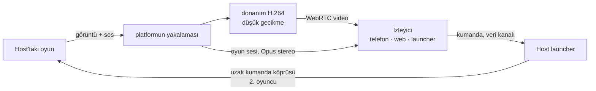

# 6. Anlık iletişim, ses ve birlikte oynama

## 6.1 Neyi kim taşıyor

| | Çevrimiçi durumu, mesajlar, bildirimler | Ses | Share play (birlikte oynama) | Arkadaşın kumandası |
|---|---|---|---|---|
| Yol | istemci ↔ kendi gateway'imiz (WSS) | **oyuncu ↔ oyuncu** (WebRTC) | **host → izleyiciler** (WebRTC) | **izleyici → host** (WebRTC veri kanalı) |
| Sunucunun rolü | taşır ve saklar | tarafları tanıştırır (sinyalleşme), yalnızca doğrudan bağlantı kurulamazsa relay (aktarma sunucusu) üzerinden aktarır | aynı | aynı |
| Önemli olan gecikme | ~1 sn | < 200 ms ağızdan kulağa gecikme | < 120 ms ekrandan ekrana gecikme | < 80 ms gidiş-dönüş |
| Kaybolan veri | asla kaybolmaz (önce resume, sonra REST) | gizlenir (Opus FEC) | bir sonraki anahtar kareye atlanır | önemsenmez: saniyede 120 kez gönderilir |
| Şifreleme | sunucuya kadar TLS | DTLS-SRTP, oyuncular arasında uçtan uca | DTLS-SRTP | DTLS (SCTP) |

## 6.2 İki oyuncuyu birbirine bağlamak (ICE)

"Aralarında tünel kurma" işini WebRTC'nin ICE mekanizması üstlenir:

1. Her taraf **adayları** toplar: kendi yerel adresleri, STUN sunucumuzun
   (`anytogether-relay.kodla.agency:3478`) gördüğü genel adresi ve TURN sunucumuzdaki bir relay adresi.
2. Adaylar gateway üzerinden sinyalleşme mesajları olarak karşılıklı iletilir.
3. ICE çiftleri en iyisinden başlayarak dener: aynı ağ (yerel adresler), ardından internet üzerinden
   doğrudan bağlantı (iki yönlendirici de giden paketlerle açılır: NAT delme (hole punching)) ve
   ancak başka hiçbir yol işe yaramazsa TURN relay'i.
4. Seçilen yol şifrelenir (DTLS); relay üzerinden geçse bile yalnızca şifreli paketler aktarılır.

Beklenen tablo: aynı ağdaki bağlantılar ve ev bağlantılarının çoğu doğrudan kurulur; simetrik NAT'lar
(bazı mobil operatörler, ofis ağları) ve UDP'yi engelleyen ağlar relay'i kullanır; UDP üzerinden ya da
son çare olarak 5349 numaralı porttan TLS üzerinden. İstemci hangi yolun kullanıldığını raporlar;
böylece ne kadar relay kapasitesine ihtiyacımız olduğunu biliriz.

**Gizlilik seçeneği**: doğrudan bağlantı, her oyuncunun IP adresini karşı tarafa gösterir. Görüşmelerin
yalnızca arkadaşlar arasında yapılabilmesi bunu çoğu kişi için kabul edilebilir kılar; "Her zaman relay
kullan" ayarı ise biraz gecikme pahasına IP adresini gizler (bkz. [Güvenlik](08-guvenlik-gizlilik.md)).

## 6.3 Gateway üzerinden sinyalleşme

İki istemci arasındaki, gateway'in aktardığı ve asla saklanmayan mesajlar:

```json
{ "op": "signal", "to": "<user id>", "device": "<device id or *>", "call": "<call id>",
  "kind": "offer | answer | candidate | bye | renegotiate", "data": { … } }
```

- Görüşmeyi API oluşturur (`POST /api/v1/calls`), aranan kişinin aranabilir olduğunu (arkadaş,
  parti üyesi, engellenmemiş) kontrol eder ve TURN kimlik bilgilerini döndürür.
- Gateway, `signal` mesajlarını yalnızca o görüşmenin üyeleri arasında iletir.
- Aranan kişinin birden çok cihazında çalan bir görüşme, biri yanıtladığında diğerlerinde çalmayı bırakır.

## 6.4 Partilerde ses

- **Eşten eşe (P2P) ağ (mesh)**: her üye diğer her üyeye bağlanır (en fazla 8 kişilik bir partide her
  üye sesini 7 kişiye gönderir ≈ 0.2 Mbit/s yükleme; hangi bağlantı olursa olsun önemsiz bir yük).
- **Opus**, mono, 48 kHz, 24-32 kbit/s, bant içi FEC (~%10 kayba dayanır), DTX (sessizlik neredeyse
  hiç bant genişliği harcamaz).
- **İşleme**: yankı giderme, gürültü bastırma ve otomatik kazanç platform tarafından yapılır: macOS/iOS'ta
  Apple'ın ses işleme altyapısı, Windows, Linux, Android ve web'de WebRTC'nin kendi işlemcisi.
- **Oyunun sesi asla gönderilmez**: yalnızca mikrofon. İlk kullanımda kulaklık önerilir.
- **Bas-konuş**: launcher'da genel bir kısayol tuşu (macOS'ta varsayılan `⌥V`, Windows/Linux'ta
  `Ctrl+Alt+V`), telefonda bir düğme.
- **Kulaklık olarak telefon**: launcher, eşleştirilmiş telefona (bugün zaten var olan yerel bağlantı
  üzerinden) sesi taşımasını söyler; telefon görüşmeye kendisi katılır ve kumanda olmayı sürdürür.
- **Konuşma halkası**: gelen her ses kanalının seviyesinden hesaplanır.
- Bir partide bir gün 8'den fazla konuşan üyeye ihtiyaç duyulursa, görüşmeyi isteğe bağlı bir SFU
  devralır (ileride).

## 6.5 Share play

Remote Play'in yerel ağ için kurduğu altyapıyı yeniden kullanır:

| Bugünkü Remote Play (macOS launcher, yerel ağ) | Share play (her launcher, internet üzerinden) |
|---|---|
| ScreenCaptureKit: oyun penceresi ve sesi | platformun yakalama altyapısı: ScreenCaptureKit (macOS), Windows.Graphics.Capture + WASAPI loopback (Windows), xdg-desktop-portal üzerinden PipeWire (Linux) |
| `StreamEncoder`: H.264, düşük gecikmeli bit hızı denetimi, kare yeniden sıralaması yok | aynı ayarlarla platformun donanım kodlayıcısı: VideoToolbox (macOS), Media Foundation / NVENC / AMF / Quick Sync (Windows), VA-API / NVENC (Linux); WebRTC'ye H.264 olarak verilir |
| Telefona UDP ile ≤1200 baytlık parçalar | host ile izleyici arasında doğrudan, SRTP üzerinden RTP |
| Bir kare kaybolduğunda `keyFrame` isteği | WebRTC'nin görüntü kaybı bildirimi (PLI) |
| Kumanda: uzak kumanda köprüsüne 80 baytlık paketler | aynı 80 baytlık paketler bir veri kanalı üzerinden, aynı köprüye |



**Görüntü**: 1280x720, 60 fps, 5-10 Mbit/s; WebRTC'nin bant genişliği tahminini izler: önce bit hızını
anında değiştirir, tahmin düşük kalmaya devam ederse çözünürlüğü ya da kare hızını düşürür. Anahtar
kareler PLI geldiğinde ve her 4 sn'de bir. **Ses**: Opus stereo 128 kbit/s, ses işleme yok.

**İzleyiciler**: yaygın durum tek izleyicidir. İki ya da üç izleyici, host'un her izleyici için ayrı bir
akış yüklemesi demektir (her biri ≈ 8 Mbit/s): launcher host'un tahmini yükleme hızını gösterir ve
birden çok izleyici için 540p/30 fps önerir. Çok sayıda izleyici, ileride isteğe bağlı SFU'nun devreye
gireceği noktadır.

**Birlikte oynamak**: host bir izleyiciye bir kumanda yuvası verir. İzleyicinin istemcisi, telefonun bugün
gönderdiği 80 baytlık kumanda paketinin aynısını `pad` adlı bir veri kanalında (sırasız, yeniden
gönderimsiz) saniyede 120 kez ve her değişiklikte anında gönderir. Host'un launcher'ı paketleri yalnızca
yuvayı tutan eşten kabul eder (eşin kimliği görüşme tarafından doğrulandığı için taklit edilemez) ve onları
o yuvanın uzak kumanda köprüsüne yazar; oyun bir DualSense daha görür. 1. oyuncunun kontrolünü devralmak da
aynı şekilde 1. yuvayla yapılır; host'un PS düğmesi kontrolü anında geri alır. Gidiş-dönüş süresi, telefonun
bugün yaptığı gibi, paketin zaman damgasının oyunun çıkış paketinde geri yansıtılmasıyla ölçülür.

**Hedefler**

| Ölçüt | Hedef |
|---|---|
| Ekrandan ekrana gecikme | ~1000 km içinde doğrudan bağlantıda < 120 ms; relay üzerinden < 160 ms |
| Kumanda gidiş-dönüş süresi | ~1000 km içinde < 80 ms |
| İlk görüntü | Share play'e basıldıktan sonra < 2 sn |
| Ani kayıp sonrası toparlanma | < 500 ms |

## 6.6 Gateway

- Giriş yapmış her istemci için bir WebSocket (tarayıcı sekmeleri tek bir soketi `SharedWorker`
  üzerinden paylaşır).
- Kimlik doğrulama ilk çerçevede yapılır; ardından bağlantı kullanıcının Valkey kanalını dinler.
- **Çevrimiçi durumu**: her 25 sn'de bir heartbeat; cihazlar birleştirilir (`in_game` > `online` > `away`);
  60 sn süreyle Valkey'e yazılır; değişiklikler bunu görmeye yetkili arkadaşlara yayımlanır.
- **Resume**: kullanıcı başına son 5 dakikanın olayları bir Valkey stream'inde tutulur; yeniden bağlanan
  istemci kaçırdıklarını alır; daha eski boşluklar REST ile doldurulur.
- Durumsuzdur; Cloudflare ve reverse proxy WebSocket'leri geçirir; birden çok süreç yan yana çalışabilir.

## 6.7 İleride: oyunların kendisi için çevrimiçi oyun

Ses, share play ve share play üzerinden arkadaşın kumandası, oyunun kendi çevrimiçi moduna ihtiyaç duymaz.
Gerçek çevrimiçi çok oyunculu oyun, yani iki oyuncunun oyunu kendi makinesinde çalıştırdığı ve oyunun diğer
kopyayla PlayStation Network üzerindeymiş gibi konuştuğu senaryo, motorun oyunun ağ çağrılarını launcher'a
devretmesini gerektirir; launcher da bunları aynı türden bir doğrudan bağlantıyla (WebRTC veri kanalları ya
da QUIC), yedek olarak aynı relay'le, diğer oyuncuya taşır. Bu, bu planın üzerine gelen bir motor işidir ve
AnyPlay kendi fork'u için tam olarak böyle bir köprü tasarlıyor; bkz. [Açık sorular](11-acik-sorular.md).

## 6.8 Hata durumunda davranış

| Ne bozulursa | Kullanıcı ne görür |
|---|---|
| Gateway | mesajlar ve çevrimiçi durumu duraklar (arkadaşlar panelinde "Yeniden bağlanılıyor"); zaten bağlı olan görüşmeler **devam eder** (doğrudan oldukları için); gateway geri geldiğinde resume aradaki boşluğu doldurur |
| Doğrudan yol kopar (ağ değişikliği) | ICE yeniden başlar, gerekirse relay üzerinden; sesteki kesintiler bir saniyenin altında kalır |
| Relay'e ulaşılamıyor ve doğrudan yol yok | nedeniyle birlikte "<arkadaş> ile bağlantı kurulamadı"; başka hiçbir şey etkilenmez |
| Share play için ağ çok zayıf | görüntü kalitesi kademeli olarak düşer; 10 sn boyunca 1.5 Mbit/s'nin altında kalırsa izleyici yalnızca sesi alır |
| Host'un oyunu biter | share play durur, parti devam eder |
