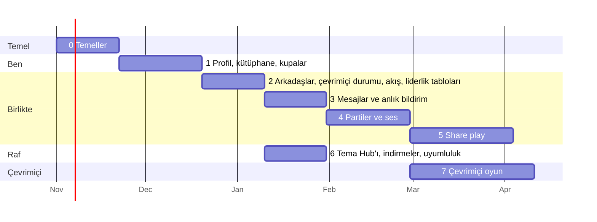

# 10. Yol haritası

Her aşama insanların kullanabileceği bir şey çıkarır; bu, oturana kadar launcher'da bir anahtarın
arkasında durur. "Bitti", "kod yazıldı" demek değildir; listesindeki her kontrolün geçmesi demektir.

## Nerede duruyor (2026-10-25)

Kod herkese açık ve MIT lisanslı:
[github.com/utkuhalis/AnyTogether](https://github.com/utkuhalis/AnyTogether). "Sürümde", AnyPS5-ARM
0.2.15'te (macOS launcher'ı), telefon uygulaması 1.11.0'da ya da AnyPS5 Desktop 0.1.1'de (Windows ve
Linux) demektir; web sitesi yapıldıkça yayına girer.

| Aşama | Durum |
|---|---|
| 0 Temeller | **büyük ölçüde yapıldı.** Depo, API, gateway, web sitesi, CI. E-posta kodu ya da bağlantısıyla giriş, passkey'ler (web), telefondan devir, cihaz kodu; Apple, Google ve Discord API'de doğrulanıyor. Her istemci giriş yapıyor (sürümde). Kalanlar: istemcilerde sağlayıcı düğmeleri, OpenAPI belgesi, staging, R2'ye yedekler, yasal sayfalar. |
| 1 Profil, kütüphane, kupalar | **büyük ölçüde yapıldı.** Profiller, kullanıcı adları, avatarlar, gizlilik; katalog, oturumlar, kütüphane, kupa setleri, nadirlik; iki launcher da oynama süresini ve kupaları gönderiyor ve profilleri gösteriyor; telefon profilini düzenliyor; web profilleri. Kalanlar: vitrin, profil teması, avatar denetimi, launcher'ın kendi kupa ekranında tarih ve nadirlik, Open Graph görselleri. |
| 2 Arkadaşlar, çevrimiçi durumu, akış, liderlik tabloları | **yapıldı**: her yerde arkadaşlar ve çevrimiçi durumu; web'de, macOS launcher'ında ve telefonda tepkili aktivite akışı ve liderlik tabloları; web'de oyuncu bulma (oyuncu arama panosu, herkese açık partiler ve share play'ler, keşif, oyun hub'ları). Kalanlar: QR kodları, yorumlar, aylık ve haftalık tablolar, AnyPS5 Desktop'ta akış ve tablolar, uygulamalarda oyuncu bulma. |
| 3 Mesajlar ve anlık bildirim | metin için grupları ve yazıyor göstergesiyle, her yerde **yapıldı**; her yerde zil simgesiyle bildirimler, tarayıcı push'u ve e-posta özeti. Kalanlar: görseller, mesajlara tepkiler, telefona push. |
| 4 Partiler ve ses | **yapıldı**: web'de, iki launcher'da ve telefonda partiler, herkese açık partiler, parti sesi ve susturmalı birebir çağrılar; iki launcher'da bas-konuş; relay desteği; oyun oturumlarıyla **arkadaşın oyununa katılma** (iki launcher). Kalanlar: parti sohbeti, kulaklık olarak telefon, görüşme kalitesi raporları. |
| 5 Share play | **yapıldı**: macOS launcher'ı yayın açıyor; izleyiciler web'de, telefonda ve macOS launcher'ında; host 2-4. kumandaları veriyor ve 1. oyuncuyu kendinde tutuyor; herkese açık listeleme ve "Şu an canlı". Kalanlar: AnyPS5 Desktop'ta yayın açma ve izleme, gerçek ağlarda ölçülmüş ekrandan ekrana gecikme, kalite raporları. |
| 6 Tema Hub'ı, indirmeler, uyumluluk | **yapıldı**: Tema Hub'ı (macOS launcher'ı ve web; eski launcher'lar eski dizin üzerinden), indirme sayfası ve sürümler API'si, macOS launcher'ından ve web'den gelen raporlarla uyumluluk listesi. Kalanlar: profil temaları, AnyPS5 Desktop tarafı, kumanda düzenleri ve ön ayarlar. |
| 7 Çevrimiçi oyun | **tasarım aşamasında**: AnyPS5-ARM'ın `online-play` branch'inde motor köprüsü; sunucuda oyuncu özellikleri, sinyalleşme ve relay kimlik bilgileriyle oyun oturumları yapıldı. |
| Kendi sunucunu kurmak | **yapıldı**: Docker Compose ve bir kurulum rehberi; her istemci başka bir sunucuya yönlendirilebilir. |
| Moderasyon | **yapıldı**: kişiler, mesajlar, temalar ve ilanlar hakkında şikâyetler; yönetim sayfası ve komut satırı aracı; bir güvenlik incelemesinin düzeltmeleri (bkz. [Güvenlik](08-guvenlik-gizlilik.md)). |
| Windows ve Linux | [AnyPS5 Desktop](https://github.com/utkuhalis/AnyPS5-Desktop) 0.1.1 (erken önizleme): kurulum paketleri, motor kendini indiriyor; AnyTogether'ın girişi, arkadaşlar, mesajlar, partiler ve ses, eşitleme, profiller ve arkadaşın oyununa katılma. |

Test: her istemci tek bir gerçek kuruluma karşı (`e2e/`): giriş, arkadaşlar, mesajlar, partiler,
çağrılar, eşitleme ve oyun oturumları 2026-10-24'te geçti (bkz. [İstemciler](07-istemciler.md) 7.0).

## Plan

İş başlamadan önce yapılan ilk plan (sıra geçerli kaldı; 0-6 arası aşamalar bu tarihlerin çok
önünde yapıldı):

Tarihler; sunucu, macOS launcher ve telefon uygulaması üzerinde Claude ile çalışan tek bir
geliştirici için yol göstericidir; Windows/Linux launcher'ını AnyPS5-Desktop aynı API ve protokollere
göre kendisi bağlar. 6. aşama 3-5 ile paralel yürüyebilir.

## Aşama 0: Temeller (≈3 hafta)

**Çıkanlar**: depo, sunucu, tek dokunuşla giriş ve oturumu açık tüm launcher'lar.

- AnyTogether monorepo'su (apps/api, realtime, worker, web; packages/shared, db), CI, staging.
- Sunucumuzda: uygulamalar (web, api, realtime, worker), PostgreSQL ve Valkey,
  bellek sınırları, R2'ye yedekler, `anytogether.kodla.agency` üzerinde `/api` ve `/rt` yolları.
- Giriş: Apple, Google, Discord (OpenID Connect + PKCE), e-posta kodları, passkey'ler, telefona
  devretme, cihaz kodu yedeği; ilk giriş hesabı oluşturur; oturumlar; refresh rotasyonu.
- hello, heartbeat ve resume destekli realtime gateway (üzerinde henüz özellik yok).
- macOS launcher: `TogetherClient`, `TogetherAuth`, `TogetherSocket`, Ayarlar → AnyTogether →
  Apple / Google / Discord / telefon / e-posta ile devam et, üst çubukta oturum açık rozeti.
- OpenAPI belgesi ve gateway protokolü sürümlü olarak yayımlanır; böylece her launcher (ilk olarak
  AnyPS5-Desktop) bizim yardımımız olmadan bağlanabilir. Kodun kendisi de herkese açık.
- macOS launcher sürüm derlemeleri Developer ID ile imzalanır ve notarize edilir.
- Web sitesi: "Coming soon"un yerini alan açılış sayfası, tek dokunuşla giriş, `/link`, ayarlar,
  gizlilik sayfaları.

**Bitti sayılması için**
- [ ] Yeni bir kullanıcı launcher'da "Google ile devam et"e dokunur ve tek dokunuşta hesabı
      oluşturulmuş olarak giriş yapar (tarayıcıda Google'a zaten giriş yapmışken); web'de
      çıkış yapmak launcher'ın da oturumunu 5 s içinde kapatır.
- [x] Oturumu açık telefon, launcher'a tek dokunuşla giriş yaptırır.
- [ ] Yayımlanan OpenAPI belgesi doğrulanır ve çalışan API ile örtüşür (CI).
- [ ] Sunucuya ulaşamayan bir launcher, AnyTogether'dan önce nasıl davranıyorsa tam olarak öyle
      davranır (otomatik test).
- [ ] Yedekler staging'e geri yüklenir; geri yükleme testi yeşil.
- [x] Refresh token'ın yeniden kullanılması oturumu iptal eder (test).

## Aşama 1: Profil, oyun kütüphanesi, kupalar (≈4 hafta)

**Çıkanlar**: oyuncu kartın, oyunların ve kupaların çevrimiçi.

- Profiller, kullanıcı adları, avatarlar (R2 + worker ile yeniden boyutlandırma + çıplaklık
  denetimi), vitrin, gizlilik ayarları.
- Oyun kataloğu, oturumlar (launcher `SessionRecorder` + outbox), oynama süreli kütüphane.
- Kupa setleri ve kazanılan kupalar (launcher `TrophySync`), nadirlik işi, puanlar.
- Launcher: profil katmanı, kupa ekranında ve bildirim bandında tarih ve nadirlik, tüm
  bilgisayarlardan toplanan oynama süresi. Telefon: profil kartı. Web: `/u/<handle>`, Open Graph
  görselli oyun ve kupa sayfaları.

**Bitti sayılması için**
- [ ] Silksong'u 10 dakika oynayıp bir kupa kazanmak, ikisini de 30 s içinde web profilinde
      gösterir; çevrimdışıyken, launcher yeniden bağlandıktan sonra bir kez görünürler.
- [ ] Tek hesaptaki iki bilgisayar (bir Mac ve bir Windows PC) oynama süresini doğru toplar.
- [ ] Bir kupanın nadirliği, staging verisinde elle yapılan sayımla eşleşir.
- [x] Gizli kupalar, onları kazanmamış kullanıcılara gizli kalır (test).

## Aşama 2: Arkadaşlar, çevrimiçi durumu, aktivite akışı, liderlik tabloları (≈3 hafta)

- Arkadaşlık istekleri (kullanıcı adı, QR), engellemeler, oyunlarla birlikte çevrimiçi durumu,
  gruplamalı akış, beğeniler ve yorumlar, liderlik tabloları (oyun başına arkadaşlar ve genel).
- Launcher: Arkadaşlar paneli, çevrimiçi sayısı, akış paneli, oyun sayfasında "oynayan
  arkadaşlar". Telefon: Arkadaşlar ve Akış sekmeleri. Web: arkadaşlar, akış, liderlik tabloları.

**Bitti sayılması için**
- [ ] Bir oyunu başlatmak, bir arkadaşın launcher'ında 3 s içinde "X oynuyor" gösterir; oyunu
      kapatmak en geç 60 s içinde (süre dolumu), genellikle anında yansır.
- [x] "Hiç kimse" yapılan çevrimiçi durumu ve engellemeler çevrimiçi durumunu tamamen gizler (test).
- [x] Bir saat içindeki beş kupa için akış tek bir gruplanmış öğe gösterir (test).

## Aşama 3: Mesajlar ve anlık bildirim (≈3 hafta)

- Birebir ve grup sohbetleri, ekler, okundu durumu, yazıyor göstergesi, şikâyetler.
- Telefon için anlık bildirim (APNs, FCM); launcher'da oyundan odağı çalmayan bildirim balonları.

**Bitti sayılması için**
- [ ] Web'den gönderilen bir mesaj launcher'a 1 s'nin altında, kilitli bir telefona da anlık
      bildirim olarak 5 s'nin altında ulaşır.
- [x] Gönderim ortasında ağı kesip yeniden göndermek hiçbir zaman mesajı çoğaltmaz (test).
- [x] Okunmamış sayıları bütün kapılarda tutarlıdır (istemciler arası test koşusu).

## Aşama 4: Partiler ve ses (≈4 hafta)

- Sunucuda coturn (`anytogether-relay.kodla.agency`; 3478 ve 5349 portları ile relay (aktarma
  sunucusu) aralığı Utku'nun onayıyla açılır); gateway üzerinden görüşmeler ve sinyalleşme; her
  launcher'da (macOS'ta WebRTC framework'ü; Windows/Linux portunda kendi WebRTC kütüphanesi), telefonda
  (`flutter_webrtc`) ve web'de eşten eşe (P2P) ses; bas-konuş; kulaklık olarak telefon; parti
  sohbeti; oyun sürümü ve motor derlemesi kontrol edilerek oyun oturumlarıyla arkadaşın oyununa katılma.

**Bitti sayılması için**
- [ ] Beş kişi (Mac, Windows PC, Linux, iPhone, tarayıcı) 30 dakika boyunca kopmadan konuşur;
      Türkiye/Avrupa içinde ağızdan kulağa gecikme 200 ms'nin altındadır (ölçülmüş).
- [ ] Görüşmelerin çoğu doğrudan bağlanır; kalite raporları relay gereken
      oranı gösterir.
- [ ] Önde bir oyun açıkken ses devam eder; parti katmanı kimin konuştuğunu gösterir.
- [ ] UDP'yi engelleyen bir ağın arkasındaki kullanıcı TURN/TLS üzerinden katılır.
- [x] Bir arkadaş yayıncının oyununa yalnızca aynı oyun sürümü ve motor derlemesiyle katılır (test).

## Aşama 5: Share play (birlikte oynama, ≈5 hafta)

- İzleyiciler host'un oyununu görür ve duyar; host en fazla üçüne 2., 3. ya da 4. oyuncu olarak bir
  kumanda verebilir ve istediği an geri alabilir. Host'un 1. oyuncusu asla devredilmez.
- Her launcher ev sahipliği yapar: macOS, Remote Play'in yakalaması ve WebRTC'nin H.264'üyle (yapıldı),
  Windows ve Linux kendi yakalama ve donanım kodlayıcılarıyla (planlandı); her izleyiciye doğrudan,
  gerekirse relay üzerinden; izleyiciler telefonda, web'de, herhangi bir launcher'da; kalite
  kademeleri; bağlantı iki tarafa da gösterilir.

**Bitti sayılması için**
- [ ] 500 km uzaktaki bir arkadaş 720p60'ı 120 ms'nin altında (medyan) ekrandan ekrana gecikmeyle
      izler; hem ev sahibi bir Mac iken hem de ev sahibi bir Windows PC iken.
- [x] Bir izleyicinin kumandası ev sahibinin oyununa yalnızca host oynamasına izin verdiği sürece
      ulaşır, asla 1. oyuncu olarak değil (test).
- [ ] Zayıf bir ağ, 500 ms'den uzun donmadan kaliteyi düşürür.

## Aşama 6: Tema Hub'ı, indirmeler, uyumluluk (≈3 hafta, 3-5 ile paralel)

- Launcher'dan tema yükleme, şikâyetlerden sonra inceleme, beğeniler, sürümler; launcher'ın Temalar
  ekranı API'den okur (GitHub klasörü yedek olarak kalır); profil temaları (planlandı).
- En son GitHub sürümlerinden, sağlama toplamlarıyla İndirmeler sayfası; `GET /releases/latest`.
- Uyumluluk raporları (isteğe bağlı) ve listede, oyun hub'larında ve launcher'ın oyun bilgisinde
  değerlendirmeler.
- Sonra aynı rafta: telefon kol düzenleri, oyun başına ön ayarlar, paylaşılan shader önbellekleri.

**Bitti sayılması için**
- [x] Launcher'dan paylaşılan bir tema başka bir kullanıcı tarafından hemen kurulabilir (kontrolleri
      geçtiğinde yayımlanır).
- [ ] İndirmeler GitHub sürümleriyle bayt bayt eşleşir (CI'da sağlama toplamı testi).
- [ ] Uyumluluk raporlarını kapatınca hiçbir şey gönderilmez (test).

## Aşama 7: Çevrimiçi oyun (tasarım aşamasında)

Her oyuncu oyunu kendi bilgisayarında çalıştırır ve kopyalar, PlayStation Network üzerindeymiş gibi,
AnyTogether üzerinden birlikte oynar. Tasarım: AnyPS5-ARM'ın `online-play` branch'inde
[ONLINE_PLAY.md](https://github.com/utkuhalis/AnyPS5-ARM/blob/online-play/docs/dev/ONLINE_PLAY.md);
özeti [Anlık iletişim](06-anlik-ses-birlikte-oynama.md) 6.7'de.

- Motor: kimliği doğrulanmış loopback köprüsü, gözlem günlüğü, giriş durumu ve Plus kontrolleri, web
  API aktarımı, sanal adreslerde datagram trafiği (yapıldı, sahte bir launcher'a karşı test edildi);
  push olayları, oturum sinyalleşmesi, akışlar, katılma intent'leri (planlandı).
- Launcher: köprünün diğer ucu, oyun oturumlarına eşlenen `anyps5` API grubu, ilk eş bağlantısı (paket
  başına HMAC ile düz UDP), varsayılan olarak kapalı (branch'te yapıldı); relay ile WebRTC veri
  kanalları ya da QUIC (planlandı).
- AnyTogether: sürüm korumalı oyun oturumları, her oyuncunun özellikleri, oyuncular arası
  sinyalleşme ve relay kimlik bilgileri (yapıldı); bir oturum anahtarı (planlandı).

**Bitti sayılması için**
- [ ] Yalnızca platform servisleri üzerine kurulu bir oyunun iki kopyası önce tek bir Mac'te, sonra
      aynı ağdaki iki Mac'te, sonra relay üzerinden iki ayrı ağda birlikte oynar.
- [ ] Farklı bir oyun sürümü ya da motor derlemesi iki tarafta da nedeniyle reddedilir.
- [ ] Hiçbir şey Sony'ye gitmez ya da bir yayıncının sunucularının yerine geçmez (gözlem
      günlüklerinin incelenmesi).

## Sonrası

- Uçtan uca şifreli birebir mesajlar ve ses; telefon uygulamasının App Store / Play
  Store sürümleri; liderlik tablolarında turnuvalar ve meydan okumalar; bir SFU
  üzerinden çok sayıda izleyiciye share play; topluluk araçları için açık bir API.
