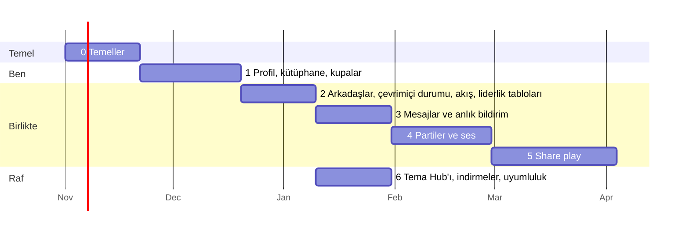

# 10. Yol haritası

Her aşama insanların kullanabileceği bir şey çıkarır; bu özellik oturana kadar launcher'da bir
anahtarın arkasında durur. "Bitti", "kod yazıldı" demek değildir; listesindeki her kontrolün
geçmesi demektir.

Tarihler, Claude ile çalışan tek bir geliştirici için yol göstericidir; 6. aşama 3-5 ile paralel
yürüyebilir.

## Aşama 0: Temeller (≈3 hafta)

**Çıkanlar**: depo, sunucu, giriş sistemi ve oturum açılmış launcher.

- AnyTogether monorepo'su (apps/api, realtime, worker, web; packages/shared, db), CI, staging.
- Docker Compose ile kurulmuş sunucu, Cloudflare DNS ve sertifikaları, yedekler, Uptime Kuma.
- Hesaplar: doğrulamalı e-posta/parola, Sign in with Apple, Discord; oturumlar; yenileme token'ı
  rotasyonu; web'deki `/link` sayfasıyla cihaz bağlama (RFC 8628).
- Hello, heartbeat ve resume destekli realtime gateway (henüz üzerinde özellik yok).
- Launcher: `TogetherClient`, `TogetherAuth`, `TogetherSocket`, Ayarlar → AnyTogether →
  Giriş yap (kod + QR), üst çubukta oturum açık rozeti.
- Web sitesi: "Coming soon" yerine gelen açılış sayfası, kayıt/giriş, `/link`, ayarlar, gizlilik
  sayfaları.

**Bitti sayılması için**
- [ ] Yeni bir kullanıcı web'de kaydolur, launcher'da kodla oturum açar ve launcher'da adını
      görür; web'de çıkış yapınca launcher'daki oturum 5 s içinde kapanır.
- [ ] Sunucuya ulaşılamadığında launcher tam olarak 0.2.12 gibi davranır (otomatik test).
- [ ] Yedekler staging'e geri yüklenebiliyor; geri yükleme testi yeşil.
- [ ] Yenileme token'ının yeniden kullanılması oturumu iptal ediyor (test).

## Aşama 1: Profil, oyun kütüphanesi, kupalar (≈4 hafta)

**Çıkanlar**: oyuncu kartın, oyunların ve kupaların çevrimiçi.

- Profiller, kullanıcı adları, avatarlar (R2 + worker'da yeniden boyutlandırma + çıplaklık
  kontrolü), vitrin, gizlilik ayarları.
- Oyun kataloğu, oturumlar (launcher `SessionRecorder` + outbox), oynama süreli kütüphane.
- Kupa setleri ve kazanılan kupalar (launcher `TrophySync`), nadirlik işi, puanlar.
- Launcher: profil katmanı, kupa ekranında ve banner'da tarihler ve nadirlik, tüm Mac'lerden
  toplanan oynama süresi. Telefon: profil kartı. Web: Open Graph görselli `/u/<handle>`, oyunlar
  ve kupalar sayfaları.

**Bitti sayılması için**
- [ ] Silksong'u 10 dakika oynayıp bir kupa kazanınca ikisi de 30 s içinde web profilinde
      görünür; çevrimdışıyken kazanılanlar launcher yeniden bağlandığında bir kez görünür.
- [ ] Aynı hesaptaki iki Mac'in oynama süreleri doğru toplanır.
- [ ] Bir kupanın nadirliği staging verisindeki elle sayımla örtüşür.
- [ ] Gizli kupalar, onları kazanmamış kullanıcılara gizli kalır.

## Aşama 2: Arkadaşlar, çevrimiçi durumu, aktivite akışı, liderlik tabloları (≈3 hafta)

- Arkadaşlık istekleri (kullanıcı adı, QR), engellemeler, oyun bilgili çevrimiçi durumu,
  gruplamalı akış, beğeniler ve yorumlar, liderlik tabloları (arkadaşlar ve genel, oyun başına).
- Launcher: Arkadaşlar paneli, çevrimiçi sayısı, akış paneli, oyun sayfasında "oynayan
  arkadaşlar". Telefon: Arkadaşlar ve Akış sekmeleri. Web: arkadaşlar, akış, liderlik tabloları.

**Bitti sayılması için**
- [ ] Bir oyun başlatıldığında arkadaşın launcher'ında 3 s içinde "X oynuyor" görünür; oyun
      kapatıldığında bu en geç 60 s içinde (süre dolumu) ve genellikle anında kalkar.
- [ ] "Çevrimdışı görün" ve engellemeler çevrimiçi durumunu tamamen gizler (test).
- [ ] Bir saatte kazanılan beş kupa için akışta tek bir gruplanmış öğe görünür.

## Aşama 3: Mesajlar ve anlık bildirimler (≈3 hafta)

- Birebir ve grup sohbetleri, ekler, okundu durumu, yazıyor göstergesi, şikâyetler.
- Telefon için anlık bildirim (APNs, FCM); launcher'da oyundan odağı çalmayan bildirim balonları.

**Bitti sayılması için**
- [ ] Web'den gönderilen bir mesaj launcher'a 1 s'nin altında, kilitli bir telefona da anlık
      bildirim olarak 5 s'nin altında ulaşır.
- [ ] Gönderim sırasında ağ kesilip mesaj yeniden gönderildiğinde mesaj asla çoğalmaz (test).
- [ ] Okunmamış sayıları üç kapıda da aynıdır.

## Aşama 4: Partiler ve ses (≈4 hafta)

- Sunucuda LiveKit ve TURN; parti yaşam döngüsü; oda token'ları; launcher (Swift SDK), telefon
  (Flutter SDK) ve web'de ses; bas-konuş; kulaklık olarak telefon; parti sohbeti; "Aynı oyunu
  oyna".

**Bitti sayılması için**
- [ ] Dört kişi (Mac, iPhone, Android, tarayıcı) 30 dakika boyunca kopma olmadan konuşur;
      Türkiye/Avrupa içinde ağızdan kulağa gecikme 200 ms'nin altındadır (ölçülmüş).
- [ ] Önde bir oyun açıkken ses devam eder; parti katmanı kimin konuştuğunu gösterir.
- [ ] UDP'yi engelleyen bir ağdaki kullanıcı TURN/TLS üzerinden katılabilir.

## Aşama 5: Share play (≈5 hafta)

- Launcher, `RemotePlay` yakalamasını ve `StreamEncoder` karelerini LiveKit'e yayınlar; önce
  doğrudan eşler arası bağlantı denenir; telefon, web ve launcher'da izleyiciler; data channel
  üzerinden uzak bir kol köprüsüne kol girdisi; 1. oyuncunun kontrolünü devralmak; kalite
  basamakları; gecikme rozeti.

**Bitti sayılması için**
- [ ] 500 km uzaktaki bir arkadaş 720p60'ı 120 ms'nin altında (medyan) ekrandan ekrana gecikmeyle
      izler ve 80 ms'nin altında girdi gidiş-dönüş süresiyle 2. oyuncu olarak oynar.
- [ ] Ev sahibi PS tuşuyla 1. oyuncuyu anında geri alır.
- [ ] Zayıf bir ağda kalite, 500 ms'den uzun donma olmadan düşürülür.

## Aşama 6: Tema Hub'ı, indirmeler, uyumluluk (≈3 hafta, 3-5 ile paralel)

- Studio'dan tema yükleme, moderasyon kuyruğu, beğeniler, sürümler; launcher'ın Temalar ekranı
  API'den okur (GitHub klasörü yedek olarak kalır); profil temaları.
- Yansılanmış sürümler ve checksum'larla İndirmeler sayfası; `GET /releases/latest`.
- Uyumluluk raporları (isteğe bağlı katılım) ve oyun sayfalarında ve launcher'ın kütüphanesinde
  uyumluluk değerlendirmeleri.
- Aynı rafta daha sonra: telefon kol düzenleri, oyuna özel ön ayarlar, paylaşılan shader
  önbellekleri.

**Bitti sayılması için**
- [ ] Studio'da yapılan bir tema, onaylandıktan 1 dakika sonra başka bir kullanıcı tarafından
      kurulabilir.
- [ ] İndirmeler GitHub sürümleriyle bayt bayt aynıdır (CI'da checksum testi).
- [ ] Uyumluluk raporları kapatıldığında hiçbir şey gönderilmez (test).

## Sonrası

- Passkey'ler; uçtan uca şifreli birebir mesajlar ve ses; telefon uygulamasının App Store / Play
  Store sürümleri; liderlik tablolarında turnuvalar ve meydan okumalar; arkadaşların
  arkadaşlarına açık share play izleme; topluluk araçları için herkese açık bir API.
