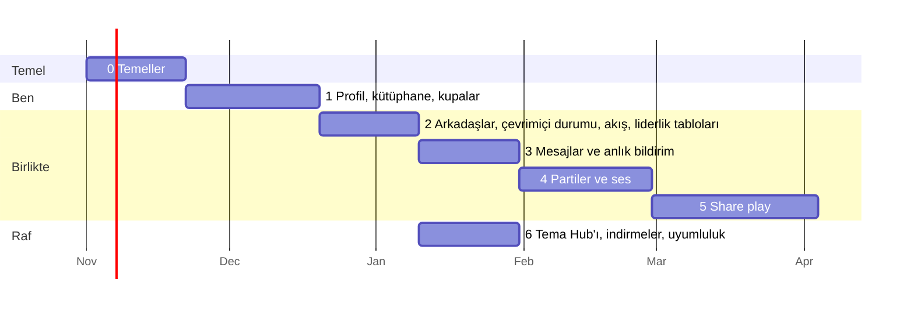

# 10. Yol haritası

Her aşama insanların kullanabileceği bir şey çıkarır; bu, oturana kadar launcher'da bir anahtarın
arkasında durur. "Bitti", "kod yazıldı" demek değildir; listesindeki her kontrolün geçmesi demektir.

Tarihler; sunucu, macOS launcher ve telefon uygulaması üzerinde Claude ile çalışan tek bir
geliştirici için yol göstericidir; Windows/Linux launcher'ının geliştiricisi, o launcher'ı portlama
sırasında yayımlanan API belgesine ve protokollere göre bağlar.
6. aşama 3-5 ile paralel yürüyebilir.

## Aşama 0: Temeller (≈3 hafta)

**Çıkanlar**: depo, sunucu, tek dokunuşla giriş ve oturumu açık tüm launcher'lar.

- AnyTogether monorepo'su (apps/api, realtime, worker, web; packages/shared, db), CI, staging.
- Sunucumuzda: uygulamalar (web, api, realtime, worker), PostgreSQL ve Valkey,
  bellek sınırları, R2'ye yedekler, `anytogether.kodla.agency` üzerinde `/api` ve `/rt` yolları.
- Giriş: Apple, Google, Discord (OpenID Connect + PKCE), e-posta kodları, telefona devretme, cihaz
  kodu yedeği; ilk giriş hesabı oluşturur; oturumlar; refresh rotasyonu.
- hello, heartbeat ve resume destekli realtime gateway (üzerinde henüz özellik yok).
- macOS launcher: `TogetherClient`, `TogetherAuth`, `TogetherSocket`, Ayarlar → AnyTogether →
  Apple / Google / Discord / telefon / e-posta ile devam et, üst çubukta oturum açık rozeti.
- OpenAPI belgesi ve gateway protokolü sürümlü olarak yayımlanır; böylece her launcher (ilk olarak
  Windows/Linux portu) bizim yardımımız olmadan bağlanabilir.
- macOS launcher sürüm derlemeleri Developer ID ile imzalanır ve notarize edilir.
- Web sitesi: "Coming soon"un yerini alan açılış sayfası, tek dokunuşla giriş, `/link`, ayarlar,
  gizlilik sayfaları.

**Bitti sayılması için**
- [ ] Yeni bir kullanıcı launcher'da "Google ile devam et"e dokunur ve tek dokunuşta hesabı
      oluşturulmuş olarak giriş yapar (tarayıcıda Google'a zaten giriş yapmışken); web'de
      çıkış yapmak launcher'ın da oturumunu 5 s içinde kapatır.
- [ ] Oturumu açık telefon, launcher'a tek dokunuşla giriş yaptırır.
- [ ] Yayımlanan OpenAPI belgesi doğrulanır ve çalışan API ile örtüşür (CI).
- [ ] Sunucuya ulaşamayan bir launcher, AnyTogether'dan önce nasıl davranıyorsa tam olarak öyle
      davranır (otomatik test).
- [ ] Yedekler staging'e geri yüklenir; geri yükleme testi yeşil.
- [ ] Refresh token'ın yeniden kullanılması oturumu iptal eder (test).

## Aşama 1: Profil, oyun kütüphanesi, kupalar (≈4 hafta)

**Çıkanlar**: oyuncu kartın, oyunların ve kupaların çevrimiçi.

- Profiller, kullanıcı adları, avatarlar (R2 + worker ile yeniden boyutlandırma + çıplaklık
  denetimi), vitrin, gizlilik ayarları.
- Oyun kataloğu, oturumlar (launcher `SessionRecorder` + outbox), oynama süreli kütüphane.
- Kupa setleri ve kazanılan kupalar (launcher `TrophySync`), nadirlik işi, puanlar.
- Launcher: profil katmanı, kupa ekranında ve bildirim bandında tarih ve nadirlik, tüm
  bilgisayarlardan toplanan oynama süresi. Telefon: profil kartı. Web: `/u/<handle>`, Open Graph
  görselli oyun ve kupa sayfaları.

**Bitti sayılması için**
- [ ] Silksong'u 10 dakika oynayıp bir kupa kazanmak, ikisini de 30 s içinde web profilinde
      gösterir; çevrimdışıyken, launcher yeniden bağlandıktan sonra bir kez görünürler.
- [ ] Tek hesaptaki iki bilgisayar (bir Mac ve bir Windows PC) oynama süresini doğru toplar.
- [ ] Bir kupanın nadirliği, staging verisinde elle yapılan sayımla eşleşir.
- [ ] Gizli kupalar, onları kazanmamış kullanıcılara gizli kalır.

## Aşama 2: Arkadaşlar, çevrimiçi durumu, aktivite akışı, liderlik tabloları (≈3 hafta)

- Arkadaşlık istekleri (kullanıcı adı, QR), engellemeler, oyunlarla birlikte çevrimiçi durumu,
  gruplamalı akış, beğeniler ve yorumlar, liderlik tabloları (oyun başına arkadaşlar ve genel).
- Launcher: Arkadaşlar paneli, çevrimiçi sayısı, akış paneli, oyun sayfasında "oynayan
  arkadaşlar". Telefon: Arkadaşlar ve Akış sekmeleri. Web: arkadaşlar, akış, liderlik tabloları.

**Bitti sayılması için**
- [ ] Bir oyunu başlatmak, bir arkadaşın launcher'ında 3 s içinde "X oynuyor" gösterir; oyunu
      kapatmak en geç 60 s içinde (süre dolumu), genellikle anında yansır.
- [ ] "Çevrimdışı görün" ve engellemeler çevrimiçi durumunu tamamen gizler (test).
- [ ] Bir saat içindeki beş kupa için akış tek bir gruplanmış öğe gösterir.

## Aşama 3: Mesajlar ve anlık bildirim (≈3 hafta)

- Birebir ve grup sohbetleri, ekler, okundu durumu, yazıyor göstergesi, şikâyetler.
- Telefon için anlık bildirim (APNs, FCM); launcher'da oyundan odağı çalmayan bildirim balonları.

**Bitti sayılması için**
- [ ] Web'den gönderilen bir mesaj launcher'a 1 s'nin altında, kilitli bir telefona da anlık
      bildirim olarak 5 s'nin altında ulaşır.
- [ ] Gönderim ortasında ağı kesip yeniden göndermek hiçbir zaman mesajı çoğaltmaz (test).
- [ ] Okunmamış sayıları üç kapının hepsinde tutarlıdır.

## Aşama 4: Partiler ve ses (≈4 hafta)

- Sunucuda coturn (`anytogether-relay.kodla.agency`; 3478 ve 5349 portları ile relay (aktarma
  sunucusu) aralığı Utku'nun onayıyla açılır); gateway üzerinden görüşmeler ve sinyalleşme; her
  launcher'da (macOS'ta WebRTC framework'ü; Windows/Linux portunda kendi WebRTC kütüphanesi), telefonda
  (`flutter_webrtc`) ve web'de eşten eşe (P2P) ses; bas-konuş; kulaklık olarak telefon; parti
  sohbeti; "Aynı oyunu oyna".

**Bitti sayılması için**
- [ ] Beş kişi (Mac, Windows PC, Linux, iPhone, tarayıcı) 30 dakika boyunca kopmadan konuşur;
      Türkiye/Avrupa içinde ağızdan kulağa gecikme 200 ms'nin altındadır (ölçülmüş).
- [ ] Görüşmelerin çoğu doğrudan bağlanır; kalite raporları relay gereken
      oranı gösterir.
- [ ] Önde bir oyun açıkken ses devam eder; parti katmanı kimin konuştuğunu gösterir.
- [ ] UDP'yi engelleyen bir ağın arkasındaki kullanıcı TURN/TLS üzerinden katılır.

## Aşama 5: Share play (birlikte oynama, ≈5 hafta)

- Her launcher ev sahipliği yapar: macOS `RemotePlay`'in yakalaması ve düşük gecikmeli H.264 ile,
  Windows ve Linux kendi yakalama ve donanım kodlayıcılarıyla; her izleyiciye doğrudan, gerekirse
  relay üzerinden; izleyiciler telefonda, web'de, herhangi bir launcher'da; kol, data channel
  üzerinden uzak kol köprüsüne; 1. oyuncunun kontrolünü devralmak; kalite kademeleri; gecikme
  rozeti.

**Bitti sayılması için**
- [ ] 500 km uzaktaki bir arkadaş 720p60'ı 120 ms'nin altında (medyan) ekrandan ekrana gecikmeyle
      izler ve 80 ms'nin altında girdi gidiş-dönüşüyle 2. oyuncu olarak oynar; hem ev sahibi bir
      Mac iken hem de ev sahibi bir Windows PC iken.
- [ ] Ev sahibi PS ile 1. oyuncuyu anında geri alır.
- [ ] Zayıf bir ağ, 500 ms'den uzun donmadan kaliteyi düşürür.

## Aşama 6: Tema Hub'ı, indirmeler, uyumluluk (≈3 hafta, 3-5 ile paralel)

- Studio'dan tema yükleme, moderasyon kuyruğu, beğeniler, sürümler; launcher'ın Temalar ekranı
  API'den okur (GitHub klasörü yedek olarak kalır); profil temaları.
- Yansılanmış sürümler ve sağlama toplamlarıyla İndirmeler sayfası; `GET /releases/latest`.
- Uyumluluk raporları (isteğe bağlı) ve oyun sayfalarında ve launcher'ın kütüphanesinde
  değerlendirmeler.
- Sonra aynı rafta: telefon kol düzenleri, oyun başına ön ayarlar, paylaşılan shader önbellekleri.

**Bitti sayılması için**
- [ ] Studio'da yapılan bir tema, onaylandıktan 1 dakika sonra başka bir kullanıcı tarafından
      kurulabilir.
- [ ] İndirmeler GitHub sürümleriyle bayt bayt eşleşir (CI'da sağlama toplamı testi).
- [ ] Uyumluluk raporlarını kapatınca hiçbir şey gönderilmez (test).

## Sonrası

- Passkey'ler; uçtan uca şifreli birebir mesajlar ve ses; telefon uygulamasının App Store / Play
  Store sürümleri; liderlik tablolarında turnuvalar ve meydan okumalar; arkadaşların
  arkadaşları için herkese açık share play'i izleme; topluluk araçları için açık bir API.
