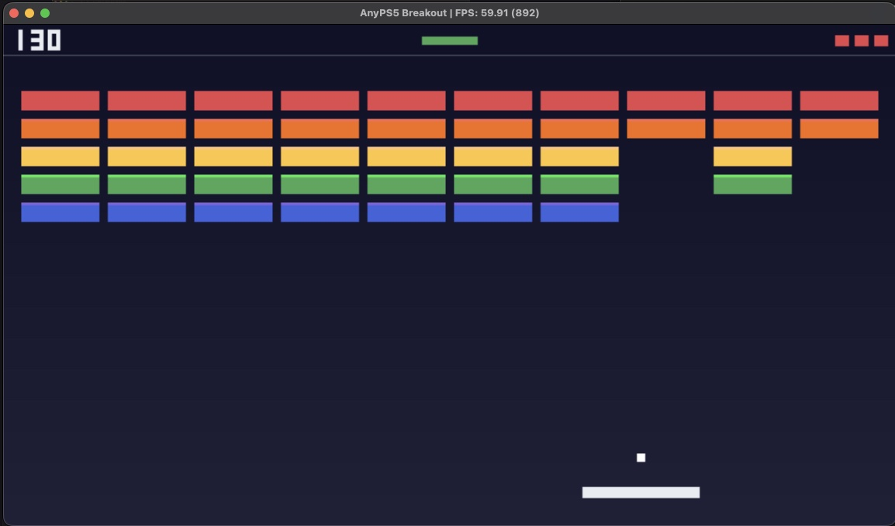
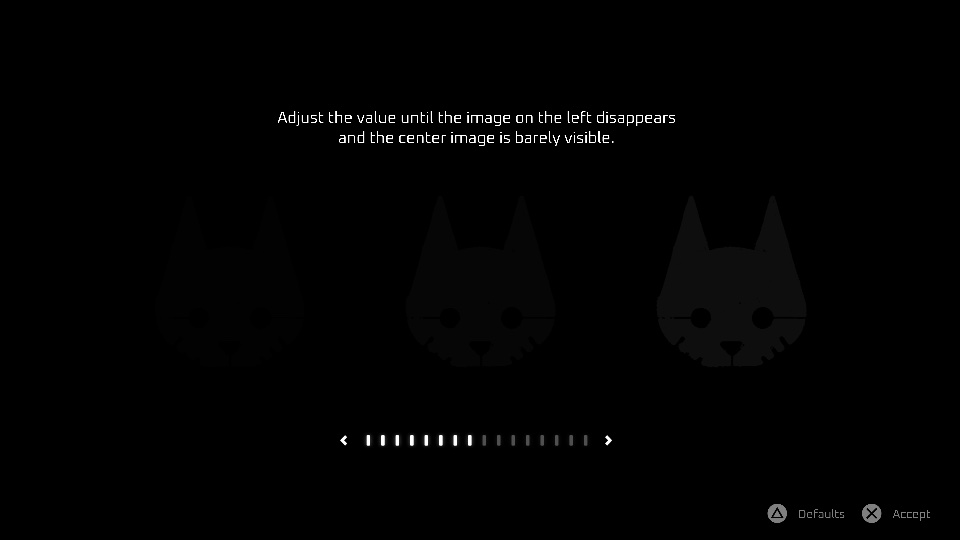
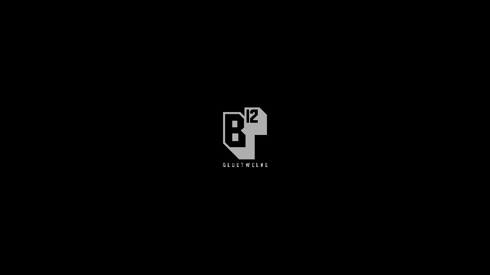
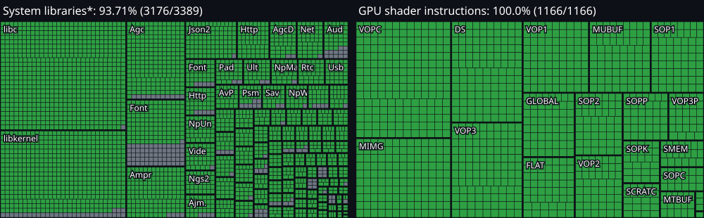
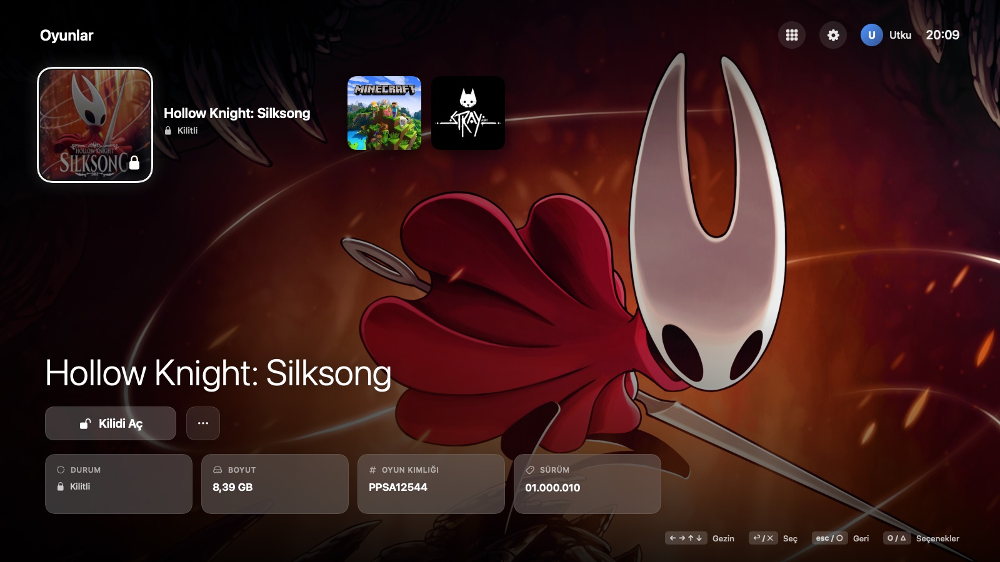

# AnyPS5-ARM guide

[English](#english) · [Türkçe](#türkçe)

---

## English

### Games that run

| Dreaming Sarah | AnyPS5 Breakout | Stray (WIP) |
|---|---|---|
|  |  |  |
| PPSA02929 · 60 fps, playable | Test title · 60 fps, video, pad and audio | PPSA02100 · Unreal Engine 4 · about 1 fps, **work in progress** |

All three run on a MacBook Pro M3 Pro with macOS 26.6.2.

#### Dreaming Sarah

The menu and gameplay run at 60 fps (about 18 fps before the macOS write watch).

| Main menu | Opening scene |
|---|---|
|  |  |

#### Stray: work in progress

Stray is the first Unreal Engine 4 title to render on macOS here. It boots through the studio logo to the brightness setup screen at about 10 fps, and past it into loading. Getting there took these fixes:

- larger shader image and sampler heaps
- a SPIR-V loop shape that MoltenVK's shader translator turned into an infinite loop and a GPU hang
- depth and stencil surfaces read as storage images
- draws the Metal backend cannot run (geometry shaders, the depth bounds test) skipped instead of stopping the game
- the guest's own `libc.prx` bound before the host libraries, write-watch fixes, a smaller SPIR-V output that the Metal compiler can build, and relaxed float semantics on MoltenVK

It runs with the default settings now. A few letters of its font are missing (glyphs the GPU adds to the font atlas later), and it still stops on the loading after the brightness screen.

| Studio logo | Brightness setup |
|---|---|
|  |  |

### Compatibility

The [compatibility list](COMPATIBILITY.md) has every game tested on macOS, its status and its frame rate. Players' own reports, for macOS, Windows and Linux, are on the [community compatibility list](https://anytogether.net/compatibility) (see [How did it run?](#anytogether)).

### Status

[](../progress/badge-libraries.svg) [](../progress/badge-shaders.svg)

[](../progress/progress.svg)

<sub>* System libraries: the share of the functions the project knows so far (declared in [core/libs/prx](../../core/libs/prx)) that are implemented, not of every PS5 system function. GPU shader instructions: the share of the RDNA instructions the shader recompiler translates. Regenerate them with `python3 tools/progress.py <directory>` and copy the three SVG files to `docs/progress/`.</sub>

| Check | Result |
|---|---|
| Guest fixtures (TLS, exceptions, threads, modules) | 10 of 10 pass |
| Test suite on MoltenVK | 477 of 484 pass |

Measured with Vulkan SDK 1.4.363.0. The 7 failing tests hit Apple GPU or Metal limits, such as 64-bit buffer atomics and 32 KiB threadgroup memory. [MACOS_PORT.md](../dev/MACOS_PORT.md) lists them, along with every change this fork makes.

### The AnyPS5 app

**AnyPS5.app** is a launcher laid out like the PS5 home screen. It finds the game dumps in a folder, unlocks (converts) them for the Mac and starts them: no Terminal, no build, no Vulkan SDK.

<p><a href="https://github.com/AnyTogether/AnyPS5-ARM/releases/latest/download/AnyPS5-macOS.zip"><b>⬇ Download AnyPS5 for macOS</b></a> · Apple silicon · macOS 14+</p>

**Install.** The quickest way is one line in Terminal; a download through `curl` is not quarantined, so macOS opens the app without any "cannot be opened" warning:

```sh
curl -fsSL https://github.com/AnyTogether/AnyPS5-ARM/releases/latest/download/install.sh | sh
```

With the zip from the [latest release](https://github.com/AnyTogether/AnyPS5-ARM/releases/latest) instead, the app is not notarized, so macOS blocks it the first time: open **System Settings → Privacy & Security** and click **Open Anyway**. If it then runs from the read-only copy macOS makes of downloaded apps, the launcher offers to move itself to Applications and reopen from there.

**First start.** Pick the language, one of four animated themes (Cosmic, Aurora, Sunset, Glass) and the folder that holds your PS5 dumps. Subfolders are scanned, and games added later show up on their own.

**Unlocking.** A game that has not been converted yet shows a lock. **Unlock** opens its `eboot.bin` and modules even when they are still SELF containers, relinks them for macOS and makes the game app, with a PS5-style progress bar. The game files are APFS clones of the dump, so an unlocked game takes no extra space. A dump that is still encrypted is reported instead of converted.

**Playing.** **Play** starts the game. **⋯** (or `O` / △) opens its settings: output resolution (for titles with a resolution patch, such as Stray), window or full screen, window size, vertical sync, the performance overlay, the game's language, **Controls**, and Show in Finder, the log, clearing the shader cache, unlocking again or removing the installation.

**Updates and add-ons (DLC).** Put the dumps of a game's update and add-ons next to the game, in the same layout shadPS4 uses:

```
Games/
  PPSA01234/                              the game
  PPSA01234-UPDATE/                       its update (PPSA01234-patch works too)
  PPSA01234-DLC/
    EXPANSION0000001/                     one folder per add-on, named by its label
    UP0000-PPSA01234_00-COSTUMEPACK00002/ or by its content ID
  UP0000-PPSA01234_00-SOUNDTRACK000003/   an add-on can also sit next to the game, named by its content ID
```

The game's folder name or its title ID goes before `-UPDATE`, `-patch` and `-DLC`, in any case. An add-on's label is the last part of its content ID, which comes from its `sce_sys/param.json` or from the folder name. The game's page shows **DLC (n)** with their names, and **Update v01.004 applied** once the game is unlocked with it. An update dumped after the unlock says **unlock to apply**, because the update's `eboot.bin` and modules have to be converted again (saves and trophies stay). The engine then reads the update's files in place of the game's and mounts each add-on the game asks for. Only the add-ons that are on the disk are reported to the game: nothing you did not dump is unlocked, and nothing is asked of PlayStation servers.

**Game Presets.** **Settings → Game Presets** sets, once for every game, what the PS5 keeps under the same name: the difficulty, Performance Mode or Resolution Mode, inverting the vertical and horizontal view for first-person and third-person games, subtitles and the audio language. Games that read the console's presets start with them; a game that keeps its own settings uses those once you change them in it, and games that do not ask ignore them. Each profile has its own, kept in `~/Library/Application Support/AnyPS5/Profiles/<profile>/GamePresets.json`; they reach the game as `ANYPS5_GAME_PRESETS` ([format](USAGE.md#game-presets)).

**Controls.** The keyboard and mouse layout for each game. Pick a pad button or stick direction, then press the key you want for it; Esc cancels. A key you give to one button leaves the button that had it, and mouse buttons stay where they were. The default layout:

| Pad | Keys |
|-----|------|
| Left stick | W A S D |
| ✕ / □ / ○ / △ | K (also Space, Return) / J (also left click) / L / I |
| L1 / R1 | Q / E |
| L2 / R2 | U (also mouse button 4) / O (also right click) |
| L3 / R3 | Shift / Ctrl |
| D-pad | Arrow keys |
| Right stick | T F G H |
| Options / touchpad | Esc / Backspace and Tab |

The launcher writes the layout to `~/Library/Application Support/AnyPS5/Controls/<game>.ini` at each start and passes it to the game as `ANYPS5_INPUT_CONFIG` ([format](INPUT_MAPPING.md)). A connected game controller keeps its own buttons.

**Trophies.** A game with a trophy list shows a 🏆 button beside **Play** with how many you have earned. It opens the list as the console shows it: the percentage, the count per grade (platinum, gold, silver, bronze), and every trophy with its icon, description and the day you earned it; hidden ones stay hidden until then, and trophies that count something (such as *Acquire all Tools*) show how far you are. The list and texts come from the game's own `sce_sys/trophy2` package, in the game's language when it has it; the engine records each unlock in the installed game's `_trophy` folder. Unlocking a game again keeps its saves and trophies. When a game earns a trophy while you play, a card drops in at the top of the screen, over the game (full screen too), without taking the keyboard or the mouse from it.

**Advanced.** **⋯ → Advanced** holds each game's finer settings: a deadzone for each controller stick; the mouse as the camera (sensitivity, vertical speed, response curve, minimum tilt, maximum speed, smoothing, how soon the camera stops); the keyboard (the tilt while **Slow Movement** is held, how long a key takes to tilt a stick or press a trigger fully); the shader cache; and **Export Settings** / **Import Settings**, which save the game's keys and settings as one file to share. Settings → Advanced picks where F12 screenshots go (`~/Pictures/AnyPS5` by default) and a folder of console system fonts.

**Broadcasting.** The launcher streams the game playing live to Twitch, YouTube or any RTMP / RTMPS server, like the console's Broadcast. Set it up once in **Settings → Broadcasting**: the service (or a custom `rtmp://` / `rtmps://` address), the stream key (typed in a hidden field or pasted from the clipboard), the quality (720p60 at 3 Mbit/s, 1080p30 at 4.5 or 1080p60 at 6), the microphone with its own level, the LIVE badge over the game and the link viewers watch on. While the game plays, **Broadcast <game>** at the top of its **⋯** panel goes live (the phone has **Go Live** too); the panel then shows the time on air, the bit rate, dropped frames, **Copy viewer link** and **Stop broadcast**. Video is H.264 High with a key frame every two seconds, sound AAC 48 kHz stereo at 160 kbit/s; a slow upload drops frames rather than falling behind, and a dropped connection is retried by itself. The key is kept in `~/Library/Application Support/AnyPS5/Broadcast/keys.json` (readable by your user only) instead of the Keychain, which would ask again after every update of the ad hoc signed app.

**When a game stops.** A game that ends on an error gets the reason in plain words on the home screen and in the log: a missing module, an unsupported system function, the GPU stopping or running out of memory, an engine error or a crash. The crash report panel opens by itself, with the reason, the Mac, the engine and the end of the log: **Export Report** saves everything in one file and **Open Issue** opens a pre-filled GitHub issue; your name, email and sign-in tokens are taken out first. **Detailed Logging (Trace)** in the game's options records more for a hard bug. [Troubleshooting](#troubleshooting) has the details.

**Engine versions.** **Settings → Engine** lists the engine builds published with this project's releases, with their date and notes. Select one to download it (it is checked against its checksum, and again before each use), then choose it as the **Default Engine** for every game, or pick an engine for one game in its options; the row also says which engine unlocked the game. **Engine Folder** uses an engine you built yourself. A game unlocked with another engine than the one chosen for it offers **Update and Play**, which unlocks it again with the chosen engine and keeps its saves and trophies. **Delete Unused Engines** removes downloads no game uses.

**Personalizing.** Settings change the theme, the accent color, the background (the theme animation, your own picture or a looping video), the selected game's artwork behind the home screen, animations, interface sounds and the profile name. The **Glass** theme makes the launcher's window see-through: your desktop and the windows behind it show through, blurred under a light tint so the wallpaper's colors glow, with the text on soft dark plates and panels of glass so it reads over any wallpaper (Apple's Liquid Glass on macOS 26, a frosted blur on earlier versions). **Settings → Appearance → Glass Transparency** sets how much shows through (0 % is solid) and **Show Game Art Behind** lays the selected game's artwork over the desktop; in full screen the desktop picture is drawn behind the glass. With **Reduce transparency** on in macOS's Accessibility settings the window and its panels turn solid. **Settings → Appearance → Themes** also lists the themes people share on the Theme Hub (see [AnyTogether](#anytogether)).

The launcher is driven with the arrow keys, Return and Esc, a game controller (D-pad, ✕, ○, △) or the mouse and trackpad.

**Controllers.** **Settings → Controllers** lists the connected pads (DualSense, DualShock 4, Xbox, Switch Pro; the DualShock 3 over USB through the launcher's own reader) with USB or Bluetooth and the battery; the one used last is Player 1. **Test Buttons and Sticks** draws the pad live (hold ○ / B or press Esc to leave), **Test Vibration** shakes it, **Light Bar** colours a DualSense or DualShock 4, **Confirm Button** lets ○ confirm as on Japanese consoles, and **Stick Dead Zone** hides a drifting stick in the launcher and in games without their own. The troubleshooter below says why a pad does not show: the cable, Bluetooth pairing, a pad without a layout, a low battery, Steam's controller support. Crash reports list the controllers.

**PS, Create and shortcuts.** The launcher starts full screen the first time and then as you left it (F11, ⌃⌘F or **Settings → Appearance → Full Screen**). The hints at the bottom show the controller's glyphs while you use a pad and the keys while you use the keyboard or mouse. With a pad, a setting with ‹ › values changes only after ✕ (its value gets a ring; ← → change it, ✕ or ○ finish); ← goes to the categories and L1 / R1 change them. **PS** over a game raises the **quick menu** (Resume, Game Settings, Close Game); held, it asks **Close game?**; held in the launcher it opens **Switch Profile** (coming with profiles) and **Quit AnyPS5**. With **Pause Game When Opening the Menu** on, the launcher first presses Options in the game on player 1, whether a controller, the keyboard or a phone is player 1; the press signs in no other player. **Create** saves the last 30 s, 1, 3 or 5 minutes (Settings → Behaviour → Clips, off by default, kept in memory only; the row shows how much); held, it takes a screenshot, and with clips off a press does. **Settings → Shortcuts** puts Home, Quick Menu, Screenshot, Save Clip, Full Screen and the previous / next section on any key (⌃ ⌥ ⇧ ⌘) and any controller button or chord, pressed or held; a clash is refused, **Reset to Defaults** brings them back, and **Game Buttons** leads to a game's own **Controls**.

| Home | Game settings | Unlocking | Game library |
|---|---|---|---|
|  |  |  |  |

[▶ Watch the launcher in action](../videos/launcher.mp4) (1:39)

### AnyTogether

[AnyTogether](https://anytogether.net) is the launcher's online home: friends, profiles, messages, parties with voice, share play, activity, leaderboards, notifications, the Theme Hub and the community compatibility list. It is optional; signed out, the launcher works exactly as before. The server is open source ([AnyTogether](https://github.com/AnyTogether/AnyTogether), MIT), and **Settings → AnyTogether → Server** points the launcher at one you run yourself.

**Signing in.** **Settings → AnyTogether**: type your email and the code it sends you, approve the launcher on the website (where passkeys work too), or tap once on your phone if the AnyPS5 Remote app is paired and signed in. There is no password and no sign-up form; the first sign-in makes the account.

**Friends, activity, leaderboards and notifications.** The **Friends** panel in the top bar lists your friends with what they are playing, requests, and adding someone by their handle. From it, **Activity** shows what friends unlock and play (trophies, platinums, first plays, long sessions, milestones); react to an item with 🔥 👏 😮 or ❤️. **Leaderboard** ranks trophy points among friends or everyone; a game's options have its own board for points, play time and completion. The bell in the top bar counts unread **notifications** (friend requests, invites, missed calls, messages while you were away) and opens the list; a new one also shows as a small card. You only appear on a global board while your trophies (and, for a game, your library) are public; the board says where you would be otherwise.

**Share play: hosting.** While a game runs, open the **Friends** panel and choose **Share play**. Friends see that you are sharing and can watch: in their browser, on the phone or in their own launcher. Invite friends from the panel, or leave **Friends can walk in** on; **Viewers at most** sets how many can watch (up to 4; from 3 on each gets 540p, since your Mac sends each one a stream). For each viewer choose **Let … play as player 2, 3 or 4**: they play the game with their own pad, as in local co-op. Your own controller stays player 1; a viewer can never take it. You can take a pad back (every button is let go first) or take someone out at any time, and **Stop share play** ends it. Each viewer's line shows whether the connection is direct or through the relay, its round trip and the picture size. macOS asks once for the screen recording permission. Only the game is sent, not the rest of your screen.

**Share play: watching.** In the launcher, **Watch** a friend from the Friends panel or from their invite: their game fills the screen with its sound, and once they let you play, your controller is their player 2, 3 or 4; the PS button leaves. On the phone (AnyPS5 Remote 1.11 or newer), **Watch** is in Friends; when the host hands you a pad, the on-screen pad lies over the picture, with the game's rumble and light bar. In a browser, open the link from the invite or the friend's profile on the website: a controller works (press a button once so the browser sees it), and so does the keyboard (WASD the left stick, the arrow keys the D-pad, I J K L the face buttons, Q / E L1 / R1, Z / C L2 / R2, Return Options).

**Theme Hub.** **Settings → Appearance → Themes** lists the themes people share on AnyTogether's Theme Hub, installed with one press; the website's [Theme Hub](https://anytogether.net/themes) has the same themes, with likes. Signed in, **Share on the Hub** uploads the theme you use (made in the Theme Studio, at most 50 MB); sharing it again sends a new version. `anyps5://theme/<id>` links open a Hub theme in the launcher.

**How did it run?** After you play a game, the launcher may ask **How did *game* run?**: Nothing, Boots, Menus, In game or Playable. One tap sends a report with the launcher and engine versions, the Mac model, macOS and the average frame rate (it shows what goes with it). **Don't ask after games** stops the question; a game's options still have **How does it run?**, with the community's verdict for that game. All reports make the [community compatibility list](https://anytogether.net/compatibility).

### About the project

AnyPS5-ARM is the macOS port of [AnyPS5](https://github.com/boykopovar/AnyPS5). AnyPS5 is not an emulator. Its relinker turns a PS5 executable into a native program, and its system libraries are reimplemented as ordinary shared libraries the program links against. This fork makes that work on Apple silicon:

- **CPU:** the game's x86-64 code runs under **Rosetta 2**. A [native arm64 mode](https://github.com/AnyTogether/AnyPS5-ARM/blob/native-arm64/docs/dev/NATIVE_ARM64.md) that translates the code ahead of time, with no Rosetta, is in development on the `native-arm64` branch.
- **Executable:** the relinker writes a **Mach-O** executable.
- **Graphics:** the PS5 graphics driver runs on **Vulkan through MoltenVK**, which runs on Metal.
- **Distribution:** the result is packaged as a normal **`.app`** you open from Finder.

### Building from source

#### Requirements

- A Mac with Apple silicon (M1 or newer)
- Rosetta 2: `softwareupdate --install-rosetta --agree-to-license`
- Xcode command-line tools: `xcode-select --install`
- CMake and Ninja: `brew install cmake ninja`
- The [Vulkan SDK for macOS](https://vulkan.lunarg.com/sdk/home#mac), which provides the Vulkan loader and MoltenVK
- A **decrypted dump of a game you own**. It needs a plain ELF executable; a signed SELF does not work.

#### 1. Build

```sh
git clone --recursive https://github.com/AnyTogether/AnyPS5-ARM.git
cd AnyPS5-ARM
cmake -S . -B build-mac -G Ninja -DCMAKE_BUILD_TYPE=Release -DCMAKE_OSX_ARCHITECTURES=x86_64
ninja -C build-mac all libs
```

`CMAKE_OSX_ARCHITECTURES=x86_64` is required, because the system libraries have to match the game's x86-64 code. The build produces:

- the relinker at `build-mac/core/relinker/relinker`
- the system libraries in `build-mac/core/libs/libs/`

#### 2. Convert a game

The dump folder holds the executable, its bundled modules and the game's data:

```text
MyGame/
    eboot.bin        decrypted ELF executable
    sce_module/      the game's bundled modules (libc.prx, ...)
    sce_sys/         param.json, icon0.png, ...
    ...              the game's data files
```

Relink the executable for macOS:

```sh
build-mac/core/relinker/relinker --macos --to-rosetta MyGame/eboot.bin out/eboot
```

- `--macos` writes a Mach-O executable.
- `--to-rosetta` rewrites the AMD-only instructions and the ones Rosetta lacks (RDSEED, RDPID, CLWB).
- The converted modules are written to `out/app0/sce_module/`.

#### 3. Package it as an app

```sh
python3 tools/package_macos_app.py \
    --relinked out \
    --game MyGame \
    --libs build-mac/core/libs/libs \
    --vulkan ~/VulkanSDK/<version>/macOS \
    "My Game.app"
```

The bundle contains everything it needs: the game, the system libraries, the Vulkan loader and MoltenVK. Its name and icon come from `sce_sys/param.json` and `icon0.png`. You can move it to `/Applications` and start it from Finder or Launchpad. The app is not signed: if macOS refuses to open it, right-click it and choose **Open** once.

To build AnyPS5.app itself from this build, run `tools/macos/build_launcher_app.sh build-mac ~/VulkanSDK/<version>/macOS dist`. `AnyPS5.app/Contents/MacOS/AnyPS5 --render-preview <folder> <games folder>` draws its screens into PNG files without opening a window.

#### 4. Play

| Keyboard / mouse | PS5 button |
|---|---|
| Arrow keys | D-pad |
| W A S D | Left stick |
| T F G H | Right stick |
| Return or Space | Cross |
| C | Circle |
| I | Triangle |
| Left click | Square |
| Q / E (or Alt) | L1 / R1 |
| Right click | R2 |
| Left Shift / Left Ctrl | L3 / R3 |
| Escape | Options |
| Backspace / Tab | Touchpad left / right |
| F11 | Toggle fullscreen |

Controllers that SDL recognizes, such as DualSense, DualShock and Xbox pads, work automatically. To change the keyboard and mouse bindings, see [INPUT_MAPPING.md](INPUT_MAPPING.md).

#### Troubleshooting

- **Log:** `~/Library/Logs/AnyPS5/<TITLE ID>.log`. When a game stops, the reason is at the end of this file. Unsupported states always end the program with an error message rather than continuing silently.
- **Crash report:** when a game stops on an error or a crash, the launcher offers its report at once; it is also in the game's options under **Last Session's Report**. **Export Report** saves `AnyPS5-<TITLE ID>-<date>.zip` (or `.txt`) with the log, macOS's crash report, the last unlock's output, the Mac, the versions and the game's settings. **Open Issue** shows what will be shared, then opens a filled-in GitHub issue; attach the exported file to it. Your home folder, names, e-mail addresses and AnyTogether tokens are taken out of both.
- **Detailed logging:** the game's options have **Detailed Logging (Trace)** and **Play with Detailed Logging** (once). They start the game with `APS5_LOG_SYNC`, `APS5_LOG_TIMESTAMPS`, `APS5_TRACE_EXIT`, `APS5_TRACE_UNREADABLE`, `APS5_TRACE_MEMORY`, `APS5_SAVEDATA_TRACE`, `APS5_PROFILE_PRESENT` and `MVK_CONFIG_LOG_LEVEL=3`. The game runs slower; a log past 256 MB starts again with the earlier part kept as `<TITLE ID>.trace-1.log`.
- **Shader cache:** `~/Library/Caches/org.anyps5.<title id>/shader_cache`. The first run compiles shaders, so it can stutter; later runs load them from the cache.
- **Performance profile:** start the executable from a terminal with `APS5_PROFILE_DRAW=1`. Every 10 seconds the log gets a `[present]` line with the number of frames drawn and the GPU time per frame.

#### Limitations

- The game's code runs under Rosetta 2. Apple has announced that macOS 27 is the last release with full Rosetta support.
- Games may stop at a function or GPU feature that is not implemented yet. See the [compatibility list](COMPATIBILITY.md).
- MoltenVK has no geometry shaders, mesh shaders, 64-bit atomics or 64-bit floats. Mesh-shader draws run as a compute shader followed by a pass-through vertex shader (`APS5_NO_MESH_EMULATION=1` skips them instead); indirect ones and draws that need geometry shaders are skipped, and shaders that need the others do not run.
- Known costs of the macOS port are listed in [TechnicalDebt.md](../dev/TechnicalDebt.md).

### Documentation

- [macOS port: status and changes](../dev/MACOS_PORT.md)
- [Native arm64 mode: design and plan](https://github.com/AnyTogether/AnyPS5-ARM/blob/native-arm64/docs/dev/NATIVE_ARM64.md)
- [Relinker usage](USAGE.md)
- [Input mapping](INPUT_MAPPING.md)
- [Architecture](../dev/ARCHITECTURE.md)
- [Technical debt](../dev/TechnicalDebt.md)
- [Code conventions](../dev/CONVENTIONS.md)

### Credits

- [boykopovar/AnyPS5](https://github.com/boykopovar/AnyPS5): the relinker, the system libraries and the shader recompiler this fork is built on.
- [mugurc/AnyPS5 `macos-port`](https://github.com/mugurc/AnyPS5/tree/macos-port): the community macOS port that added Mach-O output, merged here.

---

## Türkçe

### Çalışan oyunlar

| Dreaming Sarah | AnyPS5 Breakout | Stray (geliştiriliyor) |
|---|---|---|
|  |  |  |
| PPSA02929 · 60 FPS, oynanabilir | Test oyunu · 60 FPS, görüntü, kol ve ses | PPSA02100 · Unreal Engine 4 · yaklaşık 1 FPS, **üzerinde çalışılıyor** |

Üçü de macOS 26.6.2 çalışan bir MacBook Pro M3 Pro'da çalışıyor.

#### Dreaming Sarah

Menü ve oynanış 60 FPS'te çalışıyor (macOS yazma izleme eklenmeden önce yaklaşık 18 FPS).

| Ana menü | Açılış sahnesi |
|---|---|
|  |  |

#### Stray: üzerinde çalışılıyor

Stray, burada macOS'ta görüntü veren ilk Unreal Engine 4 oyunu. Stüdyo logosundan parlaklık ayar ekranına yaklaşık 10 FPS ile geliyor ve onu geçip yüklemeye giriyor. Bunun için şu düzeltmeler yapıldı:

- daha büyük shader image ve sampler heap'leri
- MoltenVK'nın shader çeviricisinin sonsuz döngüye ve GPU kilitlenmesine çevirdiği bir SPIR-V döngü biçimi
- storage image olarak okunan depth ve stencil yüzeyleri
- Metal'in çalıştıramadığı çizimlerin (geometry shader'lar, depth bounds testi) oyunu durdurmak yerine atlanması
- oyunun kendi `libc.prx`'inin host kütüphanelerinden önce bağlanması, write watch düzeltmeleri, Metal derleyicisinin derleyebildiği daha küçük SPIR-V çıktısı ve MoltenVK'da gevşek float kuralları

Artık varsayılan ayarlarla çalışıyor. Yazı tipinin bazı harfleri eksik (GPU'nun font atlasına sonradan eklediği harfler) ve parlaklık ekranından sonraki yüklemede hâlâ duruyor.

| Stüdyo logosu | Parlaklık ayarı |
|---|---|
|  |  |

### Uyumluluk

[Uyumluluk listesi](COMPATIBILITY.md#türkçe), macOS'ta test edilen her oyunu, durumunu ve FPS'ini gösterir. Oyuncuların macOS, Windows ve Linux için gönderdiği raporlar [topluluk uyumluluk listesinde](https://anytogether.net/compatibility) toplanır (bkz. [Nasıl çalıştı?](#anytogether-1)).

### Durum

[](../progress/badge-libraries.svg) [](../progress/badge-shaders.svg)

[](../progress/progress.svg)

<sub>* Sistem kütüphaneleri: projenin şimdiye kadar bildiği fonksiyonların ([core/libs/prx](../../core/libs/prx) içinde tanımlananlar) ne kadarının yazıldığı; PS5'in bütün sistem fonksiyonlarının değil. GPU shader komutları: shader derleyicisinin çevirebildiği RDNA komutlarının oranı. Yeniden üretmek için `python3 tools/progress.py <klasör>` çalıştırıp üç SVG dosyasını `docs/progress/` klasörüne kopyala.</sub>

| Kontrol | Sonuç |
|---|---|
| Misafir testleri (TLS, istisnalar, thread'ler, modüller) | 10/10 geçiyor |
| MoltenVK üzerinde test paketi | 484 testin 477'si geçiyor |

Ölçümler Vulkan SDK 1.4.363.0 ile yapıldı. Geçmeyen 7 test, Apple GPU'sunun veya Metal'in sınırlarına takılıyor; örneğin 64-bit buffer atomikleri ve 32 KiB threadgroup belleği. [MACOS_PORT.md](../dev/MACOS_PORT.md) bu testleri ve bu fork'un yaptığı tüm değişiklikleri listeler.

### AnyPS5 uygulaması

**AnyPS5.app**, PS5 ana ekranı gibi tasarlanmış bir launcher. Bir klasördeki oyun dump'larını bulur, Mac için kilidini açar (dönüştürür) ve başlatır: Terminal, derleme ya da Vulkan SDK gerekmez.

<p><a href="https://github.com/AnyTogether/AnyPS5-ARM/releases/latest/download/AnyPS5-macOS.zip"><b>⬇ AnyPS5'i indir</b></a> · Apple silicon · macOS 14+</p>

**Kurulum.** En kolayı Terminal'de tek satır. `curl` ile inen dosya karantinaya alınmadığı için macOS uygulamayı "açılamıyor" uyarısı vermeden açar:

```sh
curl -fsSL https://github.com/AnyTogether/AnyPS5-ARM/releases/latest/download/install.sh | sh
```

[Son sürümdeki](https://github.com/AnyTogether/AnyPS5-ARM/releases/latest) zip'i kullanırsan uygulama notarize edilmediği için macOS ilk seferde engeller: **Sistem Ayarları → Gizlilik ve Güvenlik**'te **Yine de Aç**'a tıkla. macOS indirilen uygulamayı salt okunur bir kopyadan açarsa launcher kendini Uygulamalar'a taşıyıp oradan yeniden açmayı önerir.

**İlk açılış.** Dili, dört hareketli temadan birini (Kozmik, Aurora, Gün Batımı, Cam) ve PS5 dump'larının olduğu klasörü seç. Alt klasörler de taranır, sonradan eklenen oyunlar kendiliğinden görünür.

**Kilidi açmak.** Henüz dönüştürülmemiş oyunlarda kilit işareti olur. **Kilidi Aç**, `eboot.bin` ve modüller hâlâ SELF kabı olsa bile açar, macOS için relink eder ve oyun uygulamasını hazırlar; ilerleme PS5'teki gibi bir çubukla görünür. Oyun dosyaları dump'ın APFS klonlarıdır, kilidi açılan oyun ek yer kaplamaz. Hâlâ şifreli bir dump dönüştürülmez, bildirilir.

**Oynamak.** **Oyna** oyunu başlatır. **⋯** (ya da `O` / △) oyunun ayarlarını açar: çıkış çözünürlüğü (Stray gibi çözünürlük yaması olan oyunlarda), pencere ya da tam ekran, pencere boyutu, dikey senkronizasyon, performans göstergesi, oyun dili, **Tuş Atamaları**, **Kupalar**; ayrıca Finder'da göster, günlük, shader önbelleğini temizleme, kilidi yeniden açma ya da kurulumu kaldırma.

**Güncellemeler ve eklentiler (DLC).** Bir oyunun güncellemesinin ve eklentilerinin dump'larını, shadPS4'ün kullandığı düzende oyunun yanına koy:

```
Oyunlar/
  PPSA01234/                              oyun
  PPSA01234-UPDATE/                       güncellemesi (PPSA01234-patch de olur)
  PPSA01234-DLC/
    EXPANSION0000001/                     her eklenti için bir klasör, etiketinin adıyla
    UP0000-PPSA01234_00-COSTUMEPACK00002/ ya da içerik kimliğinin adıyla
  UP0000-PPSA01234_00-SOUNDTRACK000003/   eklenti, içerik kimliği adıyla oyunun yanında da durabilir
```

`-UPDATE`, `-patch` ve `-DLC`'nin önüne oyunun klasör adı ya da başlık kimliği gelir; büyük-küçük harf fark etmez. Eklentinin etiketi, içerik kimliğinin son parçasıdır; `sce_sys/param.json`'dan ya da klasör adından okunur. Oyunun sayfası eklentileri adlarıyla **DLC (n)** altında gösterir; oyunun kilidi güncellemeyle açıldıysa **v01.004 güncellemesi uygulandı** yazar. Kilit açıldıktan sonra eklenen bir güncelleme **uygulamak için kilidi aç** der, çünkü güncellemenin `eboot.bin`'i ve modülleri yeniden dönüştürülmelidir (kayıtlar ve kupalar kalır). Motor bundan sonra oyunun dosyaları yerine güncellemeninkileri okur ve oyunun istediği her eklentiyi bağlar. Oyuna yalnızca diskteki eklentiler bildirilir: dump'lamadığın hiçbir şeyin kilidi açılmaz, PlayStation sunucularına hiçbir şey sorulmaz.

**Oyun Ön Ayarları.** **Ayarlar → Oyun Ön Ayarları**, PS5'in aynı adla tuttuğu ayarları her oyun için bir kerede belirler: zorluk, Performans Modu ya da Çözünürlük Modu, birinci ve üçüncü şahıs oyunlarda dikey ve yatay bakışı ters çevirme, altyazılar ve ses dili. Konsolun ön ayarlarını okuyan oyunlar bunlarla başlar; kendi ayarlarını saklayan bir oyun, onları oyunda değiştirdiğinde kendininkileri kullanır, sormayan oyunlar ise yok sayar. Her profilin kendi ön ayarları vardır; `~/Library/Application Support/AnyPS5/Profiles/<profil>/GamePresets.json` dosyasında tutulur ve oyuna `ANYPS5_GAME_PRESETS` olarak geçer ([biçim](USAGE.md#game-presets)).

**Kupalar.** Kupa listesi olan oyunlarda **Oyna**'nın yanında kaç kupa kazandığını gösteren bir 🏆 düğmesi çıkar. Liste konsoldaki gibi açılır: yüzde, derece başına sayı (platin, altın, gümüş, bronz) ve her kupanın ikonu, açıklaması, kazandığın gün. Gizli kupalar kazanılana kadar gizli kalır, bir şey sayan kupalar (*Tüm aletleri edin* gibi) ne kadar kaldığını gösterir. Liste ve metinler oyunun kendi `sce_sys/trophy2` paketinden, varsa oyunun dilinde gelir; motor her kazanılan kupayı kurulu oyunun `_trophy` klasörüne kaydeder. Kilidi yeniden açmak kayıtları ve kupaları korur. Oynarken bir kupa kazanınca ekranın en üstünde, oyunun üstünde (tam ekranda da) bir kart belirir; oyunun klavyesini ya da faresini almaz.

**Gelişmiş.** **⋯ → Gelişmiş** her oyunun ince ayarlarını tutar: iki kumanda çubuğu için ölü bölge; fareyle kamera (hassasiyet, dikey hız, tepki eğrisi, en küçük eğim, en yüksek hız, yumuşatma, kameranın durma süresi); klavye (**Yavaş Hareket** basılıyken eğim, bir tuşun çubuğu ya da tetiği sonuna kadar götürme süresi); shader önbelleği; ve oyunun tuşlarını ve ayarlarını paylaşmak için tek bir dosyaya kaydeden **Ayarları Dışa Aktar** / **Ayarları İçe Aktar**. Ayarlar → Gelişmiş, F12 ekran görüntülerinin nereye kaydedileceğini (varsayılan `~/Pictures/AnyPS5`) ve konsolun sistem fontlarının klasörünü seçer.

**Yayın.** Launcher, oynanan oyunu konsoldaki Yayınla gibi Twitch'e, YouTube'a ya da herhangi bir RTMP / RTMPS sunucusuna canlı yayınlar. **Ayarlar → Yayın**'dan bir kez ayarla: servis (ya da özel bir `rtmp://` / `rtmps://` adresi), yayın anahtarı (gizli bir alana yazılır ya da panodan yapıştırılır), kalite (3 Mbit/s'de 720p60, 4,5'te 1080p30 ya da 6'da 1080p60), kendi seviyesiyle mikrofon, oyunun üstündeki CANLI rozeti ve izleyicilerin izlediği bağlantı. Oyun açıkken **⋯** panelinin en üstündeki **<oyun> yayınla** yayını başlatır (telefonda da **Yayına Başla** var); panel sonra yayın süresini, giden bit hızını, düşen kareleri, **İzleyici bağlantısını kopyala**'yı ve **Yayını durdur**'u gösterir. Görüntü her iki saniyede bir ana kareyle H.264 High, ses 160 kbit/s'de AAC 48 kHz stereo; yavaş bir bağlantıda yayın geride kalmak yerine kare düşürür, kopan bağlantı kendiliğinden yeniden kurulur. Anahtar Anahtar Zinciri'nde değil, `~/Library/Application Support/AnyPS5/Broadcast/keys.json` dosyasında (yalnızca kullanıcın okuyabilir) tutulur: uygulama ad hoc imzalı olduğundan Anahtar Zinciri her güncellemeden sonra yeniden sorardı.

**Oyun kapanınca.** Hatayla kapanan bir oyunun nedeni ana ekranda ve günlükte düz bir dille yazılır: eksik modül, desteklenmeyen sistem fonksiyonu, GPU'nun durması ya da belleğin yetmemesi, motor hatası ya da çökme. Çökme raporu paneli kendiliğinden açılır; nedeni, Mac'i, motoru ve günlüğün sonunu gösterir: **Raporu Dışa Aktar** hepsini tek dosyaya kaydeder, **Sorun Bildir** doldurulmuş bir GitHub bildirimi açar; adın, e-postan ve giriş anahtarların önce çıkarılır. Oyunun seçeneklerindeki **Ayrıntılı Günlük (İz)** zor bir hata için daha fazlasını kaydeder. Ayrıntılar [Sorun giderme](#sorun-giderme) bölümünde.

**Motor sürümleri.** **Ayarlar → Motor**, bu projenin sürümleriyle yayımlanan motor derlemelerini tarihleri ve notlarıyla listeler. Birini seçince indirilir (sağlama toplamıyla, her kullanımdan önce de yeniden denetlenir); sonra onu her oyun için **Varsayılan Motor** yap ya da bir oyunun seçeneklerinden yalnızca o oyuna motor seç; aynı satır oyunun kilidini hangi motorun açtığını da söyler. **Motor Klasörü** kendi derlediğin bir motoru kullanır. Kendisi için seçilenden başka bir motorla açılmış oyun **Güncelle ve Oyna**'yı önerir: kilidi seçilen motorla yeniden açılır, kayıtları ve kupaları korunur. **Kullanılmayan Motorları Sil**, hiçbir oyunun kullanmadığı indirmeleri siler.

**Kişiselleştirme.** Ayarlar'dan tema, vurgu rengi, arka plan (tema animasyonu, kendi resmin ya da döngüdeki bir video), seçili oyunun ana ekrandaki görseli, animasyonlar, arayüz sesleri ve profil adı değiştirilir. **Cam** teması launcher penceresini saydam yapar: masaüstün ve arkadaki pencereler hafif bir renk tonunun altında bulanık görünür, duvar kağıdının renkleri parlar; yazılar her duvar kağıdında okunsun diye yumuşak koyu plakaların ve cam panellerin üstünde durur (macOS 26'da Apple'ın Liquid Glass'ı, önceki sürümlerde buzlu bir bulanıklık). **Ayarlar → Görünüm → Cam Saydamlığı** ne kadarının görüneceğini ayarlar (%0 tam opak), **Oyun Görselini Arkada Göster** seçili oyunun görselini masaüstünün üstüne serer; tam ekranda camın arkasına masaüstü resmi çizilir. macOS'un Erişilebilirlik ayarlarında **Saydamlığı azalt** açıkken pencere ve paneller düz renk olur. **Ayarlar → Görünüm → Temalar**, insanların Tema Hub'da paylaştığı temaları da listeler (bkz. [AnyTogether](#anytogether-1)).

Launcher ok tuşları, Return ve Esc ile, oyun kumandasıyla (yön tuşları, ✕, ○, △) ya da fare ve trackpad ile kullanılır.

**Kumandalar.** **Ayarlar → Kumandalar** bağlı kumandaları (DualSense, DualShock 4, Xbox, Switch Pro; DualShock 3 USB ile, launcher'ın kendi okuyucusuyla) USB ya da Bluetooth bilgisi ve şarjıyla listeler; en son kullanılan Oyuncu 1'dir. **Tuşları ve Çubukları Dene** kumandayı canlı çizer (çıkmak için ○ / B basılı tut ya da Esc), **Titreşimi Dene** titretir, **Işık Çubuğu** DualSense ya da DualShock 4'ü renklendirir, **Onay Tuşu** Japon konsollarındaki gibi ○ ile onaylatır, **Çubuk Ölü Bölgesi** kayan bir çubuğu launcher'da ve kendi ayarı olmayan oyunlarda gizler. Altındaki sorun giderici bir kumandanın neden görünmediğini söyler: kablo, Bluetooth eşleme, düzeni olmayan bir kumanda, düşük şarj, Steam'in kumanda desteği. Çökme raporları kumandaları listeler.

**PS, Create ve kısayollar.** Launcher ilk açılışta tam ekran açılır, sonra bıraktığın gibi (F11, ⌃⌘F ya da **Ayarlar → Görünüm → Tam Ekran**). Alttaki ipuçları kumanda kullanırken kumandanın simgelerini, klavye ya da fare kullanırken tuşları gösterir. Kumandayla ‹ › değerli bir ayar ancak ✕'ten sonra değişir (değeri halkayla işaretlenir; ← → değiştirir, ✕ ya da ○ bitirir); ← kategorilere gider, L1 / R1 kategori değiştirir. Oyunun üstünde **PS** **hızlı menüyü** açar (Devam Et, Oyun Ayarları, Oyunu Kapat); basılı tutulursa **Oyun kapatılsın mı?** diye sorar; launcher'da basılı tutulursa **Profil Değiştir** (profillerle gelecek) ve **AnyPS5'ten Çık** çıkar. **Menü Açılınca Oyunu Duraklat** açıksa launcher önce oyunda 1. oyuncunun Options'ına basar; 1. oyuncu kumanda, klavye ya da telefon olsun fark etmez, basış başka oyuncu eklemez. **Create** son 30 sn, 1, 3 ya da 5 dakikayı kaydeder (Ayarlar → Davranış → Klipler, varsayılan kapalı, yalnız bellekte tutulur; satır ne kadar tuttuğunu gösterir); basılı tutulursa ekran görüntüsü alır, klipler kapalıyken basmak da alır. **Ayarlar → Kısayollar** Ana Ekran, Hızlı Menü, Ekran Görüntüsü, Klip Kaydet, Tam Ekran ve önceki / sonraki bölümü herhangi bir tuşa (⌃ ⌥ ⇧ ⌘) ve herhangi bir kumanda tuşuna ya da tuş kombinasyonuna, basma ya da basılı tutma olarak atar; çakışan reddedilir, **Varsayılanlara Dön** geri getirir, **Oyun Tuşları** bir oyunun kendi **Kontroller**'ine götürür.

| Ana ekran | Oyun ayarları | Kilit açılıyor | Oyun kütüphanesi |
|---|---|---|---|
|  |  |  |  |

[▶ Launcher'ın videosunu izle](../videos/launcher.mp4) (1:39)

### AnyTogether

[AnyTogether](https://anytogether.net), launcher'ın online evi: arkadaşlar, profiller, mesajlar, sesli partiler, birlikte oynama, etkinlikler, sıralamalar, bildirimler, Tema Hub ve topluluk uyumluluk listesi. İsteğe bağlıdır; giriş yapmadan launcher eskisi gibi çalışır. Sunucu açık kaynaktır ([AnyTogether](https://github.com/AnyTogether/AnyTogether), MIT); **Ayarlar → AnyTogether → Sunucu** launcher'ı kendi kurduğun bir sunucuya bağlar.

**Giriş.** **Ayarlar → AnyTogether**: e-postanı ve gelen kodu yaz, launcher'ı web sitesinde onayla (orada passkey de çalışır) ya da AnyPS5 Remote uygulaması eşli ve giriş yapmışsa telefonda bir kez dokun. Şifre ve kayıt formu yok; ilk giriş hesabı açar.

**Arkadaşlar, etkinlikler, sıralamalar ve bildirimler.** Üst çubuktaki **Arkadaşlar** paneli arkadaşlarını ve ne oynadıklarını, istekleri ve kullanıcı adıyla birini eklemeyi gösterir. Oradan **Etkinlikler**, arkadaşlarının neler açıp oynadığını gösterir (kupalar, platinler, ilk oyunlar, uzun oturumlar, dönüm noktaları); bir öğeye 🔥 👏 😮 ya da ❤️ ile tepki ver. **Sıralama**, kupa puanlarını arkadaşlar ya da herkes arasında sıralar; bir oyunun seçeneklerinde puan, oynama süresi ve tamamlama için kendi tablosu var. Üst çubuktaki zil okunmamış **bildirimleri** sayar (arkadaşlık istekleri, davetler, cevapsız aramalar, yokken gelen mesajlar) ve listeyi açar; yenisi küçük bir kartla da görünür. Genel sıralamada yalnızca kupaların (bir oyun için kütüphanen de) herkese açıkken görünürsün; değilse tablo nerede olacağını söyler.

**Birlikte oyna: paylaşan.** Bir oyun açıkken **Arkadaşlar** panelini aç ve **Birlikte oyna**'yı seç. Arkadaşların paylaştığını görür ve izleyebilir: tarayıcıda, telefonda ya da kendi launcher'ında. Panelden arkadaşlarını davet et ya da **Arkadaşlar davetsiz girebilir**'i açık bırak; **En çok izleyici** kaç kişinin izleyebileceğini belirler (en çok 4; Mac her birine ayrı yayın gönderdiği için 3 ve üstünde her biri 540p alır). Her izleyici için **…, 2. (3., 4.) oyuncu olsun**'u seç: yerel co-op'taki gibi oyunu kendi koluyla oynar. Senin kolun 1. oyuncu kalır; izleyici onu asla alamaz. Kolu istediğin an geri alabilir (önce bütün tuşlar bırakılır) ya da birini çıkarabilirsin; **Birlikte oynamayı durdur** paylaşımı bitirir. Her izleyicinin satırı bağlantının doğrudan mı aktarıcı üzerinden mi olduğunu, gidiş-dönüş süresini ve görüntü boyutunu gösterir. macOS ekran kaydı iznini bir kez sorar. Yalnızca oyun gönderilir, ekranının geri kalanı gitmez.

**Birlikte oyna: izleyen.** Launcher'da bir arkadaşı Arkadaşlar panelinden ya da davetinden **İzle**: oyunu sesiyle tam ekran açılır; izin verdiğinde kolun onun 2., 3. ya da 4. oyuncusu olur; PS tuşu çıkarır. Telefonda (AnyPS5 Remote 1.11 ve üstü) **İzle** Arkadaşlar'dadır; paylaşan sana kol verince ekrandaki kol görüntünün üstüne gelir, oyunun titreşimi ve ışık çubuğu da gelir. Tarayıcıda davetteki bağlantıyı ya da web sitesinde arkadaşın profilini aç: kol çalışır (tarayıcının görmesi için bir tuşa bir kez bas), klavye de çalışır (WASD sol analog, ok tuşları yön tuşları, I J K L şekil tuşları, Q / E L1 / R1, Z / C L2 / R2, Return Options).

**Tema Hub.** **Ayarlar → Görünüm → Temalar**, insanların AnyTogether'ın Tema Hub'ında paylaştığı temaları listeler; tek basışla kurulur. Web sitesindeki [Tema Hub](https://anytogether.net/themes) aynı temaları beğenileriyle gösterir. Giriş yapmışken **Hub'da paylaş**, kullandığın temayı yükler (Tema Stüdyosu'nda yapılmış, en çok 50 MB); yeniden paylaşmak yeni bir sürüm gönderir. `anyps5://theme/<id>` bağlantıları bir Hub temasını launcher'da açar.

**Nasıl çalıştı?** Bir oyunu oynadıktan sonra launcher **… nasıl çalıştı?** diye sorabilir: Hiç, Açılıyor, Menüler, Oyun içi ya da Oynanabilir. Tek dokunuş launcher ve motor sürümlerini, Mac modelini, macOS'u ve ortalama FPS'i içeren bir rapor gönderir (neyin gittiğini gösterir). **Oyunlardan sonra sorma** soruyu kapatır; oyunun seçeneklerinde **Nasıl çalışıyor?** satırı topluluğun o oyun için kararıyla durur. Bütün raporlar [topluluk uyumluluk listesini](https://anytogether.net/compatibility) oluşturur.

### Proje hakkında

AnyPS5-ARM, [AnyPS5](https://github.com/boykopovar/AnyPS5)'in macOS sürümüdür. AnyPS5 bir emülatör değildir. Relinker'ı PS5 oyun dosyasını yerel bir programa dönüştürür. Sistem kütüphaneleri de yeniden yazılmıştır ve program bunlara normal paylaşımlı kütüphaneler gibi bağlanır. Bu fork, bunu Apple silicon'da çalışır hale getirir:

- **İşlemci:** Oyunun x86-64 kodu **Rosetta 2** altında çalışır. Kodu önceden arm64'e çeviren ve Rosetta gerektirmeyen bir [native arm64 modu](https://github.com/AnyTogether/AnyPS5-ARM/blob/native-arm64/docs/dev/NATIVE_ARM64.md), `native-arm64` dalında geliştiriliyor.
- **Çalıştırılabilir dosya:** Relinker, oyunu bir **Mach-O** dosyası olarak yazar.
- **Grafik:** PS5 grafik sürücüsü, **MoltenVK üzerinden Vulkan** ile çalışır. MoltenVK da Metal'i kullanır.
- **Dağıtım:** Sonuç, Finder'dan açılan normal bir **`.app`** olarak paketlenir.

### Kaynak koddan derleme

#### Gereksinimler

- Apple silicon işlemcili bir Mac (M1 veya daha yenisi)
- Rosetta 2: `softwareupdate --install-rosetta --agree-to-license`
- Xcode komut satırı araçları: `xcode-select --install`
- CMake ve Ninja: `brew install cmake ninja`
- [macOS için Vulkan SDK](https://vulkan.lunarg.com/sdk/home#mac); Vulkan yükleyicisini ve MoltenVK'yi sağlar
- **Sahip olduğun bir oyunun şifresi çözülmüş dump'ı.** Çalıştırılabilir dosya düz bir ELF olmalı; imzalı SELF çalışmaz.

#### 1. Derleme

```sh
git clone --recursive https://github.com/AnyTogether/AnyPS5-ARM.git
cd AnyPS5-ARM
cmake -S . -B build-mac -G Ninja -DCMAKE_BUILD_TYPE=Release -DCMAKE_OSX_ARCHITECTURES=x86_64
ninja -C build-mac all libs
```

`CMAKE_OSX_ARCHITECTURES=x86_64` zorunlu, çünkü sistem kütüphanelerinin oyunun x86-64 koduyla aynı mimaride olması gerekiyor. Derleme şunları üretir:

- relinker: `build-mac/core/relinker/relinker`
- sistem kütüphaneleri: `build-mac/core/libs/libs/`

#### 2. Oyunu dönüştürme

Dump klasöründe çalıştırılabilir dosya, oyunla gelen modüller ve oyunun verileri bulunur:

```text
MyGame/
    eboot.bin        şifresi çözülmüş ELF
    sce_module/      oyunla gelen modüller (libc.prx, ...)
    sce_sys/         param.json, icon0.png, ...
    ...              oyunun veri dosyaları
```

Çalıştırılabilir dosyayı macOS için dönüştür:

```sh
build-mac/core/relinker/relinker --macos --to-rosetta MyGame/eboot.bin out/eboot
```

- `--macos`, Mach-O dosyası üretir.
- `--to-rosetta`, AMD'ye özel komutları ve Rosetta'nın çalıştıramadığı komutları (RDSEED, RDPID, CLWB) dönüştürür.
- Dönüştürülen modüller `out/app0/sce_module/` klasörüne yazılır.

#### 3. Uygulama olarak paketleme

```sh
python3 tools/package_macos_app.py \
    --relinked out \
    --game MyGame \
    --libs build-mac/core/libs/libs \
    --vulkan ~/VulkanSDK/<sürüm>/macOS \
    "My Game.app"
```

Paket, çalışmak için gereken her şeyi içerir: oyun, sistem kütüphaneleri, Vulkan yükleyicisi ve MoltenVK. Adı ve simgesi `sce_sys/param.json` ile `icon0.png`'den alınır. Uygulamayı `/Applications` klasörüne taşıyıp Finder'dan ya da Launchpad'den açabilirsin. Uygulama imzasız: macOS açmayı reddederse, uygulamaya sağ tıklayıp bir kere **Aç**'ı seç.

AnyPS5.app'in kendisini bu derlemeden üretmek için `tools/macos/build_launcher_app.sh build-mac ~/VulkanSDK/<sürüm>/macOS dist` çalıştır. `AnyPS5.app/Contents/MacOS/AnyPS5 --render-preview <klasör> <oyun klasörü>` ekranlarını pencere açmadan PNG dosyalarına çizer.

#### 4. Oynama

| Klavye / fare | PS5 tuşu |
|---|---|
| Yön tuşları | D-pad |
| W A S D | Sol analog |
| T F G H | Sağ analog |
| Return veya Space | Çarpı (Cross) |
| C | Daire (Circle) |
| I | Üçgen (Triangle) |
| Sol tık | Kare (Square) |
| Q / E (veya Alt) | L1 / R1 |
| Sağ tık | R2 |
| Sol Shift / Sol Ctrl | L3 / R3 |
| Escape | Options |
| Backspace / Tab | Touchpad sol / sağ |
| F11 | Tam ekran aç/kapat |

SDL'in tanıdığı kollar (DualSense, DualShock, Xbox kolları gibi) kendiliğinden çalışır. Klavye ve fare tuşlarını değiştirmek için [INPUT_MAPPING.md](INPUT_MAPPING.md) dosyasına bak.

#### Sorun giderme

- **Log:** `~/Library/Logs/AnyPS5/<TITLE ID>.log`. Oyun kapanırsa sebebi bu dosyanın sonunda yazar. Desteklenmeyen bir durumda program sessizce devam etmez, her zaman bir hata mesajıyla kapanır.
- **Çökme raporu:** Bir oyun hatayla ya da çökerek kapanınca launcher raporunu hemen sunar; oyunun seçeneklerinde **Son Oturumun Raporu** altında da durur. **Raporu Dışa Aktar**, günlüğü, macOS'un çökme raporunu, son kilit açmanın çıktısını, Mac'i, sürümleri ve oyunun ayarlarını `AnyPS5-<TITLE ID>-<tarih>.zip` (ya da `.txt`) olarak kaydeder. **Sorun Bildir** önce neyin paylaşılacağını gösterir, sonra doldurulmuş bir GitHub bildirimi açar; dışa aktarılan dosyayı ona ekle. Ana klasörün, adların, e-posta adreslerin ve AnyTogether anahtarların ikisinden de çıkarılır.
- **Ayrıntılı günlük:** Oyunun seçeneklerinde **Ayrıntılı Günlük (İz)** ve (bir kerelik) **Ayrıntılı Günlükle Oyna** var. Oyunu `APS5_LOG_SYNC`, `APS5_LOG_TIMESTAMPS`, `APS5_TRACE_EXIT`, `APS5_TRACE_UNREADABLE`, `APS5_TRACE_MEMORY`, `APS5_SAVEDATA_TRACE`, `APS5_PROFILE_PRESENT` ve `MVK_CONFIG_LOG_LEVEL=3` ile başlatır. Oyun yavaşlar; 256 MB'ı geçen günlük baştan başlar, önceki kısmı `<TITLE ID>.trace-1.log` olarak kalır.
- **Shader önbelleği:** `~/Library/Caches/org.anyps5.<title id>/shader_cache`. İlk açılışta shader'lar derlendiği için takılmalar olabilir; sonraki açılışlarda önbellekten yüklenir.
- **Performans ölçümü:** Çalıştırılabilir dosyayı terminalden `APS5_PROFILE_DRAW=1` ile başlat. Log dosyasına her 10 saniyede bir `[present]` satırı düşer; bu satırda çizilen kare sayısı ve kare başına GPU süresi yazar.

#### Sınırlamalar

- Oyun kodu Rosetta 2 altında çalışıyor. Apple, macOS 27'nin tam Rosetta desteği olan son sürüm olacağını duyurdu.
- Oyunlar henüz yazılmamış bir fonksiyona ya da GPU özelliğine takılıp durabilir. [Uyumluluk listesine](COMPATIBILITY.md#türkçe) bak.
- MoltenVK'de geometry shader, mesh shader, 64-bit atomic ve 64-bit float yok. Mesh shader çizimleri bir compute shader ve ardından bir geçiş vertex shader'ı olarak çalışır (`APS5_NO_MESH_EMULATION=1` bunları atlar); indirect olanlar ve geometry shader gerektiren çizimler atlanır, diğerlerini gerektiren shader'lar çalışmaz.
- macOS sürümünün bilinen maliyetleri [TechnicalDebt.md](../dev/TechnicalDebt.md) dosyasında listelenir.

### Belgeler

- [macOS sürümü: durum ve değişiklikler](../dev/MACOS_PORT.md)
- [Native arm64 modu: tasarım ve plan](https://github.com/AnyTogether/AnyPS5-ARM/blob/native-arm64/docs/dev/NATIVE_ARM64.md)
- [Relinker kullanımı](USAGE.md)
- [Tuş atamaları](INPUT_MAPPING.md)
- [Mimari](../dev/ARCHITECTURE.md)
- [Teknik borç](../dev/TechnicalDebt.md)
- [Kod kuralları](../dev/CONVENTIONS.md)

### Teşekkürler

- [boykopovar/AnyPS5](https://github.com/boykopovar/AnyPS5): Bu fork'un temeli olan relinker, sistem kütüphaneleri ve shader derleyicisi.
- [mugurc/AnyPS5 `macos-port`](https://github.com/mugurc/AnyPS5/tree/macos-port): Mach-O çıktısını ekleyen topluluk macOS sürümü; buraya birleştirildi.
