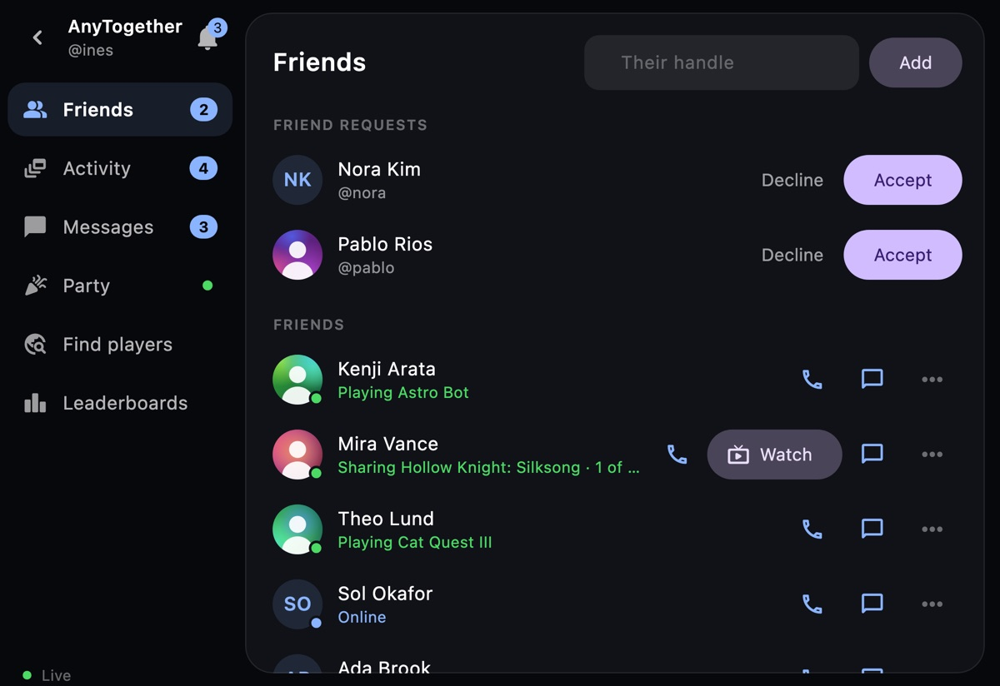
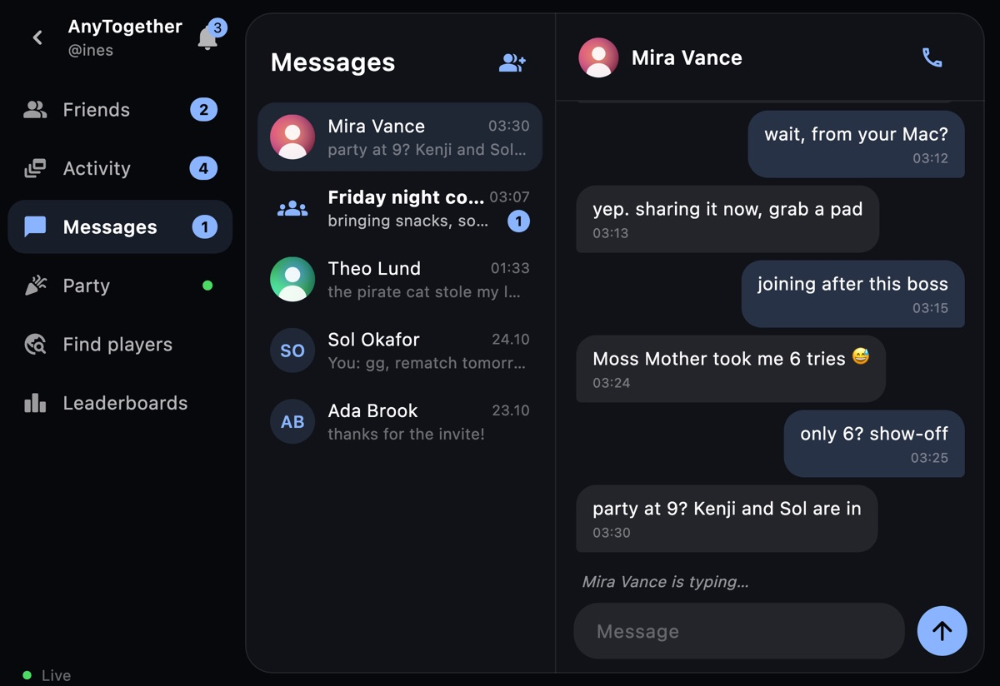
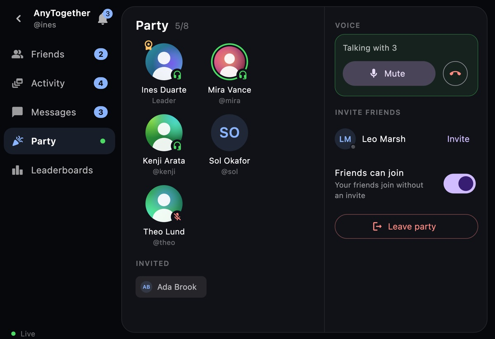
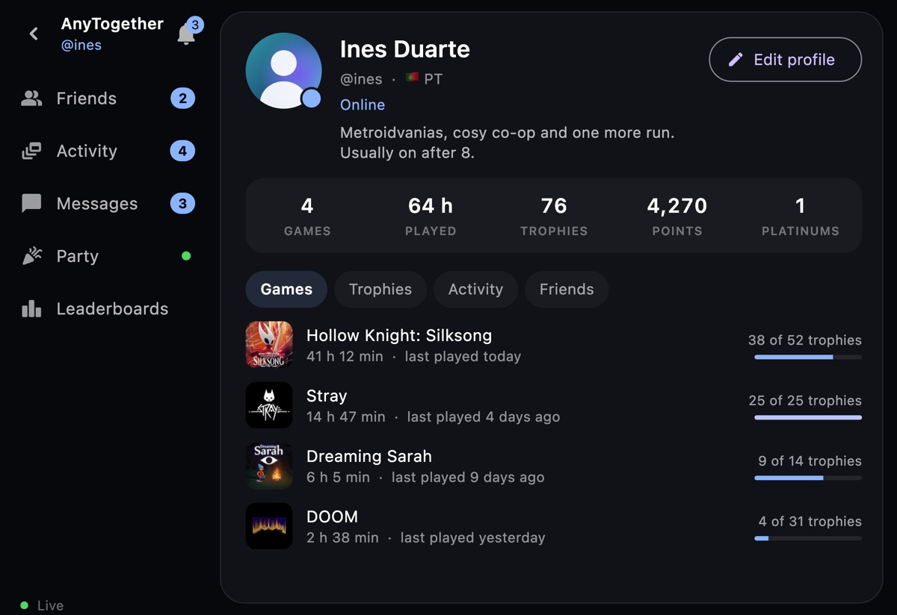
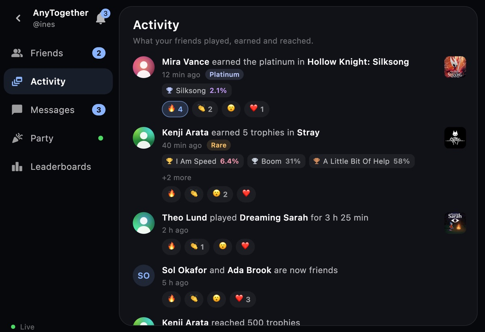
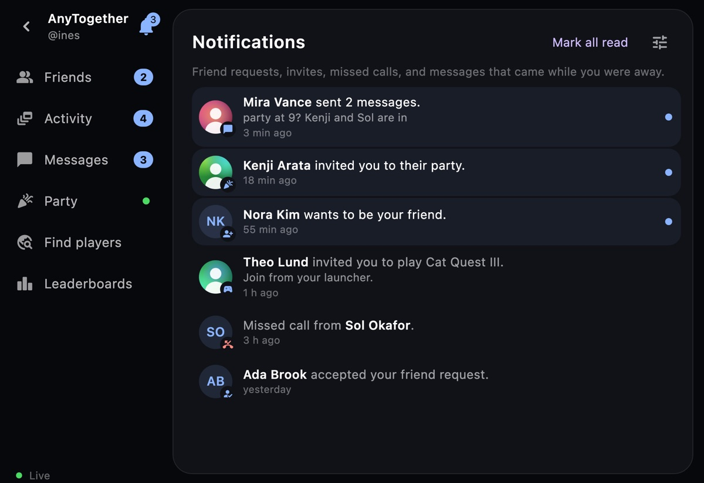
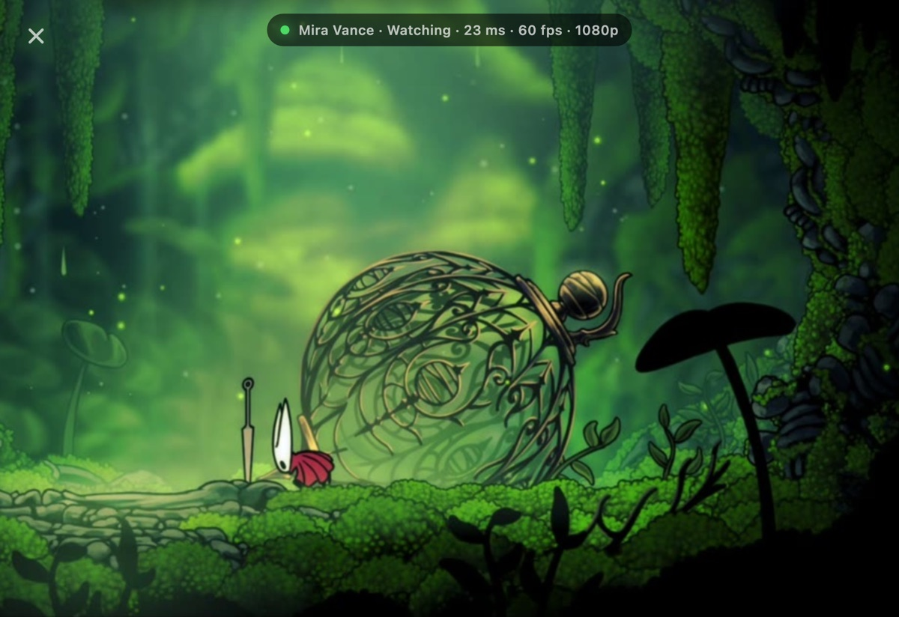

# AnyPS5 Remote

Use your phone as a DualSense for the PS5 games [AnyPS5-ARM](https://github.com/AnyTogether/AnyPS5-ARM) runs on a Mac. Android and iOS, from one Flutter code base.

| Launcher mode | The pad |
|---|---|
|  |  |

## What it does

- **Connects by itself.** The phone finds AnyPS5.app on the same Wi-Fi. The first time, the Mac asks once whether to allow it and both show the same four-digit code; after that it connects with no question. When nothing is found, the Mac's address can be typed in.
- **Launcher mode.** The Mac's games, with their icons, over the selected one's background. Picking a game on the phone picks it on the Mac, and the other way round. **Play** does on the Mac what Play does there (unlock, update or start); **Back to Game** and **Close Game** work while one plays, and starting another game stops the one playing first. The arrows, ✕, ○ and ≡ at the bottom right move around the launcher's own screen: menus, settings, panels.
- **Several phones.** Up to four phones connect at once, one per player; a phone becomes a player the first time a button is pressed on it in the game. A new phone can pair while others are connected.
- **The pad.** Both sticks, ✕ ○ □ △, L1 R1, L2 R2, the D-pad, Options and the touchpad, any number of them held at once. Sliding a finger on the touchpad moves the touch, a tap is a click and a finger held still clicks until it lifts; two fingers are two touches. A double tap on a stick holds L3 or R3. The latency from the touch to the game is shown on the phone and in the launcher. The pad takes over by itself when a game starts and gives the phone back to the launcher when it ends.
- **PS** takes the phone to the launcher and brings the launcher in front of the game on the Mac; the game gets nothing from the phone meanwhile.
- **Create** (◉, left of the touchpad) has the Mac save the last seconds of the game as a clip, with Clips on in the launcher.
- **Go Live / End Broadcast** on the launcher screen starts and stops the Mac's broadcast of the game playing (Twitch, YouTube or RTMP, set up in the launcher's Settings → Broadcasting).
- **Rumble, trigger effects and light.** The game's two motors are felt on the phone, the large one dull and the small one crisp (amplitude-controlled vibration on Android, Core Haptics on iPhone). While L2 or R2 is held, the phone pulses where the DualSense trigger would push back, and the pad glows with the game's light bar colour. About turns the vibration off, and its **Test** plays both motors and a trigger's pulses.
- **Motion.** The phone's accelerometer and gyroscope are the DualSense's motion sensors while a game plays, turned to match whichever way the phone is held: tilt it to steer or turn it to aim in games that use them. About turns it off.
- **Your own layout, per game.** The lock at the pad's bottom left opens the editor: drag a control to move it, tap it to size it, fade it, hide it, or make it a toggle (one tap presses it, the next lets go) or a turbo button. Reset and Reset All go back to the default. The layout is kept on the Mac with the game's settings and comes back whenever that game plays.
- **What the Mac is doing.** While a game is unlocked, updated or started, a card at the top of the phone shows the step, a bar that fills and the time it has taken, and says when the game is ready.
- **Trophies.** A trophy earned in the game drops in at the top of the phone for a few seconds, with its icon and grade, and the phone buzzes.
- **Language.** The phone uses the launcher's language when it has a file for it in `assets/l10n` (English and Turkish so far), else English. To add one, see [TRANSLATING.md](TRANSLATING.md).
- The version is shown faintly in the bottom right corner.

It needs AnyPS5.app with phone support, and games unlocked with it: a game unlocked before shows **Update available** and needs **Update and Play** once. [AnyPS5 Desktop](https://github.com/AnyTogether/AnyLauncher-Port), the launcher for Windows and Linux (early preview), pairs with it too.

## AnyTogether

The phone signs in to [AnyTogether](https://anytogether.net), the launchers' online home ([open source](https://github.com/AnyTogether/AnyTogether), MIT). Signed out, the phone is the controller as always.

- **Sign-in:** with a code sent to your email, or with one tap using the account the Mac is signed in with; a signed-in phone also signs the Mac in. No password, no sign-up form.
- **Friends**: from the people button on the home screen: who is online and what they play, requests, adding by handle.
- **Messages**: your conversations, the same ones as on the Mac and the website, with unread counts; write to a friend from their entry.
- **Parties and voice**: start a party, invite friends or join theirs, and talk with its members, voice going straight between you; mute or deafen. The leader hands out a join code (copy the code or its link, make a new one, stop it) and sets the party's Discord link, which everyone in it can open. **Join with a code** looks a code or its link up and asks to join.
- **Calls, profiles, activity**: call a friend 1:1 (an incoming call shows over any screen, the pad too), edit your profile and picture, the activity feed, leaderboards and notifications.
- **Share play**: watch a friend's game and, when they let you, play as player 2–4 with the phone's pad.
- **Another server**: for a self-hosted AnyTogether; when the Mac uses another server, the phone offers it.

| Friends | Messages |
|---|---|
|  |  |
| **Party and voice** | **Profile** |
|  |  |
| **Activity** | **Notifications** |
|  |  |
| **Watching a friend's share play** | |
|  | |

<sub>The pictures use demo people and data, rendered with `tool/screens/render.sh`.</sub>

## Installing

- **Android:** open [AnyPS5-Remote.apk](https://github.com/AnyTogether/AnyPS5-ARM/releases/latest/download/AnyPS5-Remote.apk) on the phone and allow installing from your browser when asked.
- **iPhone** (iOS 15 or newer): install [AnyPS5-Remote.ipa](https://github.com/AnyTogether/AnyPS5-ARM/releases/latest/download/AnyPS5-Remote.ipa) with [AltStore](https://altstore.io) (or SideStore, or [Sideloadly](https://sideloadly.io) from a computer): it signs the app with your own Apple ID as it installs it. With a free Apple ID the app has to be refreshed every 7 days, which AltStore does by itself.

## Building

```sh
flutter build apk --release
```

The APK is `build/app/outputs/flutter-apk/app-release.apk`. For the iPhone, `flutter build ios --release --no-codesign` makes an unsigned app; zipped as `Payload/Runner.app` it is the .ipa that AltStore or Sideloadly sign while installing.

## Testing

`flutter test` runs the protocol, session, pad and setup tests.

The whole flow, from the welcome screen to a game and back with PS, runs on a simulator or a device against the launcher's command-line phone server, which shows a games folder and only pretends to play:

```sh
anyps5-tool remote --allow-all --hidden --port 47790 --games <games folder>
ANYPS5_SHOTS=build/shots flutter drive -d <device> --driver test_driver/integration_test.dart \
    --target integration_test/flow_test.dart --dart-define=ANYPS5_LAUNCHER=127.0.0.1:47790
```

`--hidden` keeps that server off Bonjour and `ANYPS5_LAUNCHER` makes the app connect to it alone, so no other launcher on the network is reached. The screenshots land in `build/shots`.

To feel the rumble and the light bar without a game, with the app in front on a phone connected to AnyPS5.app, run `python3 tool/rumble_test.py`: it plays a pretend game on the launcher's bridge and sends the large motor, the small one, a ramp, pulses and a red light bar. `python3 tool/motion_test.py` does the opposite while a game plays: it prints the phone's motion as the game gets it.

## Design

[Design](docs/superpowers/specs/2026-10-22-phone-controller-design.md) · [Phase 1 plan](docs/superpowers/plans/2026-10-22-phone-controller-phase1.md)
